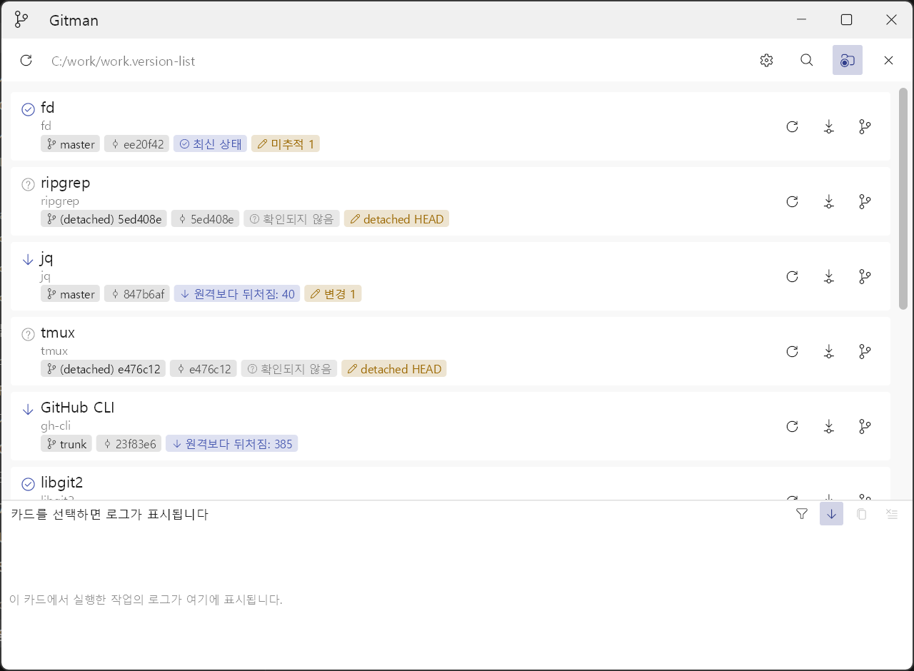

# Gitman

Gitman은 여러 Git 및 SVN 작업 경로의 상태와 변경 작업을 한 화면에서 관리하는 Windows용 데스크톱 애플리케이션입니다. JSON 형식의 `.version-list` 작업공간 문서에 저장소를 등록하고, 각 저장소의 브랜치 또는 URL, 리비전, 작업 트리 상태와 원격 동기화 상태를 카드 형태로 표시합니다.



화면 위주의 사용 안내는 [사용 설명서](docs/user-manual.md)에 있습니다.

## 개요

- Windows 11 x64에서 실행되는 C++20 Win32 네이티브 애플리케이션입니다.
- UI 프레임워크 [luil](https://github.com/yuldK/luil)(Skia 내장)로 화면을 렌더링하며 Direct3D를 우선 사용하고, 초기화에 실패하면 CPU 렌더링으로 전환합니다.
- Git과 SVN 저장소를 하나의 `.version-list` 문서로 관리합니다.
- 전체 또는 개별 저장소의 상태 새로 고침, Git pull/SVN update, Git branch/SVN URL 전환을 제공합니다.
- 카드별 변경 로그와 선택 카드 전용 하단 로그 창을 제공합니다.
- 저장소마다 자주 쓰는 일(빌드, 테스트, IDE 열기, 스크립트)을 작업공간 문서에 기능 버튼으로 정의해 카드에서 실행합니다. 프로그램은 셸 없이 인자 배열로 실행하고, 처음 실행할 때 정의를 신뢰할지 묻습니다.
- 설정·외양·글꼴·창 배치를 앱 전역과 작업공간 문서 두 계층으로 관리하며, 문서가 덮어쓴 항목은 환경설정에 범위 배지로 표시합니다.
- 텍스트 입력은 TSF 인라인 조합을 사용해 한글을 입력 칸 안에서 조합하고, BMP 밖 문자(이모지)와 고른 글꼴에 없는 글자의 대체 표시를 지원합니다.
- `.version-list` Windows 파일 연결을 현재 사용자 범위에서 관리할 수 있습니다.
- 배포 산출물은 의존성과 UI 자산을 포함한 단일 `gitman.exe` 파일입니다. Git과 SVN 명령줄 도구는 해당 저장소를 사용할 때 별도로 설치하면 됩니다.

단계별 검증 기록은 `docs/verification/`에 있으며 가장 최근 기록은 2026-09-06(luil 이식)입니다. CTest에 등록된 테스트는 2026-09-06 기준 812개이고(그 뒤 더한 기능 버튼 테스트는 이 수에 없습니다), 여기에는 단위 테스트 외에 renderer smoke test와 소스 스타일 검사가 포함됩니다. 렌더러·텍스트 편집·TSF·글꼴 대체 같은 기반 계층의 테스트는 luil 저장소가 맡습니다. 실제 SVN CLI와 네트워크 드라이브는 아직 보증 범위에 포함하지 않습니다.

## 목적

Gitman은 여러 저장소를 오가며 각각의 상태를 반복해서 확인하고 변경 작업을 실행해야 하는 부담을 줄이는 것을 목적으로 합니다. Git과 SVN이 섞인 작업공간에서도 공통 카드와 로그 형식으로 상태를 비교할 수 있으며, 원격 조회는 명시적인 새로 고침이나 변경 작업 후에 실행합니다.

변경 작업은 비대화형 외부 프로세스로 실행하고, 실행 직전에도 작업 트리와 대상 브랜치를 다시 검증합니다. 자격 증명을 저장하지 않으며, Gitman 자신은 강제 전환·자동 stash·커밋·푸시·병합·리베이스·충돌 해결을 수행하지 않습니다. 기능 버튼으로 실행한 사용자 프로그램이 하는 일은 그 프로그램의 일이며 Gitman이 해석하거나 막지 않습니다. UI, 애플리케이션 로직과 외부 프로세스 실행을 분리하여 저장소가 많거나 조회가 느린 상황에서도 창의 응답성을 유지하도록 설계되어 있습니다.

## 사용 방법

### 1. 실행 환경

앱을 실행하려면 다음 환경이 필요합니다.

- Windows 11 x64
- Git 2.43.0 이상 CLI (Git 저장소를 사용할 때 선택 사항)
- SVN 1.14.5 이상 CLI (SVN 저장소를 사용할 때 선택 사항)

Git과 SVN 실행 파일은 `PATH`에서 자동 탐색합니다. 열린 `.version-list` 문서의 환경설정에서 파일 선택기로 절대 경로를 지정할 수도 있습니다. 경로를 지우면 자동 탐색으로 돌아갑니다.

### 2. 개발 환경과 의존성 준비

소스에서 빌드하려면 다음이 추가로 필요합니다.

- CMake 4.2.0 이상
- Visual Studio 2022 17.10 이상 또는 Visual Studio 2026
  - `Desktop development with C++` 워크로드
  - Windows SDK 10.0.22621.0 이상
- Python 3.9 이상과 Pillow (앱 아이콘을 다시 만들 때만)

CMake가 의존성을 자동으로 내려받지는 않습니다. submodule과 luil의 패키지 스크립트로 준비합니다. UI 프레임워크 luil은 `third_party/luil` submodule이며, luil이 쓰는 Skia 패키지(미리 빌드된 정적 라이브러리)는 luil의 스크립트가 해시를 확인하며 설치합니다. Skia를 직접 빌드하지 않으며 GN·Ninja도 필요하지 않습니다.

```powershell
git submodule update --init third_party/nlohmann-json
git submodule update --init third_party/luil
git -C third_party/luil submodule update --init third_party/nlohmann_json
third_party\luil\scripts\fetch_skia.ps1 -Configuration Debug,Release
```

제한된 환경에서는 아카이브를 브라우저로 받아 `third_party/luil/third_party/skia-prep-archives/`에 두고 같은 스크립트를 `-Offline`으로 실행합니다. 절차의 근거는 [ADR-007](docs/decisions/ADR-007-luil-ui-framework-adoption.md)에 있습니다.

테스트까지 빌드하려면 Catch2 submodule도 초기화합니다.

```powershell
git submodule update --init third_party/catch2
```

Skia 패키지의 내용과 갱신 절차는 luil 저장소의 `docs/skia-build.md`(`third_party/luil/docs/skia-build.md`)에 있습니다.

### 3. 빌드 및 설치

Visual Studio 2022 Release 구성을 생성하고 빌드한 뒤 설치합니다.

```powershell
cmake --preset vs2022
cmake --build --preset vs2022-release
cmake --install build\vs2022 --config Release
```

Visual Studio 2026은 `vs2022`가 포함된 preset 이름을 각각 `vs2026`으로 바꿉니다. 설치 결과는 다음 단일 파일입니다.

```text
bin\gitman.exe
```

### 4. 작업공간 문서 만들기

Gitman을 인자 없이 실행합니다.

```powershell
.\bin\gitman.exe
```

시작 페이지의 `새 문서 만들기…`를 누르면 앱 창 안에 dialog가 뜨며 문서 이름, 저장소들을 담고 있는 폴더, 저장 위치를 정합니다. 폴더는 Windows 폴더 선택 창으로 고르고, 만들어질 경로를 미리 보여 줍니다. 선택한 폴더의 바로 아래 하위 폴더만 스캔하며, 발견한 Git·SVN 저장소를 새 문서에 등록합니다. 기존 문서는 덮어쓰지 않습니다.

이미 열린 문서에 저장소를 추가하려면 상단의 하위 저장소 탐색·등록 버튼을 사용합니다. 스캔 폴더를 선택하면 깊이 1 후보와 제외 사유가 표시되고, 등록할 후보만 체크해 문서에 원자적으로 추가할 수 있습니다.

작업공간 문서를 직접 작성할 수도 있습니다. 최소 형식은 다음과 같습니다.

```json
{
    "schema_version": 1,
    "settings": {
        "git_executable": "",
        "svn_executable": "",
        "show_relative_paths": false
    },
    "projects": [
        {
            "id": "frontend",
            "path": "repositories/frontend",
            "display_name": "Frontend",
            "vcs_hint": "git"
        },
        {
            "id": "legacy-server",
            "path": "D:/repositories/legacy-server",
            "display_name": "Legacy Server",
            "vcs_hint": "svn"
        }
    ]
}
```

`id`는 문서 안에서 고유해야 합니다. 상대 경로는 `.version-list` 문서가 있는 폴더를 기준으로 해석합니다. `display_name`, `vcs_hint`, `settings`는 생략할 수 있으며, `vcs_hint`는 `auto`, `git`, `svn` 중 하나입니다. 기존 문서의 `svn_switch_targets` 배열은 호환을 위해 보존되지만 현재 전환 후보에는 사용되지 않습니다.

### 5. 문서 열기와 상태 확인

문서를 열지 않은 상태에서는 시작 페이지가 표시됩니다. 왼쪽에는 `문서 열기…`와 `새 문서 만들기…`가 있고, 오른쪽에는 최근에 연 문서가 최신 순으로 표시됩니다. 항목을 누르면 그 문서를 엽니다.

행 양끝에는 아이콘 버튼이 있습니다. 왼쪽 pin 버튼은 그 문서를 목록에 고정하고, 오른쪽 `x` 아이콘은 목록에서만 제거합니다(파일은 지우지 않습니다). 고정한 문서는 `고정됨` 무리로 따로 모여 `최근 항목` 위에 표시되며, **최근 항목 상한(10개)에 들지 않아** 새 문서를 여러 개 열어도 밀려나지 않습니다. 고정을 풀면 가장 최근에 연 문서로 쳐서 `최근 항목`의 맨 앞에 섭니다.

최근 목록은 `gitman.exe`와 같은 폴더의 `gitman.app-settings.json`에 저장되며, 실행 파일 폴더에 쓸 수 없으면 목록은 그 실행 동안에만 유지됩니다.

다음 방법 중 하나로 문서를 엽니다.

- 오른쪽 위의 폴더 버튼에서 `.version-list` 파일을 선택합니다.
- `.version-list` 파일을 Gitman 창으로 끌어다 놓습니다.
- 실행할 때 문서 경로를 인자로 전달합니다.
- 파일 연결을 등록한 뒤 Explorer에서 문서를 더블클릭합니다.

```powershell
.\bin\gitman.exe "D:\workspaces\team.version-list"
```

문서를 닫으려면 도구 막대 오른쪽 끝의 닫기 버튼을 누릅니다. 닫으면 시작 페이지로 돌아가며, 문서가 열려 있는 동안에는 새 문서 만들기 버튼이 보이지 않습니다.

문서를 열면 먼저 로컬 상태를 조회합니다. 도구 막대 왼쪽 끝의 전체 새로 고침 버튼이나 `F5`를 누르면 원격 상태까지 확인합니다. 카드의 새로 고침 버튼은 해당 저장소만 조회하며, 카드를 선택한 뒤 `Enter`를 눌러도 같은 동작을 실행합니다.

카드는 끌어다 놓아 순서를 바꿀 수 있으며 변경된 순서는 문서에 저장됩니다. 경로 표시 버튼으로 절대 경로와 문서 기준 상대 경로를 전환할 수 있습니다.

### 6. 업데이트와 전환

- Git 카드의 업데이트는 `git pull --ff-only`를 사용하며, 확인 창에서 recursive submodule 갱신 여부를 선택할 수 있습니다.
- SVN 카드는 `svn update`를 실행합니다.
- 실행 중 업데이트 버튼은 취소 버튼으로 바뀝니다. 성공·실패·취소 결과와 외부 명령 출력은 해당 카드 로그에 남고, 작업 후 상태를 자동으로 다시 조회합니다.
- Git 전환 창은 원격 branch를 우선 표시한 뒤 local branch를 표시합니다. local tracking branch가 새로 필요하면 명시적인 확인을 받습니다.
- 전환 창 제목 아래에는 질의 막대가 있습니다. 왼쪽 갱신 버튼은 목록을 다시 조회하고, 가운데 입력 칸과 오른쪽 버튼의 역할은 저장소 종류에 따라 다릅니다.
  - Git에서는 필터입니다. 입력하는 즉시 이름에 그 글자가 든 후보만 남고, Enter는 첫 후보를 고릅니다. 오른쪽 버튼은 필터를 지웁니다.
  - SVN에서는 저장소 루트 기준의 실제 경로를 보여 주는 주소 막대입니다. 트리에서 디렉터리를 고르면 그 경로가 표시되고, 경로를 직접 입력한 뒤 Enter나 오른쪽 버튼을 누르면 그 위치까지 트리를 펼쳐 내려갑니다.
  - 입력 칸은 드래그 범위 선택, 더블 클릭 낱말 선택, 방향키·Home·End·Delete(Ctrl은 낱말 단위, Shift는 범위 확장), Ctrl+A·C·X·V를 지원합니다. 붙여넣기는 한 줄 칸이므로 첫 줄만 씁니다.
- SVN 전환 창은 창을 열 때 **현재 작업 복사본으로 가는 길만** 한 단계씩 조회해 그 자리를 펼쳐 둡니다. 형제 가지와 그 아래는 사용자가 펼치거나 주소 막대로 이동할 때만 조회하므로 저장소 전체를 미리 읽지 않습니다.
- 조회 하나가 초 단위로 걸릴 수 있으므로, 한 단계 내려갈 때마다 그 깊이의 폴더를 골라 목록 **가운데**로 옮깁니다. `a/b/c`로 이동하면 a → b → c 순으로 따라갑니다. 걸어 내려가는 동안에는 `전환` 버튼이 잠깁니다 — 지나가는 자리에서 확인을 받으면 목표가 아니라 중간 폴더로 전환되기 때문입니다.
- 선택 대상은 실행 직전에 같은 저장소인지 다시 확인합니다.
- 이미 사용 중인 대상과 대상 불일치는 실행 전에 차단합니다. 외부 명령은 비대화형으로 실행해 인증 프롬프트 없이 실패를 로그에 남깁니다.
- 작업 트리 판정은 저장소 종류마다 다릅니다.
  - **Git**은 커밋하지 않은 수정이 있으면 전환을 차단합니다. 업데이트는 미추적 파일만 있는 상태라면 진행합니다.
  - **SVN**은 로컬 수정이 있어도 업데이트·전환을 **진행합니다**. `svn update`와 `svn switch`는 로컬 변경을 새 개정판·새 위치에 병합하고, 병합할 수 없으면 충돌로 남길 뿐 변경을 잃지 않기 때문입니다. 그때의 해결은 사용자의 몫입니다. 다만 **이미 충돌이 남은** 작업 복사본과 **상태를 읽지 못한** 작업 복사본은 차단합니다.

### 7. 로그와 환경설정

카드를 선택하면 하단에 해당 카드의 변경 로그가 표시됩니다. 로그 본문과 diff 본문은 환경설정의 코드 글꼴로 그립니다. 로그 창에는 전체·출력·오류 스트림 필터, 자동 스크롤, 복사, 지우기, 스크롤 막대가 있으며 연속 progress 출력은 화면에서 접혀 표시됩니다. 화면 로그는 카드당 최대 1,000개 record의 메모리 ring buffer입니다. 로그 머리의 경과 시간은 명령이 도는 동안 흘러가고, 끝난 뒤에도 걸린 시간을 그대로 남겨 두어 작업이 끝난 다음 확인할 수 있습니다. 다음 명령을 시작하면 새 값으로 바뀝니다.

같은 내용을 문서 폴더에 파일로도 남깁니다. 문서가 `D:\workspaces\team.version-list`이면 같은 폴더에 `.team.version-list.log` 폴더가 만들어지고, 저장소마다 하위 폴더 하나에 `20260821-184012.log` 형태의 파일이 쌓입니다. 폴더 이름 앞의 `.`은 탐색기에서 저장소 폴더들 사이에 섞이지 않고 맨 앞에 모이게 합니다. 파일은 문서를 연 뒤 그 저장소에 첫 로그가 생길 때 하나 만들어 앱이 끝날 때까지 이어 씁니다. 저장소 폴더 이름은 작업 복사본의 마지막 폴더 이름이며, 문서 안에서 겹치면 상위 폴더를 앞에 붙이고(`a-b-c`) 그래도 겹치면 드라이브까지 붙입니다(`c-drive_a-b-c`). 오래된 로그는 지우지 않으므로 필요할 때 직접 정리합니다. 환경설정의 `로그를 문서 폴더에 파일로 남김`을 끄면 폴더를 만들지 않습니다.

환경설정 창은 왼쪽 탭으로 나뉩니다. `도구`는 Git·SVN 실행 파일 경로와 상태 확인 제한 시간, `작업`은 submodule 갱신·로컬 변경 무시·파일 로그, `테마`는 화면 테마·키 컬러와 글꼴, `시스템`은 `.version-list` 파일 연결입니다. 저장하면 설정을 문서에 원자적으로 기록하고 도구를 다시 탐색한 뒤 카드 전체를 새로 고칩니다. 창이 낮아 항목이 다 들어가지 않으면 항목 열만 스크롤되고 탭 목록·제목·버튼 줄은 제자리에 남습니다.

문서를 연 상태에서 값을 고치면 그 항목만 문서에 남고, 나머지는 앱 전역 설정을 따릅니다. 각 항목의 제목 위에 범위 배지가 붙어, 문서가 덮어쓴 항목은 `문서 설정`, 전역을 따르는 항목은 흐린 `전역 설정`으로 표시합니다. `문서 설정` 배지를 누르면 문서의 정의를 지우고 다시 전역 설정을 따릅니다. 테마와 키 컬러도 같은 규칙입니다. 고른 테마와 색은 창에 곧바로 미리 보이지만 파일에 남는 것은 `저장`을 눌렀을 때이며, `취소`로 닫으면 원래 값으로 돌아갑니다.

글꼴은 `테마` 탭의 `글꼴` 섹션에서 고릅니다. `UI 글꼴`은 창 전체에, `코드 글꼴`은 로그 본문과 diff 본문에 쓰입니다. `선택…`을 누르면 시스템에 설치된 글꼴을 나열하는 창이 열리며, 목록의 각 줄을 그 글꼴로 그려 목록 자체가 미리 보기가 되고 아래 칸이 고른 글꼴로 예문을 보여 줍니다. 글꼴도 테마·키 컬러와 같은 계층이라 문서가 덮어쓸 수 있으며, 고르면 곧바로 미리 보이고 `저장`이 남기며 `취소`가 되돌립니다.

고른 글꼴에 없는 글자는 시스템에서 그 글자를 가진 글꼴을 찾아 그 부분만 대신 그립니다. 예를 들어 한글 글리프가 없는 `Cascadia Code`를 코드 글꼴로 골라도 로그의 한글이 깨지지 않습니다.

창 크기와 위치는 문서를 열지 않았을 때만 앱 설정에 기록합니다. 문서를 열면 그때부터는 그 문서의 배치를 따르고 문서에만 저장하며, 문서를 여는 순간의 배치가 앱 설정에 남습니다. 문서를 닫으면 다시 앱 설정의 크기·위치로 돌아갑니다.

### 8. 기능 버튼

저장소마다 자주 쓰는 일을 버튼으로 만들 수 있습니다. 정의와 변수는 작업공간 문서의 `function_buttons`에 두고, 각 저장소 안에는 두지 않습니다.

```json
"function_buttons": {
    "variables": { "build_config": "Debug" },
    "project_variables": { "frontend": { "build_config": "Release" } },
    "buttons": [
        {
            "id": "build",
            "label": "빌드",
            "icon": "tools",
            "program": "C:\\Program Files\\CMake\\bin\\cmake.exe",
            "args": ["--build", "${projectRoot}\\build", "--config", "${build_config}"],
            "placement": "card"
        }
    ]
}
```

- 버튼 하나가 외부 프로그램 하나를 셸 없이 실행합니다. `program`, `args`, `cwd`에 `${projectRoot}`, `${branch}` 같은 내장 변수, 문서·저장소별 사용자 변수, `${env:NAME}`을 쓸 수 있습니다. `program`은 `.exe`·`.com` 절대 경로여야 하며, 스크립트는 `powershell.exe -NoProfile -File <ps1>`처럼 인터프리터를 적습니다.
- 기능마다 자리를 고릅니다. `card`는 모든 적용 카드의 아이콘 버튼(문서 전체 3개, `Alt+1`~`Alt+3`), `bar`는 선택한 카드의 기능 줄(로그 창 맨 위), `menu`(생략했을 때)는 카드의 `⋯` 기능 메뉴와 카드 우클릭 메뉴에만 나옵니다. 어느 자리든 `⋯` 기능 메뉴에는 늘 있습니다. 버튼을 우클릭하면 자리를 바로 바꿉니다.
- 실행 방식은 출력을 카드 로그로 받는 `capture`(기본, 제한 시간 3600초, 중지 가능)와 Gitman이 시작만 하고 관리하지 않는 `detached`(IDE나 창이 필요한 프로그램용) 두 가지입니다. 끝난 뒤 저장소를 자동으로 다시 조회하지 않고, 같은 카드의 출력 수집 실행과 업데이트·전환은 서로 막습니다.
- 문서의 기능 정의를 처음 실행할 때 프로그램과 인자를 보여 주고 신뢰할지 묻습니다. 신뢰는 문서 경로와 정의 해시로 앱 설정에 기억하며, 정의나 저장소 경로가 바뀌면 다시 묻습니다. 신뢰는 스크립트 파일의 내용까지 확인하지 않습니다.
- 도구 막대 우클릭 메뉴의 `기능 편집…`에서 기능을 추가·수정·삭제하고, 손으로 고친 문서는 `문서 다시 읽기`로 불러옵니다. 다시 읽기에 실패하면 지금 문서를 그대로 둡니다.

필드, 변수 표, 보안 주의 사항은 [사용 설명서 12장](docs/user-manual.md#12-기능-버튼)과 [기능 버튼 설계](docs/function-buttons-design.md)에 있습니다.

### 9. 파일 연결

`.version-list`를 현재 Windows 사용자 계정에 연결하려면 관리자 권한 없이 다음을 실행합니다.

```powershell
.\bin\gitman.exe --register-file-association
```

연결 제거는 다음 명령으로 수행합니다.

```powershell
.\bin\gitman.exe --unregister-file-association
```

두 작업은 환경설정 창의 `연결 등록`·`연결 해제` 버튼으로도 수행할 수 있으며, 결과는 앱 스타일 알림 창으로 표시됩니다. 실행 파일을 다른 위치로 옮겼다면 연결을 다시 등록해야 새 경로가 반영됩니다. 등록은 `HKCU\Software\Classes`에만 적용되며, 다른 프로그램이 선택한 사용자 연결은 제거하지 않습니다.

### 10. 렌더러 선택

기본값인 `auto`는 Direct3D를 먼저 사용하고 실패하면 CPU 렌더링으로 전환합니다. 문제를 진단하거나 렌더러를 고정하려면 다음 옵션을 사용합니다.

```powershell
.\bin\gitman.exe --renderer=auto
.\bin\gitman.exe --renderer=direct3d
.\bin\gitman.exe --renderer=cpu
```

## 테스트

테스트는 앱 빌드와 분리된 전용 preset을 사용합니다. luil의 Skia 패키지 Debug·Release와 Catch2 submodule이 준비되어 있어야 합니다.

```powershell
cmake --preset vs2022-tests
cmake --build --preset vs2022-tests-debug
ctest --preset vs2022-tests-debug
```

Release 구성도 같은 방식으로 실행합니다.

```powershell
cmake --build --preset vs2022-tests-release
ctest --preset vs2022-tests-release
```

테스트 모음은 작업공간 JSON, 경로와 schema, Git·SVN 명령과 출력 파서, 실제 Git update·switch 통합, 프로세스 실행·취소, 동시 작업과 로그 격리, UI 상호작용과 tree 배치, 환경설정·전환·탐색 dialog, 앱 설정과 최근 목록, 파일 연결, luil 위의 driver·relay·policy 조립, 렌더러 smoke test, 기능 버튼(정의 읽기·변수 치환·실행 정책·실행과 중지·신뢰·카드 열·기능 줄·편집 dialog·다시 읽기)을 포함합니다. 텍스트 편집·TSF 입력·글꼴 대체·렌더러 같은 기반 계층의 테스트는 luil 저장소에 있습니다. CTest 등록 수는 luil 이식 최종 검증(2026-09-06) 때 812개였고 그때 VS2026 Debug/Release를 확인했습니다. 기능 버튼 테스트를 더한 뒤의 수와 전체 실행은 기능 버튼 전역 검증에서 다시 확인합니다.

정적 분석과 포맷·소스 스타일 검사는 다음과 같이 실행합니다.

```powershell
cmake --preset vs2022-analysis
cmake --build --preset vs2022-analysis
cmake --build build\vs2022-tests --target gitman_format_check --config Debug
.\scripts\check_source_style.ps1 -root .
```

특정 테스트만 실행하려면 CTest의 정규식 필터를 사용합니다.

```powershell
ctest --preset vs2022-tests-debug -R Git
```

## 배포와 데이터

Gitman은 installer나 MSIX 없이 `bin\gitman.exe`를 원하는 위치에 복사해 배포합니다. luil(Skia 포함)과 C/C++ runtime은 정적으로 연결되고, Codicons·앱 아이콘·제3자 라이선스 고지문은 실행 파일 resource에 포함됩니다. Git/SVN CLI는 외부 prerequisite입니다.

사용자 데이터는 다음 위치에 저장됩니다.

- 프로젝트 목록, 실행 파일 경로, 경로 표시 방식, 문서별 테마·키 컬러·글꼴, 창 배치, 기능 버튼과 변수(`function_buttons`): 사용자가 만든 `.version-list` JSON 문서
- 최근에 연 문서 목록과 고정 여부, 전역 설정과 외양·글꼴, 문서 없이 쓸 때의 창 배치, 신뢰한 기능 정의(문서 경로와 해시): `gitman.exe`와 같은 폴더의 `gitman.app-settings.json`
- 작업 로그: 화면은 메모리 전용(카드당 1,000 record), 파일은 `.<이름>.version-list.log` 폴더의 저장소별 `타임스탬프.log`
- 파일 연결: 등록한 경우 `HKCU\Software\Classes`

업그레이드는 새 `gitman.exe`로 기존 파일을 교체하면 됩니다. 실행 파일 경로가 바뀌면 파일 연결을 다시 등록합니다. 문서 저장은 임시 파일과 원자적 교체를 사용하고, 동시에 다른 프로그램이 문서를 수정하면 revision 충돌로 덮어쓰기를 막습니다. 백업 파일(`.bak`)은 만들지 않습니다.

자세한 설치·업그레이드·제거·데이터 위치·라이선스·제한 사항은 [배포 안내](docs/deployment.md)를 참고합니다.

## 알려진 제한

- 실제 `svn.exe` 작업 복사본과 SVN 네트워크 동작은 아직 실측하지 않았습니다. 현재 보증 범위는 fixture와 fake runner 검증입니다.
- 네트워크 드라이브와 실제로 매우 느린 경로에서의 탐색·조회는 검증하지 않았습니다.
- 커밋, 푸시, 병합, 리베이스, 충돌 해결, 대화형 셸, 자격 증명 저장, 깊이 2 이상 자동 탐색은 Gitman 자신의 동작으로 지원하지 않습니다.
- 기능 버튼의 따로 실행(`detached`)은 시작 성공만 기록하며 제한 시간·중지·로그가 없고 앱을 끝내도 남습니다. 출력을 로그로 받는 실행은 표준 입력이 비어 있어 입력을 받을 수 없습니다. 기능 메뉴는 스크롤이 없어 화면보다 길면 아래가 잘립니다. 실제 창에서의 기능 버튼 화면과 몇 가지 실행 세부(분리 실행의 콘솔 창, `start`로 띄운 손자 정리)는 아직 수동 확인 전입니다.
- 로그 파일은 자동으로 정리되지 않습니다(오래된 파일은 직접 지웁니다). Page Up/Page Down 키보드 스크롤은 제공하지 않습니다.
- 카드 목록은 항상 문서에 등록된 순서로 표시됩니다. 별도 정렬 기능은 없으며, 카드를 드래그해 순서를 바꾸면 문서에도 반영됩니다.
- SVN 전환 창의 저장소 목록은 스크롤만 지원하며 접기·펼치기 상태를 문서에 저장하지 않습니다. 창을 닫으면 조회 결과도 함께 버립니다.
- 시작 페이지의 최근 목록은 창 높이에 들어가는 만큼만 그리고 나머지는 개수로 알립니다. 목록 자체에는 스크롤이 없습니다.

## 참고 문서

- [사용 설명서](docs/user-manual.md) — 실제 화면 캡처로 설명하는 사용 안내
- [변경 이력](docs/change_log.md)
- [빌드 및 실행 안내](docs/build.md)
- [luil 채택 설계](docs/luil-migration-design.md)와 [ADR-007](docs/decisions/ADR-007-luil-ui-framework-adoption.md)
- [기능 버튼 설계](docs/function-buttons-design.md) — 저장소 카드에서 사용자 프로그램을 실행하는 기능 버튼의 설계와 구현 결과
- [배포 안내](docs/deployment.md)
- [요구사항 기준선](docs/requirements.md)
- [코드 스타일](docs/code_style.md)
- [단계 8 최종 검증 기록](docs/verification/2026-08-19-stage-8.md)
- [luil 이식 최종 검증 기록](docs/verification/2026-09-06-luil-migration.md)
