# Gitman 사용 설명서

버전 기준: 2026-11-03 소스(`feature/function-buttons`). 캡처는 2026-08-23 빌드(`bin/gitman.exe`) 화면입니다.
캡처가 없는 12장 "기능 버튼"의 그림은 구조를 보이는 글 그림이고, 5.1의 도구 막대 우클릭 메뉴 캡처는 기능 버튼을 더하기 전 화면입니다.

---

## 1. Gitman은 무엇을 하는 프로그램인가

Gitman은 여러 개의 Git·SVN 작업 복사본을 **한 화면에서 확인하고 갱신**하는 Windows 데스크톱 애플리케이션입니다.

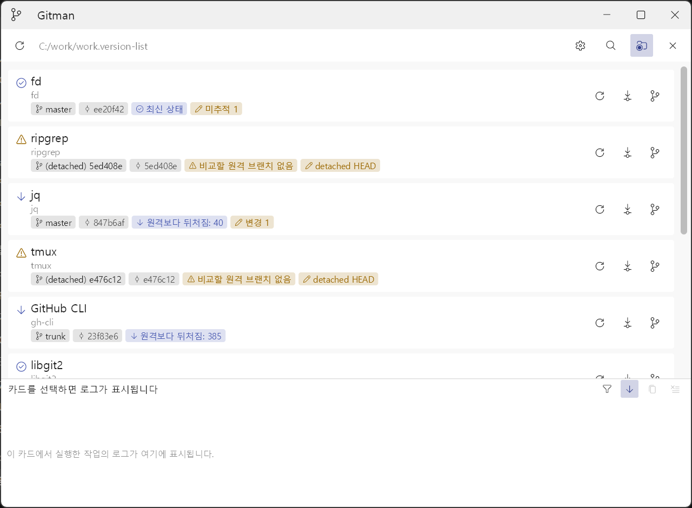

- 저장소 목록은 JSON 형식의 **작업공간 문서(`.version-list`)** 에 저장합니다.
- 저장소마다 카드 한 장이 만들어지고, 카드에는 브랜치 또는 URL, 리비전, 원격과의 동기화 상태, 작업 트리 상태가 표시됩니다.
- 카드에서 **상태 새로 고침**, **업데이트**(`git pull --ff-only` / `svn update`), **전환**(`git switch` / `svn switch`)을 실행할 수 있습니다.
- 실행한 외부 명령의 출력은 카드별 로그에 남고, 원하면 파일로도 남습니다.
- 저장소마다 자주 쓰는 일(빌드, 테스트, IDE 열기, 스크립트)을 **기능 버튼**으로 문서에 정의해 카드에서 실행할 수 있습니다([12장](#12-기능-버튼)).

### 하지 않는 일

Gitman 자신은 **읽기와 안전한 갱신만** 담당합니다. 다음은 Gitman이 스스로 하는 동작으로는 의도적으로 제공하지 않습니다.

- 커밋, 푸시, 병합(merge), 리베이스(rebase), 충돌 해결
- 자동 stash, 강제 전환, 강제 reset, `--discard-changes`, cleanup, revert
- 대화형 터미널, 자격 증명 입력·저장
- 깊이 2 이상 자동 재귀 탐색

fast-forward가 불가능하면 병합하지 않고 오류로 끝냅니다. 안전하지 않은 작업은 우회 옵션 없이 명시적인 오류로 알립니다.

기능 버튼은 사용자가 문서에 적은 외부 프로그램을 Gitman이 대신 실행하는 것입니다. Gitman은 그 프로그램의 내용을 해석하거나 제한하지 않고, 결과를 VCS 상태로 해석하지 않으며, 끝난 뒤 저장소를 다시 조회하지도 않습니다. 사용자 스크립트가 커밋이나 푸시를 한다면 그것은 사용자의 프로그램이 한 일입니다.

---

## 2. 실행 환경과 설치

### 2.1 필요한 것

| 항목 | 요구 사항 |
| --- | --- |
| 운영체제 | Windows 11 x64 |
| 그래픽 | Direct3D 기본, 실패 시 CPU 렌더링으로 자동 전환 |
| Git CLI | 2.43.0 이상 (Git 저장소를 쓸 때만 필요) |
| SVN CLI | 1.14.5 이상 (SVN 저장소를 쓸 때만 필요) |

Git과 SVN은 **선택 사항**입니다. 한쪽이 없어도 앱은 정상 실행되며, 해당 종류의 카드만 조회·업데이트·전환이 비활성화되고 카드에 이유가 표시됩니다.

### 2.2 설치

배포 산출물은 `gitman.exe` **파일 하나**입니다. UI 프레임워크 luil(Skia 포함)과 C/C++ 런타임이 정적으로 연결되어 있고 아이콘·폰트·제3자 라이선스 고지문이 실행 파일 안에 들어 있습니다.

원하는 폴더에 복사하면 설치가 끝납니다. installer, MSIX, 필수 레지스트리 항목이 없습니다.

### 2.3 명령줄 옵션

```powershell
.\gitman.exe                                   # 시작 페이지로 실행
.\gitman.exe "D:\workspaces\team.version-list" # 문서를 열면서 실행
.\gitman.exe --renderer=auto                   # 기본값: D3D 우선, 실패 시 CPU
.\gitman.exe --renderer=direct3d               # Direct3D 고정 (CPU 전환 없음)
.\gitman.exe --renderer=cpu                    # CPU 렌더링 고정
.\gitman.exe --register-file-association       # .version-list 연결 등록
.\gitman.exe --unregister-file-association     # 연결 해제
```

- 문서 경로는 **하나만** 지정할 수 있습니다. 확장자가 `.version-list`가 아니면 사용 예와 함께 오류를 표시합니다.
- 상대 경로와 `/` 혼용은 절대 경로로 정규화한 뒤 처리합니다.
- `--renderer`는 한 번만 지정할 수 있습니다.
- `--smoke-test`, `--simulate-direct3d-failure`는 자동 테스트 전용 진단 옵션입니다.

### 2.4 파일 연결

`--register-file-association`은 **현재 사용자 범위(`HKCU\Software\Classes`)** 에만 등록하므로 관리자 권한이 필요 없습니다. 환경설정 창의 `시스템` 탭에서도 같은 작업을 할 수 있습니다.

- 등록·해제는 여러 번 실행해도 안전합니다(멱등).
- 실행 파일을 다른 폴더로 옮겼다면 **다시 등록**해야 새 경로가 반영됩니다.
- 다른 프로그램이 선택한 사용자 연결(UserChoice)은 건드리지 않습니다.

---

## 3. 첫 화면 — 시작 페이지

문서를 열지 않은 상태에서는 시작 페이지가 표시됩니다.

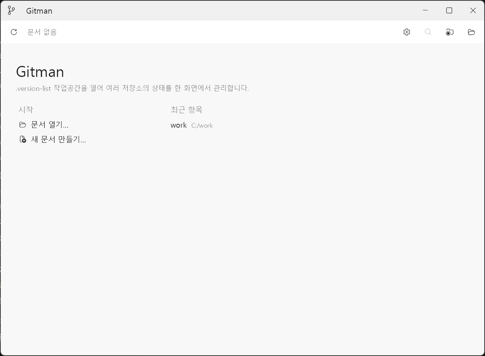

- 큰 제목 `Gitman`과 부제 `.version-list 작업공간을 열어 여러 저장소의 상태를 한 화면에서 관리합니다.`
- **왼쪽 `시작` 열**
  - `문서 열기…`
  - `새 문서 만들기…` — 새 문서를 만드는 유일한 진입점입니다(도구 막대에는 없습니다).
- **오른쪽 `최근 항목` 열**
  - 이름(굵게) + 폴더 경로(흐림) 형태로, 위 화면처럼 `work  C:/work` 로 표시됩니다. 경로 구분자는 `/`입니다.
  - 최대 **10개**, 최신 순. 누르면 그 문서를 엽니다. 오른쪽 `x`는 목록에서만 지웁니다.
  - 비어 있으면 `최근에 연 문서가 없습니다.`
  - 없어진 문서를 눌러도 **목록에서 자동으로 지우지 않습니다**(네트워크 드라이브가 잠시 끊긴 경우를 위해). 대신 상단 배너로 열기 실패를 알립니다.
- 창이 좁으면(폭 720 논리 픽셀 미만) 두 열이 세로로 쌓이고, 높이가 모자라면 마지막 줄에 `외 N개 더 있습니다`가 표시됩니다.
- 시작 페이지에는 하단 로그 창이 없고, 마우스 클릭만 받습니다.

최근 목록은 `gitman.exe`와 **같은 폴더의 `gitman.app-settings.json`** 에 저장됩니다. 실행 파일 폴더에 쓸 수 없으면(예: Program Files) 목록은 그 실행 동안만 유지되고 안내가 한 번 표시됩니다.

---

## 4. 작업공간 문서 만들기

### 4.1 새 문서 만들기 창

시작 페이지의 `새 문서 만들기…`를 누르면 제목이 `새 문서 만들기` 인 창이 열립니다. 이 창은 앱이 직접 그리므로 색·글꼴·버튼 모양이 창의 나머지와 같습니다.

| 행 | 내용 |
| --- | --- |
| `이름` | 문서 이름. 비어 있으면 `확장자 없이 문서 이름`, 툴팁은 `확장자(.version-list)는 앱이 붙입니다` |
| `저장소 폴더` | **저장소들을 담고 있는 상위 폴더**. 읽기 전용이며 오른쪽 `찾아보기…` 로 고릅니다. 비어 있으면 `저장소들을 담은 폴더를 고르세요` |
| `저장 위치` | 문서를 저장할 폴더. 아래 토글이 켜져 있으면 **흐려집니다**. 비어 있으면 `문서를 저장할 폴더를 고르세요` |
| `저장소 폴더에 만들기` | 토글(기본 켬). 켜져 있으면 강조 배경이 깔립니다. 켜면 저장 위치가 저장소 폴더와 같아집니다 |
| `만들 경로:` | 최종 경로 미리 보기. 아직 정해지지 않았으면 `만들 경로: —` |

아래에 메시지 줄, 그 밑에 `만들기` · `취소` 버튼이 있습니다.

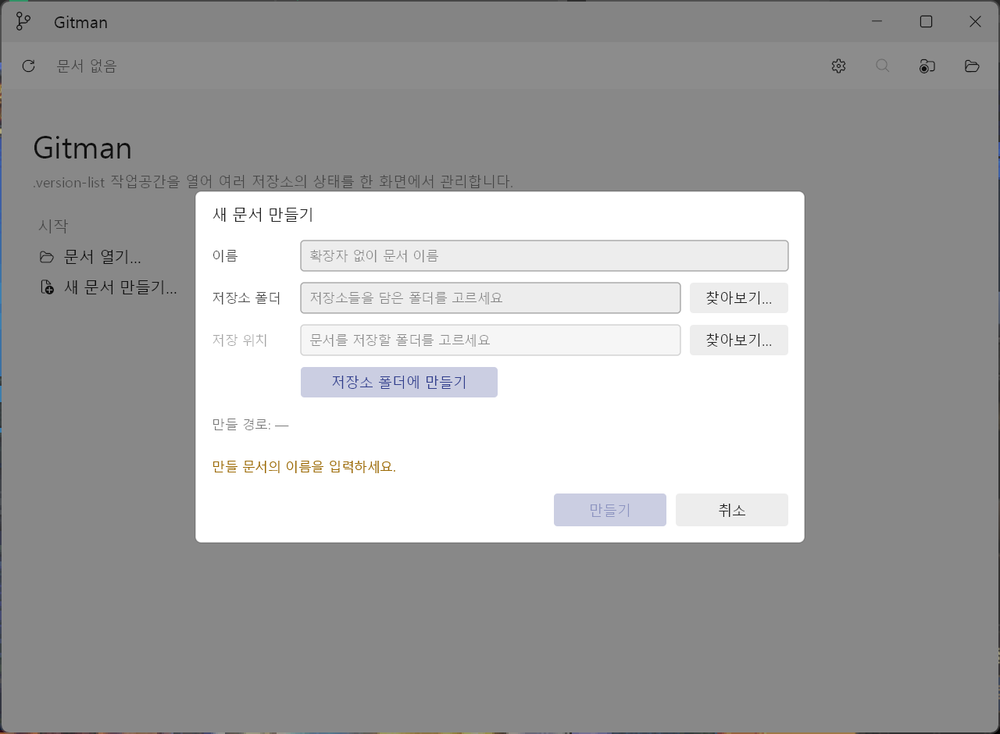

- 이름이 비어 있으면 `만들 문서의 이름을 입력하세요.` 가 표시되고 `만들기` 가 비활성입니다.
- 폴더를 고르는 창은 **여전히 Windows 시스템 대화 상자**입니다. 앱이 그리는 것은 위 패널뿐입니다.
- 스캔은 **깊이 1**만 봅니다. 폴더 자체가 저장소이면 `지정한 폴더 자체가 저장소입니다. 저장소들을 담은 상위 폴더를 지정하세요.`
- 저장소를 하나도 못 찾으면 `하위 폴더에서 저장소를 찾지 못해 문서를 만들지 않았습니다.`
- 만들지 못하면 사유가 그대로 메시지 줄에 표시됩니다(`문서를 만들지 못했습니다.` 외 구체 사유 포함). 같은 이름이 이미 있는 경우도 이 단계에서 알립니다.

### 4.2 열린 문서에 저장소 추가 — 탐색·등록

도구 막대의 돋보기 버튼(`하위 폴더 저장소 탐색·등록`)을 누르고 스캔 폴더를 고르면 깊이 1 후보 목록이 뜹니다.

- 후보마다 저장소 종류와 **제외 사유**가 함께 표시됩니다. 예: `bare 저장소`, `링크라 제외`, `저장소가 아님`, `이미 문서에 등록된 경로입니다.`, `경로를 사용할 수 없음`
- `linked worktree`와 submodule(`.git`이 파일인 경우)은 등록 후보로 허용합니다.
- bare 저장소는 목록에 보이지만 등록할 수 없습니다. reparse point(심볼릭 링크·junction)는 판정하지 않고 제외하되 목록에는 표시합니다.
- 체크한 항목만 문서에 **원자적으로** 추가됩니다.

### 4.3 문서를 직접 작성하기

최소 형식은 다음과 같습니다.

```json
{
    "schema_version": 1,
    "settings": {
        "git_executable": "",
        "svn_executable": "",
        "show_relative_paths": false
    },
    "projects": [
        {
            "id": "frontend",
            "path": "repositories/frontend",
            "display_name": "Frontend",
            "vcs_hint": "git"
        },
        {
            "id": "legacy-server",
            "path": "D:/repositories/legacy-server",
            "display_name": "Legacy Server",
            "vcs_hint": "svn"
        }
    ]
}
```

전체 필드는 [부록 A](#부록-a-version-list-스키마)를 참고하세요.

> **손으로 써 넣은 설정이 사라져 보일 수 있습니다.**
> Gitman은 문서를 저장할 때 **환경설정 창에서 실제로 덮어쓴 항목만** 남깁니다. 문서에 직접 적어 둔 값이라도 환경설정에서 건드린 적이 없으면 다음 저장 때 지워지고 전역 설정을 따르게 됩니다. 또 문서를 열고 창을 옮기기만 해도 `window` 블록이 문서에 추가됩니다.
> 기능 버튼 정의(`function_buttons`)는 여기에 해당하지 않습니다. 환경설정에서 건드리지 않아도 정의는 저장 뒤에 남고, 알 수 없는 키도 보존됩니다([12.8](#128-기능-편집-창), [부록 A](#function_buttons)).

### 4.4 문서 열기와 닫기

문서를 여는 방법은 네 가지입니다.

1. 도구 막대의 폴더 버튼(`.version-list 문서 열기`)
2. `.version-list` 파일을 Gitman 창으로 **끌어다 놓기**
3. 실행할 때 문서 경로를 인자로 전달
4. 파일 연결을 등록한 뒤 탐색기에서 더블클릭

닫으려면 도구 막대 오른쪽 끝의 `문서 닫기`를 누릅니다. 문서 변경은 항상 즉시 저장되므로 저장할지 묻는 창은 없습니다(저장에 실패한 변경이 있을 때만 아래 확인이 뜹니다). 닫을 때 진행 중인 변경 작업은 취소되고, 창 배치가 한 번 저장된 뒤 시작 페이지로 돌아갑니다.

단, **출력을 로그로 받는 기능 버튼이 실행 중이면** 닫기 전에 `실행 중인 기능` 확인 창이 뜹니다. 저장에 실패해 **저장하지 못한 변경**이 있어도 `저장하지 못한 변경` 확인 창이 뜹니다. 다른 문서를 열 때, 문서를 다시 읽을 때, 앱을 끝낼 때도 같습니다([12.9](#129-문서-다시-읽기와-실행-중-확인)).

손으로 고친 문서는 `문서 다시 읽기`로 불러옵니다. 도구 막대 우클릭 메뉴와 카드의 기능 메뉴에 있습니다([12.9](#129-문서-다시-읽기와-실행-중-확인)).

---

## 5. 화면 구성

### 5.1 도구 막대

창 위쪽 막대입니다. 왼쪽 끝이 새로 고침, 그 오른쪽이 현재 문서 경로, 오른쪽 끝이 문서 닫기입니다.

| 버튼 | 툴팁 | 동작 |
| --- | --- | --- |
| ↻ 새로 고침 | `모든 카드 새로 고침` | 모든 카드를 원격까지 조회합니다 (`F5`와 같음) |
| ⚙ 톱니 | `환경설정 (문서)` / `환경설정 (전역)` | 환경설정 창을 엽니다. 문서가 없어도 열립니다 |
| 🔍 돋보기 | `하위 폴더 저장소 탐색·등록` | 저장소를 찾아 문서에 추가합니다. 문서가 없으면 비활성이며 툴팁에 `(문서를 먼저 여세요)`가 붙습니다 |
| 루트 폴더 | `카드 경로를 문서 기준 상대 경로로 표시` / `카드 경로를 전체 경로로 표시` | 경로 표시 방식을 전환합니다. **켜져 있으면 버튼에 강조 배경**이 생깁니다 |
| 폴더 | `.version-list 문서 열기` | 문서를 고릅니다 (문서가 없을 때만 보임) |
| ✕ | `문서 닫기` | 문서를 닫고 시작 페이지로 돌아갑니다 (문서가 열려 있을 때만 보임) |

문서가 없으면 경로 자리에 `문서 없음`이 표시됩니다. 창이 좁아지면 오른쪽 버튼부터 순서대로 숨고, 경로 글자는 `…`로 잘립니다.

**상단 배너** — 알릴 것이 있으면 도구 막대 아래에 한 줄 띠가 나타납니다. 첫 알림만 보이고 나머지는 `(외 N건)`으로 붙습니다. 알림이 여럿이거나 상세가 있으면 배너의 툴팁에 모든 알림과 상세가 나옵니다.

**도구 막대 우클릭 메뉴** — 빈 곳이나 문서 경로 글자를 우클릭하면 네 항목이 나옵니다(문서가 적은 Git·SVN 실행 파일을 아직 신뢰하지 않았으면 다섯). (버튼 위에서는 열리지 않고, 문서가 없으면 아무 일도 하지 않습니다.) 아래 화면은 앞 두 항목만 있던 때의 것입니다.

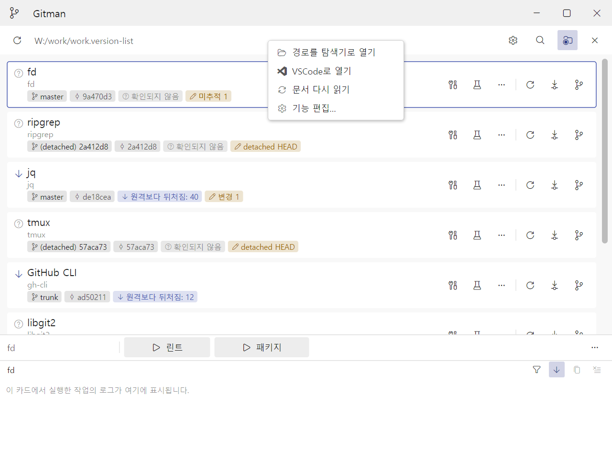

- `경로를 탐색기로 열기` — 폴더를 열고 문서 파일을 선택 상태로 둡니다
- `VSCode로 열기` — 문서가 있는 폴더를 VS Code로 엽니다
- `문서 다시 읽기` — 손으로 고친 문서를 안전하게 다시 읽습니다([12.9](#129-문서-다시-읽기와-실행-중-확인)). 다시 읽는 동안은 `문서 다시 읽기 — 읽는 중`으로 비활성입니다
- `기능 편집…` — 기능 편집 창을 엽니다([12.8](#128-기능-편집-창)). 기능이 하나도 없는 문서는 여기서만 열 수 있습니다. 다시 읽는 동안은 `기능 편집… — 읽는 중`으로 비활성입니다
- `문서 실행 파일 신뢰…` — 문서가 적은 Git·SVN 실행 파일을 아직 신뢰하지 않아 쓰지 않을 때만 구분선 아래에 나옵니다. `실행 파일 신뢰 확인` 창에서 경로를 보고 `신뢰`를 누르면 그 실행 파일로 다시 조회합니다([13.1](#131-도구-탭))

### 5.2 카드

저장소 하나가 카드 한 장입니다. 구성은 다음과 같습니다.

```text
[상태아이콘]  이름
              경로
              [참조] [리비전] [동기화 상태] [작업 트리]        [↻] [↓] [전환]
```

그 카드에 적용되는 기능 버튼이 있으면 오른쪽 열이 다음과 같아집니다([12.2](#122-배치--카드--기능-줄--메뉴만)).

```text
              경로                    [기능1] [기능2] [기능3] [⋯] │ [↻] [↓] [전환]
```

- **1줄** — 표시 이름(`display_name`, 없으면 `id`)
- **2줄** — 작업 복사본 경로. 경로 표시 토글에 따라 전체 경로 또는 문서 기준 상대 경로
- **3줄** — 칩 4조각. 출력을 로그로 받는 기능이 실행 중이면 맨 앞에 `▶ 빌드 00:12`처럼 기능 이름과 경과 시간 칩이 하나 더 붙습니다

| 칩 | Git 예시 | SVN 예시 |
| --- | --- | --- |
| 참조 | `master`, `trunk`, `maint/v1.9`, `(detached) 5ed408e` | `^/subversion/trunk` (저장소 루트 기준 상대 URL) |
| 리비전 | `ee20f42` | 리비전 번호 |
| 동기화 상태 | `최신 상태`, `원격보다 뒤처짐: 40` | 같음 |
| 작업 트리 | `미추적 1`, `변경 1`, `detached HEAD` | 같음 |

폭이 모자라면 왼쪽부터 채우고, 들어가지 않는 칩은 그리지 않습니다.

카드 버튼 세 개:

| 버튼 | 툴팁 |
| --- | --- |
| ↻ | `이 카드 새로 고침` |
| ↓ | `업데이트 (git pull --ff-only)` / `업데이트 (svn update)`. 실행 중에는 정지 아이콘 + `실행 중인 작업 취소`. 준비 전에는 `카드가 준비된 뒤 업데이트할 수 있습니다`. 그 카드에서 출력을 로그로 받는 기능이 실행 중이면 비활성이고 `기능 "빌드"가 실행 중입니다` |
| 전환 | `브랜치 전환 (git switch)` / `URL 전환 (svn switch)`. 준비 전에는 `카드가 준비된 뒤 전환할 수 있습니다`. 출력을 로그로 받는 기능이 실행 중이면 업데이트와 같습니다 |

기능 버튼이 있는 카드에는 다음이 더해집니다. 자세한 규칙은 [12장](#12-기능-버튼)에 있습니다.

| 요소 | 설명 |
| --- | --- |
| 카드 기능 버튼(0~3개) | `카드`에 둔 기능의 아이콘 버튼. 툴팁은 `빌드 (Alt+1)`처럼 이름과 단축키이고, 실행 중·실패·비활성이면 단축키 대신 상태가 붙습니다([12.3](#123-실행과-표시)). 실행 중이면 중지 아이콘이 되고 누르면 중지합니다 |
| `⋯` | 그 카드의 기능 메뉴를 엽니다. 툴팁 `기능 더 보기 (Alt+↓)`. 카드에 버튼이 보이지 않는 기능(기능 줄·메뉴에만 있는 기능, 창이 좁아 접힌 카드 기능)이 실행 중이거나 실패했으면 툴팁 끝에 `— 실행 중 1개, 실패 1개`처럼 수가 붙고 오른쪽 위에 표식(실행 중은 원, 실패는 마름모)이 붙습니다 |
| `│` | 기능 버튼과 기본 버튼 사이의 구분선 |

기본 버튼 세 개의 자리는 기능 버튼이 있든 없든 같습니다. 기능 버튼과 `⋯`가 놓인 만큼 경로·칩 글 영역이 좁아집니다.

카드는 **끌어다 놓아 순서를 바꿀 수 있고**, 바뀐 순서는 문서에 저장됩니다(6px 이상 움직여야 드래그로 인식하며 `Esc`로 취소). 별도의 정렬 기능은 없습니다 — 순서는 언제나 문서의 `projects` 배열 순서입니다.

### 5.3 카드 우클릭 메뉴

카드 본문을 우클릭하면 그 카드가 선택되고 메뉴가 열립니다.

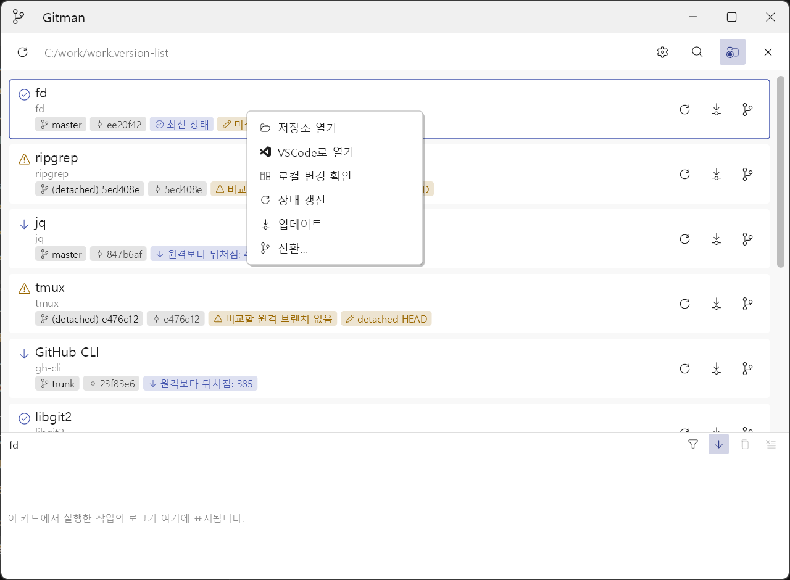

| 항목 | 동작 | 활성 조건 |
| --- | --- | --- |
| `저장소 열기` | 작업 복사본 폴더를 탐색기로 엽니다 | 항상 |
| `VSCode로 열기` | 작업 복사본 폴더를 VS Code로 엽니다 (`code.cmd`가 없으면 아무 일도 일어나지 않습니다) | 항상 |
| `로컬 변경 확인` | 로컬 변경 목록과 diff를 봅니다 | 항상 |
| `상태 갱신` | 이 카드만 조회합니다 | 항상 |
| `업데이트` | 업데이트를 실행합니다 | 변경 가능하고 실행 중이 아닐 때 |
| `전환…` | 전환 창을 엽니다 | 변경 가능할 때 |

그 카드에 적용되는 기능 버튼이 있으면 구분선 아래에 **기능 절**이 붙습니다. 적용 기능이 없는 카드의 메뉴는 위 여섯 항목 그대로입니다.

| 항목 | 동작 |
| --- | --- |
| 기능 앞 8개 | 문서 순서대로 배치와 상관없이 나옵니다. 고르면 실행하고, 실행 중인 기능은 고르면 중지합니다. 상태는 이름 뒤에 붙습니다(`빌드 — 실행 중 00:12`, `테스트 — 실패 (종료 코드 1)`, 비활성이면 사유) |
| `기능 더 보기…` | 적용 기능이 8개를 넘을 때만 나옵니다. 9번째부터의 기능(12개까지)을 보이는 기능 메뉴로 바뀝니다 |
| `기능 편집…` | 기능 편집 창을 엽니다([12.8](#128-기능-편집-창)) |

`↑`/`↓`로 이동(비활성 항목은 건너뜀), `Enter`로 실행, `Esc` 또는 바깥 클릭으로 닫습니다. 메뉴가 떠 있는 동안 휠은 무시됩니다. 업데이트·전환을 취소하는 항목은 없습니다 — 취소는 카드의 업데이트 버튼으로 합니다. 기능은 위 기능 절에서 중지할 수 있습니다.

### 5.4 하단 로그 창

선택한 카드의 로그가 창 아래쪽에 항상 표시됩니다. 선택한 카드가 없으면 제목이 `로그`이고 본문이 카드를 고르라고 안내하며, 카드를 고르면 제목이 그 카드 이름으로 바뀝니다. 로그가 없으면 본문에 `이 카드에서 실행한 작업의 로그가 여기에 표시됩니다.`

본문은 **코드 글꼴**로 그려집니다([14.3](#143-글꼴)).

헤더 오른쪽 버튼은 **왼쪽부터** 다음 순서입니다.

| 버튼 | 설명 |
| --- | --- |
| 깔때기 | 필터. 누를 때마다 `전체` → `출력만` → `오류만`. 툴팁은 `로그 필터: <현재값> (클릭해 전환)` |
| ↓ | `자동 스크롤 켜기 (맨 아래 따라가기)` / `자동 스크롤 끄기`. 켜져 있으면 강조 표시 |
| 복사 | `표시 중인 로그 복사` |
| 지우기 | `이 카드 로그 지우기` |

**경과 시간**은 버튼 왼쪽에 `MM:SS`로 표시됩니다. 업데이트·전환이나 출력을 로그로 받는 기능이 실행 중이면 1초마다 흐르고, **끝나면 걸린 시간이 그대로 남습니다.** 다음 명령이 시작하면 새 값으로 다시 흐릅니다. 문서를 연 뒤 아직 명령을 실행하지 않았으면 표시되지 않습니다. 따로 실행한 기능은 경과 시간을 바꾸지 않습니다.

기능 버튼의 로그 줄은 `[빌드]`처럼 기능 이름을 앞에 붙여 업데이트·전환 로그와 구분합니다([12.3](#123-실행과-표시)).

문서의 어느 카드에든 적용되는 `기능 줄` 배치 기능이 있으면 로그 창 맨 위에 **기능 줄**(높이 36)이 생기고 그만큼 로그 본문이 낮아집니다([12.2](#122-배치--카드--기능-줄--메뉴만)). 기능 줄 위에서 굴리는 휠도 로그를 스크롤합니다.

- 화면 로그는 **카드당 최대 1,000 record**의 메모리 링 버퍼입니다. 밀려난 줄은 `# 앞선 로그 … 줄이 유실되었습니다 (기록이 밀렸습니다)`로 알립니다.
- 연속된 progress 출력은 화면에서 `(진행 표시 N줄 접힘)`처럼 접혀 보이지만 **파일에는 전부 남습니다**.

---

## 6. 카드 상태 읽는 법

### 6.1 문서를 막 열었을 때

문서를 열면 **로컬 상태만** 조회합니다. 그런데도 일부 카드에는 이미 뒤처짐 수치가 나옵니다.

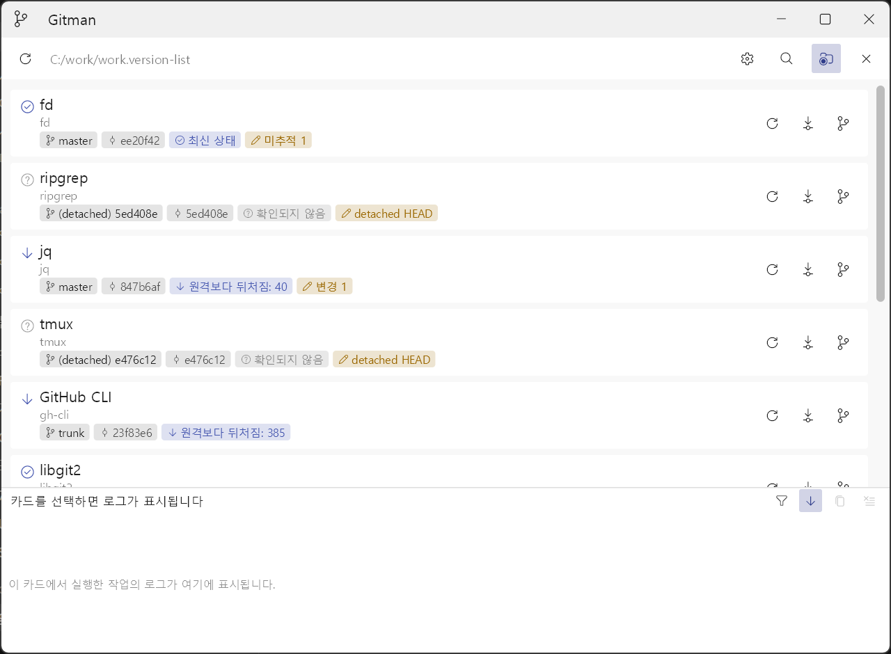

- `jq`, `GitHub CLI` — upstream이 있는 브랜치는 **로컬에 이미 있는 원격 추적 ref**만으로 앞뒤 차이를 계산할 수 있어, 네트워크를 쓰지 않고도 `원격보다 뒤처짐: 40` 이 바로 나옵니다.
- `ripgrep`, `tmux` — detached HEAD라 비교 대상이 없어 `확인되지 않음`입니다. 이 상태는 키 컬러 대신 **흐린 회색**으로 그려서, 값이 없는 것과 값이 확인된 것을 눈으로 구분할 수 있게 합니다.

`F5`로 원격까지 조회하면 `확인되지 않음`이 실제 판정으로 바뀝니다.


`ripgrep`과 `tmux`가 `비교할 원격 브랜치 없음`으로 확정된 것을 볼 수 있습니다.

### 6.2 동기화 상태 전체

| 표시 | 의미 |
| --- | --- |
| `최신 상태` | 원격과 같습니다 |
| `원격보다 뒤처짐: N` | 원격에 새 커밋/리비전이 있습니다 |
| `로컬이 앞섬: N` | 로컬에만 있는 커밋이 있습니다 (SVN에는 없는 상태) |
| `분기됨: 로컬 N / 원격 M` | 양쪽에 서로 다른 커밋이 있습니다 → 업데이트 차단 |
| `확인되지 않음` | 아직 판정하지 못했습니다. **흐린 회색**으로 표시 |
| `인증 필요` | 자격 증명이 없거나 거부되었습니다 |
| `로컬 저장소 기준` | 원격이 없어 로컬 기준으로만 판단합니다 |
| `비교할 원격 브랜치 없음` | 원격은 있지만 대응하는 브랜치가 없습니다 |
| `오프라인` | 원격에 연결하지 못했습니다 |
| `오류로 판정 불가` | 조회에 실패했습니다 (자세한 내용은 로그) |

이 밖에 `저장소 아님`, `지원하지 않는 저장소 배치`, `VCS 도구를 사용할 수 없음`, `경로를 사용할 수 없음`, `진행 중 작업 있음` 같은 카드 수준 상태가 있습니다.

### 6.3 무엇과 비교하는가 (Git)

Gitman은 **원격 우선**으로 비교 대상을 고릅니다.

1. 현재 브랜치에 upstream이 있으면 그 원격 추적 브랜치
2. 없으면 `preferred_remote` → `origin` → 유일한 remote 순으로 remote를 고르고, **현재 브랜치와 같은 이름의** 원격 브랜치
3. remote는 있는데 비교할 브랜치가 없으면 `비교할 원격 브랜치 없음` (로컬로 물러서지 않습니다)
4. remote가 하나도 없으면 `로컬 저장소 기준`

remote가 여러 개여서 고를 수 없으면 `remote가 여러 개여서 비교 대상을 자동으로 고를 수 없습니다. upstream 또는 preferred_remote를 지정하세요.` 라고 알립니다.

detached HEAD는 비교할 원격 브랜치가 없어 네트워크를 쓰기 전에 판정이 끝나며, fetch하지 않습니다.

### 6.4 SVN의 차이

- 현재 URL을 다시 읽고 **원격 HEAD 리비전과 비교**합니다.
- SVN에는 `로컬이 앞섬`과 `분기됨`이 없어 `최신 상태` 또는 `원격보다 뒤처짐`만 나옵니다.
- 참조 칩에는 전체 URL이 아니라 **저장소 루트 기준 상대 URL**(`^/subversion/trunk`)이 표시됩니다.
- 작업 복사본을 바꾸지 않는 조회만 사용하며, `switched된 하위 경로`와 `리비전 혼합` 여부도 함께 봅니다.

---

## 7. 상태 새로 고침

- 문서를 열면 **로컬 상태만** 조회합니다. 자동 주기 조회는 없습니다.
- 도구 막대의 새로 고침 버튼 또는 **`F5`** 를 누르면 **원격까지** 조회합니다.
- 카드의 새로 고침 버튼, 카드를 선택한 뒤 **`Enter`**, 우클릭 메뉴의 `상태 갱신`은 그 카드만 조회합니다.
- 중복 요청은 병합됩니다. 카드 선택을 바꿔도 진행 중인 작업은 계속됩니다.

Git 조회는 `status --porcelain=v2`, `rev-parse`, `rev-list` 등을, SVN 조회는 `info --show-item`, `status`, `svnversion`을 사용합니다. 셸을 거치지 않고 인자 배열로 직접 실행합니다.

---

## 8. 업데이트

### 8.1 실행 내용

| 종류 | 명령 |
| --- | --- |
| Git | `git pull --ff-only --recurse-submodules=no <remote> <branch>` |
| Git (submodule 켬) | `git pull --recurse-submodules=on-demand …` 성공 후 `git submodule update --init --recursive` |
| SVN | `svn update` (작업 복사본 루트에서) |

- **확인 창은 없습니다.** submodule을 함께 갱신할지는 환경설정의 `업데이트 시 submodule 갱신`(기본 끔)이 정하고, 버튼을 누르면 바로 실행됩니다.
- submodule 갱신은 **부모 pull이 성공한 경우에만** 실행하며, 로그에는 프로젝트 기준 상대 경로와 함께 남습니다.
- 성공이든 실패든 끝나면 로컬 상태를 다시 조회합니다.
- 업데이트에는 **제한 시간이 없습니다.** 중단은 취소 버튼으로만 합니다. 취소는 즉시 동작합니다.

### 8.2 시작하지 않는 경우

아래 조건을 위에서부터 순서대로 검사하며, 걸리면 명령을 만들지 않습니다.

| 조건 | 표시되는 문구(예) |
| --- | --- |
| 도구 없음 | `이 저장소 종류의 명령줄 도구를 사용할 수 없습니다.` |
| 저장소 아님 | `등록한 경로가 Git 저장소가 아닙니다.` / `등록한 경로가 SVN 작업 복사본이 아닙니다.` |
| 충돌 / 진행 중 작업 | `충돌이 남아 있어 갱신하지 않았습니다.` / `진행 중인 merge, rebase 또는 cherry-pick이 있어 갱신하지 않았습니다.` |
| 다른 프로세스 | `다른 Git 프로세스가 저장소를 사용 중입니다.` |
| detached HEAD | `detached HEAD 상태에서는 갱신하지 않습니다.` |
| 커밋하지 않은 수정 | `커밋하지 않은 수정이 있어 갱신하지 않았습니다. 우클릭 메뉴의 "로컬 변경 확인"에서 내용을 볼 수 있습니다.` |
| submodule 변경 | `submodule에 변경이나 충돌이 있어 갱신을 시작하지 않았습니다.` |
| 분기됨 | `로컬과 원격이 분기되어 fast-forward 갱신을 할 수 없습니다.` |
| 대상 없음 | `비교할 원격 branch가 없어 갱신 대상을 정할 수 없습니다.` |
| SVN 전용 | `switched된 하위 경로가 있어 갱신하지 않았습니다.` / `작업 복사본의 리비전이 섞여 있어 갱신하지 않았습니다.` |
| 이미 실행 중 | `이미 작업이 진행 중이라 update를 시작하지 않습니다.` |
| 기능 실행 중 | `기능이 실행 중이라 update를 시작하지 않습니다: 빌드` (그 카드에서 출력을 로그로 받는 기능이 실행 중. 버튼이 이미 비활성이라 누르는 순간 상태가 바뀐 경우에만 나옵니다, [12.3](#123-실행과-표시)) |

> **미추적 파일만 있으면 업데이트를 막지 않습니다.** Git pull은 미추적 파일을 덮어쓰게 되면 스스로 중단하고, SVN update는 tree conflict로 남기기 때문입니다. 차단되는 것은 **추적 파일의 수정**입니다. 위 화면의 `fd` 카드(`미추적 1`)는 업데이트할 수 있고, `jq` 카드(`변경 1`)는 막힙니다.

---

## 9. 전환 (switch)

전환은 **창에서 한 번, 실행 직전에 한 번** 두 번 검증합니다. 검증에 실패하면 창의 오류 문구만 갱신되고 명령은 만들어지지 않습니다.

제목 줄과 목록 사이에 **한 줄짜리 막대**가 있습니다. 왼쪽 끝이 갱신 버튼, 가운데가 입력 칸, 오른쪽 끝이 동작 버튼입니다. 이 막대는 Git과 SVN에서 성격이 다릅니다 — Git에서는 **필터**, SVN에서는 **주소 막대**입니다.

창을 열 때 입력 칸에 **자동으로 초점이 가지 않습니다.** `Esc`는 입력 칸에 초점이 있어도 글을 지우지 않고 **창을 바로 닫습니다.**

### 9.1 Git — 브랜치 전환

제목은 `전환 - <카드 이름>` 입니다.

| 요소 | 문구 |
| --- | --- |
| 입력 칸 placeholder | `브랜치 이름으로 필터링` |
| 입력 칸 툴팁 | `이름의 일부를 입력해 후보를 거릅니다. Enter가 첫 후보를 고릅니다` |
| 갱신 버튼 툴팁 | `전환 후보를 다시 조회합니다` |
| 오른쪽 버튼 | 질의가 비면 돋보기 모양 장식(비활성, `입력한 글자가 들어간 후보만 남깁니다`), 질의가 있으면 `✕` 지우기(`필터를 지웁니다`) |

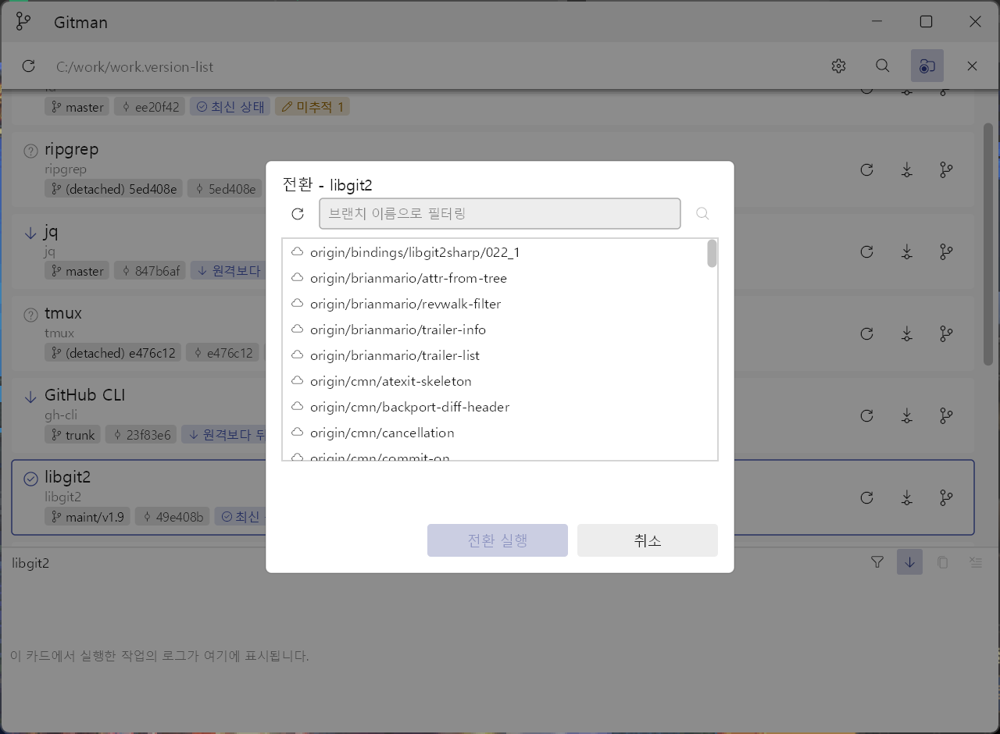


- **치는 즉시** 걸러집니다. 대상은 후보의 표시 이름이고 **대소문자를 무시하는 부분 일치**입니다.
- 질의를 고치면 **선택이 지워집니다.** 걸러져 사라진 후보가 선택된 채 남지 않습니다.
- **`Enter`** 는 걸러진 **첫 후보를 선택**합니다.
- 걸러낸 결과가 없으면 목록 자리에 `필터에 맞는 후보가 없습니다.` (필터가 없을 때의 `전환할 수 있는 후보가 없습니다.` 와 다릅니다.)
- 갱신 버튼은 후보를 다시 조회(fetch 포함)하고 **선택만 지우며 질의 글은 그대로 둡니다.** 실패하면 `후보를 다시 조회하지 못했습니다.`

목록 자체의 규칙은 이전과 같습니다.

- **원격 브랜치가 위**(구름 아이콘 + `origin/...`), 로컬 브랜치가 아래입니다.
- 원격 후보로 도달할 수 있는 로컬 브랜치는 중복해서 보여 주지 않습니다.
- fetch에 실패해도 목록은 뜹니다. 제목에 `(일부 후보 미갱신)` 이 붙고 해당 항목에 `이번 조회에서 갱신되지 않은 후보입니다` 툴팁과 ` (미갱신)` 꼬리표가 붙습니다.
- 대응하는 로컬 브랜치가 없는 원격 브랜치를 고르면 **확인이 필요합니다**: `local tracking branch를 만들고 전환합니다. 확인하려면 한 번 더 누르세요.` 확인하면 버튼이 `브랜치 만들고 전환` 으로 바뀝니다.
- 여러 remote에 같은 이름의 브랜치가 있으면 자동으로 고르지 않습니다: `여러 remote에 같은 이름의 branch가 있어 remote를 직접 선택해야 합니다.`
- 실행은 `--no-guess`와 완전한 ref로 하며, **실행 직전에 다시 fetch하지 않습니다**.
- detached HEAD로 전환, 강제 reset, `--merge`, `--discard-changes`는 지원하지 않습니다.

### 9.2 SVN — URL 전환

제목은 `SVN 저장소 전환 - <카드 이름>` 입니다.

| 요소 | 문구 |
| --- | --- |
| 입력 칸 placeholder | `이동할 경로 (예: /branches/2026-08)` |
| 입력 칸 툴팁 | `저장소 최상단을 기준으로 한 경로입니다. Enter로 이동합니다` |
| 갱신 버튼 툴팁 | `선택한 디렉터리를 다시 조회합니다` |
| 오른쪽 버튼 | `→` 이동. 툴팁 `입력한 경로로 이동합니다 (Enter)`. 질의가 있을 때만 활성 |

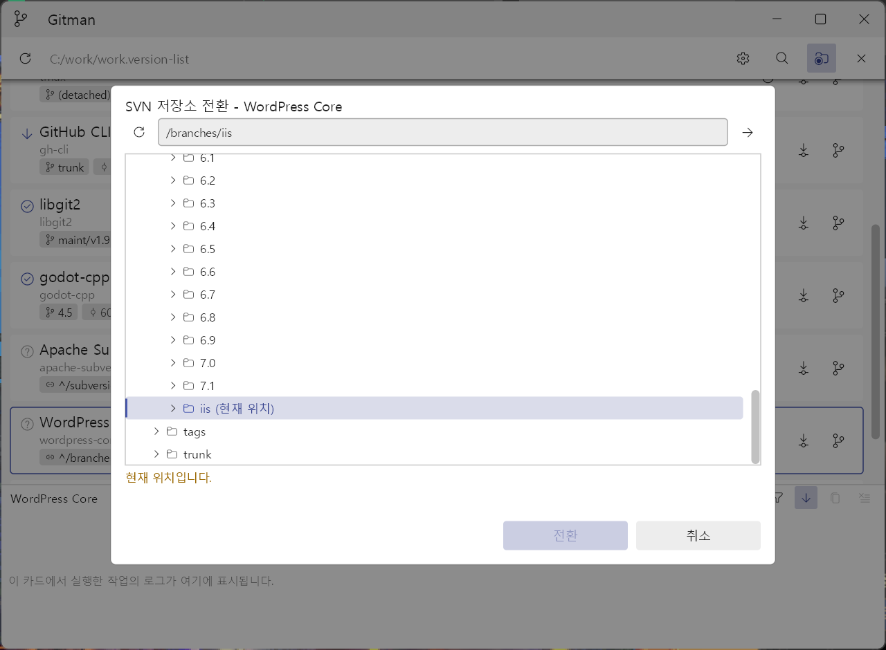

창을 열면 주소 칸에 **현재 작업 복사본의 경로가 미리 채워져 있습니다**(위 화면의 `/branches/iis`). 여기서 `Enter` 를 누르면 그 위치까지 트리가 펼쳐집니다. 따로 `현재 위치로` 버튼은 없습니다.

- 입력 칸에는 **저장소 루트 기준 경로**가 보입니다. 루트는 `/`, 그 아래는 `/branches/2026-08` 형태이며 전체 URL은 툴팁에 있습니다.
- **트리에서 노드를 고르면 입력 칸이 그 경로로 덮어써집니다.**
- 루트 기준 상대 경로와 루트로 시작하는 전체 URL을 모두 받습니다. 앞뒤 공백은 버리고 `.`·`..` 조각은 거부하며, 한글 같은 비 ASCII 경로는 자동으로 percent-encoding됩니다.
- 없는 경로를 넣으면 `그 경로를 찾을 수 없습니다: …` 가 뜨고 **트리는 그대로 둡니다.**
- 갱신 버튼은 **선택한 노드**(선택이 없으면 루트)를 다시 조회합니다. 그 아래 캐시를 버리고 다시 읽되 **펼침 상태는 유지**하므로, 방금 만든 branch를 **창을 닫지 않고** 확인할 수 있습니다.

트리 동작:

- 창을 열면 **현재 작업 복사본 위치까지 가는 길만** 한 단계씩 펼칩니다. `branches` 같은 형제 가지는 열지 않고, 목표 노드 자신도 펼치지 않습니다. 그 아래는 사용자가 열 때 조회합니다.
- 즉 저장소 전체를 미리 읽지 않습니다. 사용자가 직접 연 가지와 현재 위치로 가는 길만 조회합니다.
- 펼침 글리프는 `▸` / `▾` 이며 툴팁은 `펼치기` / `접기` 입니다. 디렉터리 행과 글리프는 서로 다른 클릭 대상입니다.
- 행에는 **이름만** 그립니다. 전체 경로는 입력 칸과 툴팁이 맡습니다.
- 현재 위치 행에는 ` (현재 위치)` 가 붙고 강조 표시가 됩니다. 그 위치를 고르면 `이미 현재 위치입니다. 다른 디렉터리를 선택하세요.`
- `trunk`/`branches`/`tags` 같은 layout 이름을 가정하지 않습니다. 실제로 조회한 디렉터리만 보여 줍니다.
- 조회 중인 노드는 `조회 중`, 실패한 노드는 사유를 표시합니다. 인증이 필요하면 프롬프트 없이 `인증이 필요해 조회하지 못했습니다`.
- 저장소 루트 밖으로는 나가지 않습니다: `저장소 루트 밖의 SVN 디렉터리는 조회하지 않습니다.`
- 실행 직전에 저장소 root와 UUID를 양쪽에서 다시 읽어 **모두 있고 같을 때만** 통과합니다. 다르면 `저장소 root 또는 UUID가 현재 작업 복사본과 다릅니다.`

> 문서에 남아 있는 `svn_switch_targets` 배열은 호환을 위해 보존만 하고 후보나 검증에는 사용하지 않습니다.

### 9.3 전환을 막는 조건

업데이트와 달리 **전환은 미추적 파일도 차단 대상입니다.** 전환은 작업 복사본 내용이 통째로 바뀌기 때문입니다.

- `작업 트리에 변경이나 진행 중인 작업이 있어 전환할 수 없습니다.`
- `이미 현재 참조입니다. 다른 후보를 선택하세요.`
- `이미 작업이 진행 중이라 switch를 시작하지 않습니다.`
- `기능이 실행 중이라 switch를 시작하지 않습니다: 빌드`, 전환 창에서는 `이 카드에서 기능이 실행 중입니다. 끝난 뒤 다시 시도하세요.` (출력을 로그로 받는 기능이 실행 중. 전환 버튼이 이미 비활성이라 누르는 순간 상태가 바뀐 경우에만 나옵니다)
- `전환할 수 있는 후보가 없습니다.`

---

## 10. 로컬 변경 확인

카드 우클릭 메뉴의 `로컬 변경 확인`을 누르면 제목이 `로컬 변경 - <카드 이름>` 인 창이 열립니다.

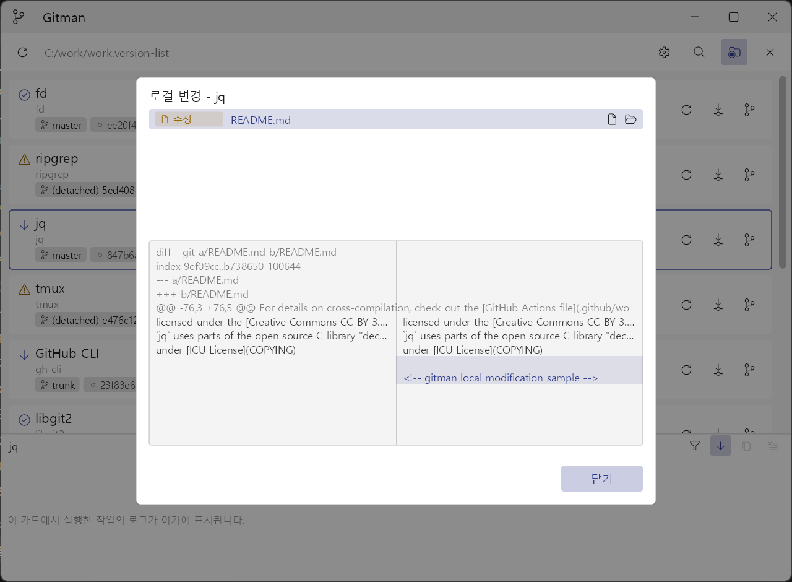

- **위쪽**이 변경 파일 목록입니다. 파일마다 상태 배지(`수정` 등)와 경로, 오른쪽에 파일 열기·폴더 열기 버튼이 있습니다.
- **아래쪽**이 선택한 파일의 **좌우 2단 diff**입니다. 왼쪽이 변경 전, 오른쪽이 변경 후이며 바뀐 줄이 강조됩니다. 본문은 **코드 글꼴**로 그려집니다.
- 목록과 diff 각각에 스크롤 막대가 붙습니다.
- 변경이 없으면 `표시할 로컬 변경이 없습니다.`, 차이가 없으면 `표시할 차이가 없습니다.`
- 이진 파일은 `이진 파일 - 내용을 표시하지 않습니다.`
- 미추적 디렉터리는 `미추적 디렉터리 - 내부 파일은 표시하지 않습니다.`
- 표시 상한은 **256 KiB**이며 넘으면 `표시 상한(256 KiB)을 넘어 이후 내용을 생략했습니다.`
- 닫기는 `닫기` 버튼 또는 `Esc`입니다.

---

## 11. 로그 파일

화면 로그와 같은 내용을 문서 폴더에 파일로도 남깁니다(환경설정에서 끌 수 있습니다).

문서가 `D:\workspaces\team.version-list`이면:

```text
D:\workspaces\.team.version-list.log\
    frontend\20260821-184012.log
    legacy-server\20260821-184015.log
```

- 폴더 이름 앞의 `.`은 탐색기에서 저장소 폴더들 사이에 섞이지 않고 맨 앞에 모이게 합니다.
- 저장소 폴더 이름은 작업 복사본의 **마지막 폴더 이름**입니다. 문서 안에서 겹치면 상위 폴더를 붙이고(`a-b-c`), 그래도 겹치면 드라이브까지 붙입니다(`c-drive_a-b-c`). 저장소가 추가·삭제되면 이름이 다시 계산되므로 **같은 저장소의 폴더 이름이 달라질 수 있습니다.**
- 파일은 문서를 연 뒤 그 저장소에 **첫 로그 record가 생길 때** 하나 만들어 문서를 닫거나 앱이 끝날 때까지 이어 씁니다. 조회가 전부 성공하면 남길 것이 없어 **로그 폴더가 아예 만들어지지 않을 수 있습니다** — 성공은 카드 표시로 충분하다고 보고 기록하지 않기 때문입니다.
- 형식은 UTF-8(BOM 없음), CRLF입니다. 첫 두 줄이 머리글이고, `# 문서:`는 그 로그를 남긴 문서의 경로입니다(예전 판은 로그 폴더 경로를 적었습니다).

```text
# 문서: D:\workspaces\team.version-list
# 저장소: Frontend (D:\repositories\frontend)
2026-08-21 18:40:12.128 [lifecycle/information] update 시작 (git pull --ff-only)
```

- **자동 정리(회전)는 없습니다.** 오래된 파일은 직접 지웁니다.
- 폴더를 만들지 못하거나 쓰기에 실패하면 경고 한 건을 남기고 그 세션 동안 파일 로그를 끕니다.

---

## 12. 기능 버튼

기능 버튼은 저장소마다 자주 쓰는 일 — 빌드, 테스트, IDE로 열기, 정리 스크립트 — 을 카드에서 바로 실행하는 버튼입니다. 버튼 하나가 **사용자가 정한 외부 프로그램 하나**를 그 저장소의 값으로 실행합니다.

- 정의와 변수는 작업공간 문서(`.version-list`)의 `function_buttons`에만 둡니다. Gitman은 정의를 찾으려고 저장소 안의 파일을 읽지 않습니다. 실행한 프로그램이 저장소 안의 파일을 쓰는 것은 상관없습니다.
- 프로그램은 **셸 없이** 실행 파일, 인자 배열, 작업 폴더를 주어 띄웁니다. 인자 하나는 값에 공백이나 `&`가 있어도 인자 하나 그대로 넘어갑니다.
- 끝난 뒤 저장소를 자동으로 다시 조회하지 않습니다. 기능이 저장소를 바꿨다면 카드를 새로 고칩니다.
- 정의는 [기능 편집 창](#128-기능-편집-창)에서 고치거나, 문서 JSON을 직접 고친 뒤 [문서 다시 읽기](#129-문서-다시-읽기와-실행-중-확인)로 불러옵니다.

### 12.1 정의 예

문서가 `E:\repos\work.version-list`에 있다고 합시다.

```json
{
    "schema_version": 1,
    "function_buttons": {
        "variables": {
            "unity": "C:\\Program Files\\Unity\\Hub\\Editor\\6000.0.1f1\\Editor\\Unity.exe",
            "build_config": "Debug"
        },
        "project_variables": {
            "frontend": { "build_config": "Release" }
        },
        "buttons": [
            {
                "id": "build",
                "label": "빌드",
                "icon": "tools",
                "program": "C:\\Program Files\\CMake\\bin\\cmake.exe",
                "args": ["--build", "${projectRoot}\\build", "--config", "${build_config}"],
                "timeout_seconds": 1800,
                "project_ids": ["frontend", "backend"],
                "placement": "card"
            },
            {
                "id": "open-unity",
                "label": "Unity로 열기",
                "icon": "window",
                "program": "${unity}",
                "args": ["-projectPath", "${projectRoot}"],
                "mode": "detached",
                "placement": "card"
            },
            {
                "id": "clean",
                "label": "정리 스크립트",
                "icon": "trash",
                "program": "C:\\Windows\\System32\\WindowsPowerShell\\v1.0\\powershell.exe",
                "args": ["-NoProfile", "-File", "${workspaceFolder}\\tools\\clean.ps1", "-Root", "${projectRoot}"],
                "vcs": "git",
                "confirm": true,
                "placement": "menu"
            },
            {
                "id": "test",
                "label": "테스트",
                "icon": "beaker",
                "program": "C:\\Tools\\test.exe",
                "args": ["${projectRoot}"],
                "project_ids": ["frontend"],
                "placement": "bar"
            }
        ]
    },
    "projects": [
        { "id": "frontend", "path": "frontend" },
        { "id": "backend", "path": "backend" }
    ]
}
```

- `빌드`와 `Unity로 열기`는 카드 버튼입니다(`Alt+1`, `Alt+2`). `빌드`는 `frontend`와 `backend` 카드에만 나옵니다.
- `frontend`에서 `${projectRoot}`는 `E:\repos\frontend`이고 `${build_config}`는 저장소별 값 `Release`입니다. 그래서 `빌드`는 `cmake.exe --build E:\repos\frontend\build --config Release`로 실행됩니다. `backend`에서는 `Debug`입니다.
- `Unity로 열기`는 따로 실행(`detached`)이라 Unity 창이 뜨고, Gitman은 시작했는지만 기록합니다.
- `정리 스크립트`는 Git 저장소에만 적용되고 메뉴에만 있습니다. `confirm`을 켰으므로 실행 전에 명령줄을 보이고 확인을 받습니다.
- `테스트`는 `frontend` 카드를 선택했을 때 기능 줄에 나옵니다.
- 스크립트는 인터프리터(`powershell.exe`)를 `program`에 적고 스크립트 경로를 인자로 넘깁니다([12.6](#126-허용-목록과-cmd-방어)). 스크립트는 문서 폴더(`${workspaceFolder}`)에 두어도, 저장소 안(`${projectRoot}`)에 두어도 됩니다.
- JSON 안에서 경로의 `\`는 `\\`로 적습니다. 필드 전체는 [부록 A](#function_buttons)에 있습니다.

### 12.2 배치 — 카드 · 기능 줄 · 메뉴만

기능마다 보이는 자리(`placement`)를 하나 고릅니다.

| 값 | 화면 이름 | 보이는 곳 | 실행 |
| --- | --- | --- | --- |
| `card` | 카드 | 그 기능이 적용되는 **모든 카드**의 오른쪽 열에 아이콘 버튼. 문서 전체에서 3개까지, `Alt+1`~`Alt+3` | 어느 카드에서나 클릭 한 번 |
| `bar` | 기능 줄 | **선택한 카드**의 기능 줄에 글자 버튼 | 선택한 카드에서 클릭 한 번 |
| `menu` (적지 않으면 이것) | 메뉴만 | `⋯` 기능 메뉴와 카드 우클릭 메뉴에만 | 두 번 |

- 어느 배치든 그 카드의 `⋯` 기능 메뉴에는 **늘** 나옵니다. 숨어서 닿을 수 없는 기능은 없습니다.
- `placement`를 적지 않은 기능은 메뉴만입니다. 그래서 처음 정의한 문서를 열면 카드에는 `⋯`만 있고 기능 줄이 없습니다. 자주 쓰는 기능은 편집 창의 `배치`에서 카드나 기능 줄로 올립니다. 한 번 버튼이 된 뒤에는 아래 배치 메뉴로 바로 바꿉니다.
- 카드 배치는 문서 순서로 **앞 3개**만 카드에 나옵니다. 4번째부터와 알 수 없는 값은 경고(`card 배치는 문서 전체에서 3개까지입니다. 기능 줄(bar)에 둡니다.` 등)를 남기고 기능 줄에 보입니다. 파일에 적힌 값은 바꾸지 않습니다. 카드에 나오는 기능끼리 아이콘이 같으면(아이콘을 생략하면 모두 같은 기본 아이콘입니다) 뒤 기능에 `앞의 card 기능과 아이콘이 같아 카드에서 구별하기 어렵습니다.` 경고가 붙습니다.
- 카드 버튼과 기능 줄 버튼은 문서의 `buttons` 순서대로, 그 카드에 적용되는 것만 놓입니다. `Alt+N`의 N은 문서 전체의 카드 배치 순서라, 적용 범위가 다른 카드 기능이 섞이면 카드에서 보이는 자리와 N이 다를 수 있습니다.
- 한 카드에 적용되는 기능은 **20개까지**입니다. 넘으면 문서 순서로 21번째부터 그 카드에서 쓰지 않고 경고합니다.

**카드 열.** `[카드 기능 0~3] [⋯] │ [↻] [↓] [전환]`입니다([5.2](#52-카드)). 기본 버튼 세 개의 자리는 그대로이고 기능 버튼이 늘수록 경로·칩 영역이 좁아집니다. 창 폭 480에서도 세 개를 모두 둘 수 있습니다. 카드 기능 버튼은 Tab으로 가지 않으므로 키보드에서는 `Alt+1`~`Alt+3`과 `Alt+↓` 기능 메뉴를 씁니다.

**기능 줄.** 로그 창 안 맨 위의 한 줄입니다.

```text
| frontend │ [테스트] [린트]                                              [⋯] |
| frontend                                           00:00 [필터][↓][복사][지우기] |
```

- 문서의 카드 중 하나에라도 적용되는 기능 줄 기능이 있으면 **늘** 보입니다. 선택이 바뀌어도 로그 높이가 튀지 않게 하려는 것입니다. 그런 기능이 하나도 없으면 줄이 없고 로그 창은 예전과 같습니다. 기능 줄이 있으면 로그 본문이 134에서 98(논리 픽셀)로 줄고, 시스템 글자 크기를 키우면 줄도 함께 높아집니다.
- 왼쪽에 선택한 카드 이름이 붙습니다. 창 폭 640 이상이면 150, 560~639면 72 폭이고, 560보다 좁으면 이름이 없습니다. 이름이 잘리면 줄의 툴팁에 전체 이름이 있습니다.
- 버튼 폭은 `이름 · 실행 중`이 들어가는 폭(64~160)으로 미리 정해 두어, 상태가 바뀌어도 옆 버튼이 접혔다 펴지지 않습니다. 기능 줄에 둘 기능의 이름은 5자 안팎이 좋습니다.
- 들어가지 않는 버튼은 오른쪽부터 숨고 줄 끝의 `⋯`(선택한 카드의 기능 메뉴)에서 닿습니다.
- 줄에는 힌트가 나올 수 있습니다. 선택한 카드가 없으면 `카드를 선택하면 기능이 나옵니다`(이때 `⋯`는 비활성), 선택한 카드에 기능 줄 기능이 없으면 `이 카드에는 기능 줄 항목이 없습니다 — ⋯에서 모든 기능을 봅니다`, 적용 기능이 하나도 없으면 `이 카드에 적용되는 기능이 없습니다`.
- 기능 줄 버튼과 줄의 `⋯`는 Tab 정지점입니다.

**기능 메뉴.** 카드의 `⋯` 클릭, `Alt+↓`, 기능 줄의 `⋯`가 같은 메뉴를 엽니다. 카드 우클릭 메뉴의 `기능 더 보기…`는 이 메뉴의 9번째 기능부터를 엽니다.

```text
+------------------------------------------+
| [tools]  빌드 — 실행 중 00:12      Alt+1 |
| [window] Unity로 열기              Alt+2 |
| [trash]  정리 스크립트                   |
| [beaker] 테스트 — 실패 (종료 코드 1)     |
|------------------------------------------|
| [gear]   기능 편집…                      |
| [sync]   문서 다시 읽기                  |
+------------------------------------------+
```

- 그 카드에 적용되는 기능이 배치와 상관없이 문서 순서로 나옵니다. 한 번에 **12개까지** 나오고, 더 있으면 그 아래 `기능 더 보기…`가 같은 자리에 나머지를 엽니다. 메뉴에는 스크롤이 없어, 작은 화면(1366×768을 125%로 쓸 때)에서도 메뉴 전체가 들어가도록 정한 수입니다. 카드 우클릭 메뉴는 기존 항목이 더 있어 기능을 8개까지 싣습니다. 카드 배치 기능은 오른쪽에 `Alt+N`이 붙습니다.
- 상태는 이름 뒤에 붙습니다. 실행 중이면 `— 실행 중 MM:SS`(메뉴를 연 시각의 값에서 멈춥니다), 쓸 수 없으면 `— <사유>`([12.3](#123-실행과-표시)), 마지막 실행이 실패했으면 `— 실패 (종료 코드 N)`입니다. 시간 초과·시작 실패·누른 순간의 검사처럼 종료 코드가 없는 실패는 `— 실패`만 붙습니다.
- 실행 중인 항목은 아이콘이 중지 모양이고, 고르면 중지합니다.
- 메뉴를 열고 바로 `Enter`를 누르면 첫 번째 활성 기능이 실행됩니다. 그 카드에서 출력을 로그로 받는 기능이 실행 중이면 `Enter` 기본 항목이 없어, 습관적인 `Enter`가 다른 기능을 시작하지 않습니다. `기능 더 보기…`로 연 나머지 쪽에도 기본 항목이 없습니다. 다만 `⋯`에서 `Enter`를 길게 눌러 생기는 자동 반복은 막지 못할 수 있습니다([20장](#20-알려진-제한)).
- 기능 메뉴를 열어도 카드 선택은 바뀌지 않습니다.

**배치 메뉴 — 자리를 바로 바꾸기.** 카드 기능 버튼이나 기능 줄 버튼을 **우클릭**하면 열립니다. 기능 줄 버튼에 Tab 초점이 있을 때 `Shift+F10`도 같습니다.

```text
+------------------------------------------+
| ( ) 카드에 두기                    Alt+3 |
| (o) 기능 줄에 두기                       |
| ( ) 메뉴에만 두기                        |
|------------------------------------------|
| [gear] 기능 편집…                        |
+------------------------------------------+
```

- 지금 배치에 점이 찍혀 있습니다. `카드에 두기` 오른쪽에는 카드에 두면 받을 `Alt+N`이 보입니다. 카드 배치가 이미 3개이고 이 기능이 그중 하나가 아니면 `카드에 두기 — 3개까지`로 비활성입니다.
- 고르면 **문서에 바로 저장**하고 카드 열, 기능 줄, `Alt+N` 번호가 곧바로 바뀝니다. 앞 번호의 카드 기능을 내리면 뒤 기능의 번호가 당겨지고, 넘쳐서 기능 줄에 있던 4번째 카드 기능이 카드로 올라옵니다. `기능 줄에 두기`와 `메뉴에만 두기` 사이를 오가는 것은 신뢰 확인 대상이 아니라 다시 묻지 않습니다. `카드에 두기`로 넣거나 빼면 `Alt+N` 번호가 바뀌어 신뢰 확인 대상이 바뀌지만, 바꾸기 전에 신뢰한 문서면 여기서 바꾼 것은 다시 묻지 않습니다. 신뢰하지 않은 문서면 다음에 누를 때 묻습니다([12.5](#125-신뢰-확인과-실행-전-확인)).
- `기능 편집…`은 그 기능을 고른 채 편집 창을 엽니다.
- 메뉴만 기능(버튼이 없음)과 비활성 버튼(우클릭을 받지 않음)의 배치는 편집 창에서 바꿉니다. 카드 기능 버튼은 Tab으로 가지 않으므로 키보드로는 편집 창에서 바꿉니다.
- 카드 본문 우클릭은 예전처럼 카드 메뉴입니다. 카드 안의 기능 버튼 우클릭만 배치 메뉴입니다.
- 기능 줄 버튼에서 연 배치 메뉴로 그 버튼이 기능 줄을 떠나면, 초점은 줄의 다음 버튼 → 줄의 `⋯` → 그 카드의 `⋯` 순서로 갈 수 있는 곳에 옮겨 갑니다.
- 기능 줄 버튼이나 줄의 `⋯`에 초점이 있을 때 `Esc`로 카드 선택을 풀면 줄의 버튼이 사라지므로, 초점은 방금까지 선택했던 카드의 `⋯`로 옮겨 갑니다. 그 카드가 목록에 보이지 않으면 초점이 지워집니다.

### 12.3 실행과 표시

**적용 범위.** `project_ids`가 있으면 그 저장소의 카드에만, `vcs`가 `git`이나 `svn`이면 그 종류의 카드에만 나옵니다. 범위 밖 카드에는 버튼도 메뉴 항목도 없습니다. `vcs_hint`가 `auto`인 카드는 조회하기 전까지 종류를 모르므로, `vcs`를 정한 기능을 비활성으로 보였다가 조회 뒤에 판정합니다.

**쓸 수 없을 때.** 버튼은 비활성이 되고 툴팁과 메뉴 이름 뒤에 사유가 붙습니다. 같은 기능은 카드 버튼, 기능 줄, 메뉴 어디서나 같은 상태입니다.

| 사유 | 언제 |
| --- | --- |
| `저장소를 조회한 뒤에 쓸 수 있습니다` | 런타임 변수(`${branch}` 등, [12.7](#127-변수와-gitman_-환경-변수))를 쓰는데 그 카드를 아직 조회하지 않음 |
| `저장소 종류를 아직 모릅니다` | `vcs`를 정한 기능이고 `vcs_hint: auto` 카드를 아직 조회하지 않음 |
| `저장소 종류를 알 수 없습니다` | 조회했지만 종류를 정하지 못함 |
| `제외된 카드는 저장소를 조회하지 않습니다` | 제외된 카드(문서에 `enabled: false`, [부록 A](#projects))라 위 두 경우가 풀리지 않음 |
| `이 저장소에 정의되지 않은 변수입니다: ${이름}` | 쓰는 사용자 변수가 문서에도 그 저장소의 덮어쓰기에도 없음 |
| `지금 값을 풀 수 없는 변수입니다: ${이름}` | 조회했지만 값이 없음(detached HEAD나 SVN 카드의 `${branch}` 등) |
| `저장소 경로를 쓸 수 없습니다` | `${projectRoot}`를 쓰는데(작업 폴더 기본값 포함) 저장소 경로를 쓸 수 없음 |
| `이 카드에서 다른 기능이 실행 중입니다` | 출력을 로그로 받는 기능은 카드당 하나만 돕니다 |
| `업데이트 중입니다` / `전환 중입니다` | 그 카드의 업데이트·전환이 진행 중 |

- 제외된 카드에서도 문서에 적힌 값만 쓰는 기능은 실행할 수 있습니다. 제외는 VCS 일괄 작업에서 빼는 뜻입니다.
- 런타임 변수를 쓰지 않는 기능은 저장소 조회가 끝나기 전에도 실행됩니다.

**실행 중·실패 표시.**

| 상태 | 카드 기능 버튼 | 기능 줄 버튼 | `⋯` | 카드 | 로그 |
| --- | --- | --- | --- | --- | --- |
| 출력을 로그로 받으며 실행 중 | 중지 아이콘 + 강조 배경, 누르면 중지 | `빌드 · 실행 중` + 강조 배경, 누르면 중지 | 카드에 버튼이 보이지 않는 기능이면 작은 강조색 **원** | 상태 아이콘 회전, 3줄 맨 앞 `▶ 빌드 00:12` | 시작 줄, 출력 |
| 같은 카드의 다른 출력 수집 기능 | 비활성 | 비활성 | | | |
| 따로 실행 시작 | 변화 없음 | 변화 없음 | | | `시작:` 한 줄 |
| 성공 | 표식 없음 | 이름으로 돌아옴 | | 칩 사라짐 | 끝 줄 |
| 실패 | 오른쪽 위 작은 오류색 **마름모** | 오류 마름모, `빌드 · 실패` | 카드에 버튼이 보이지 않는 기능이면 오류 마름모(실행 중보다 먼저) | 칩 사라짐 | 끝 줄(오류) |
| 사용자가 중지 | 표식 없음 | 표식 없음 | | | `[빌드] 취소됨` (경고) |

- 실패에는 종료 코드가 0이 아님, 시간 초과, 시작하지 못함, 누른 순간의 검사에 걸림이 모두 들어갑니다.
- 표식은 색뿐 아니라 모양으로도 다릅니다. 실행 중은 원, 실패는 마름모입니다. `⋯`의 화면 읽기 이름과 툴팁에는 표식이 맡는 기능(카드에 버튼이 보이지 않는 기능(기능 줄·메뉴에만 있는 기능, 창이 좁아 접힌 카드 기능))의 수가 붙습니다(`기능 더 보기, frontend, 5개, 실행 중 1개, 실패 1개`). 앞의 `5개`는 그 카드의 기능 전체 수입니다. 카드에 보이는 기능 버튼의 상태는 그 버튼의 이름(`빌드, frontend, 실행 중`)이 말하므로 이 수에 들지 않습니다.
- 실패 표식은 그 기능을 다시 실행하거나, 선택이 그 카드로 바뀌면 지워집니다(이미 선택한 카드였으면 다른 카드를 골랐다가 다시 고를 때). 메모리에만 있고 저장하지 않습니다.
- 카드 기능 버튼의 툴팁은 평소 `빌드 (Alt+1)`이고, 실행 중이면 `빌드 — 실행 중입니다. 누르면 중지합니다`, 실패했으면 `빌드 — 마지막 실행이 실패했습니다: 종료 코드 1`(종료 코드가 없는 실패는 `빌드 — 마지막 실행이 실패했습니다`), 비활성이면 `빌드 — <사유>`입니다. 상태가 붙으면 단축키는 빠집니다.
- 경과 시간은 3번째 줄 칩과 로그 머리에서만 흐릅니다. 버튼의 이름과 툴팁에는 넣지 않습니다(화면 읽기가 이름을 거듭 읽지 않게 하려는 것입니다).

**로그.** 선택한 카드의 로그(카드당 1,000 record)에 기능 줄이 `[이름]` 접두로 섞입니다. 파일 로그를 켜 두었으면 파일에도 남습니다.

```text
[빌드] 실행: "C:\Program Files\CMake\bin\cmake.exe" --build E:\repos\frontend\build --config Release
[빌드] -- Build files have been written to: …
[빌드] 종료 코드 0 · 12.3초
[테스트] 종료 코드 1 · 5.0초
[Unity로 열기] 시작: "C:\Program Files\Unity\…\Unity.exe" -projectPath E:\repos\frontend
[린트] 시간 초과(3600초)
[정리 스크립트] 취소됨
```

- 끝 줄은 `종료 코드 N · X.X초`, `종료 코드를 알 수 없습니다 · X.X초`(오류), `시간 초과(N초)`, `취소됨`, `시작하지 못했습니다: …`, `실행하지 못했습니다: …` 중 하나입니다. 소요 시간은 프로세스를 띄운 때부터 잽니다. 음수 종료 코드는 `0xC0000005`처럼 16진수로 적습니다.
- 출력이 잘렸거나(스트림당 8 MiB) 출력 수집에 문제가 있었으면 끝 줄 뒤에 그 사유가 한 줄씩 붙습니다.
- 누른 순간의 검사([12.6](#126-허용-목록과-cmd-방어))에 걸리면 `[이름] 실행하지 않습니다: <사유>`(오류)를 남기고 실패 표식을 답니다.
- 명령줄은 실제 인자를 이은 글이 아니라 **표시용 명령줄**입니다. `${env:NAME}`에서 온 부분은 값 대신 `${env:NAME}` 그대로 보이고, `--password`·`--token` 값, URL 사용자 정보, `Authorization:` 같은 비밀은 가려집니다. 출력에도 같은 가리기가 적용됩니다. 이 가리기는 끌 수 없고, 규칙에 맞지 않는 비밀은 가리지 못합니다.
- 기능의 결과는 상단 배너에 올리지 않습니다.

**동시 실행과 업데이트·전환.**

- 출력을 로그로 받는 기능은 **카드당 하나**만 돕니다. 따로 실행은 카드당 제한이 없습니다(시작하는 동안에는 아래 4자리 중 하나를 잠깐 씁니다).
- 앱 전체에서 동시에 도는 기능(대기 포함)은 **4개까지**입니다. 넘으면 기다리게 하지 않고 `[이름] 동시에 실행할 수 있는 기능은 4개까지입니다`(경고)를 남깁니다.
- 출력을 로그로 받는 기능과 **같은 카드의 업데이트·전환은 서로 막습니다.** 빌드 스크립트와 `git pull`이 같은 작업 트리를 동시에 건드리지 않게 하려는 것입니다. 새로 고침과 다른 카드, 따로 실행은 막지 않습니다.
- 기능 실행은 카드의 "작업 중" 상태를 세우지 않으므로, 상태 조회 중에도 실행할 수 있습니다.

### 12.4 실행 방식 — 출력을 로그로 받기 / 따로 실행

`mode`로 고릅니다. 편집 창에서는 `실행 방식`입니다.

| | `capture` — 출력을 로그로 받기 (기본) | `detached` — 따로 실행 |
| --- | --- | --- |
| 쓰임 | 빌드, 테스트, 코드 생성, 짧은 스크립트 | IDE·도구 열기, 창이 필요한 프로그램, 입력을 받는 스크립트 |
| 출력 | 줄마다 카드 로그(와 파일 로그)에 남김 | 남기지 않음. `시작:` 줄 하나 또는 `시작하지 못했습니다:` 줄 하나 |
| 종료 코드·소요 시간 | 남김 | 없음 |
| 중지 | 버튼·메뉴로 중지. Windows job으로 묶인 자식 프로세스까지 함께, 유예 없이 바로 끝냅니다 | 없음 |
| 제한 시간 | `timeout_seconds`(기본 3600초, `0`은 무제한, 최대 86400). 넘으면 끝내고 `시간 초과(N초)` | 없음. 적어 두면 경고만 합니다 |
| 표준 입력 | 빈 입력(NUL). 입력을 물어도 답할 수 없으므로 입력이 필요한 스크립트는 따로 실행으로 돌립니다 | Gitman이 넘기지 않습니다 |
| 콘솔 창 | 만들지 않음. 프로그램이 스스로 띄우는 GUI 창은 보입니다 | 콘솔 창을 숨기지 않습니다. 콘솔 프로그램은 새 콘솔 창이 뜰 수 있습니다(어떻게 뜨는지는 확인 전, [20장](#20-알려진-제한)) |
| 환경 변수 | Gitman의 환경 + `GITMAN_*` + `GIT_TERMINAL_PROMPT=0` | Gitman의 환경 + `GITMAN_*` |
| 문서 닫기·다시 읽기·다른 문서 열기·앱 종료 | 확인 뒤 중지 | 그대로 남습니다 |

- `GIT_TERMINAL_PROMPT=0`은 스크립트 안의 git이 터미널에서 자격 증명을 묻다가 제한 시간까지 멈추지 않게 합니다. Git Credential Manager 같은 GUI 창은 막지 못합니다.
- `0`(무제한)으로 둔 기능은 끝날 때까지 동시 실행 4자리 중 하나를 차지합니다.
- 출력의 인코딩은 UTF-8이 아니면 Windows 활성 코드 페이지로 읽습니다.
- 따로 실행한 프로그램은 Gitman이 관리하지 않으므로 앱을 끝내도 남습니다. 의도된 동작입니다.

### 12.5 신뢰 확인과 실행 전 확인

**신뢰 확인.** 남이 만든 문서의 버튼을 무심코 누르지 않게 하는 장치입니다. 문서의 기능 정의를 신뢰한다고 기록하지 않았으면, 기능을 처음 누를 때 `기능 실행 확인` 창이 뜹니다.

- 대상 줄은 문서 경로이고, 그 문서에서 검증을 통과한 **모든 기능**이 나옵니다(누른 기능이 맨 앞). 기능마다 이름, 실행 방식, 그리고 변수를 풀기 **전의** `program`, 인자, `작업 폴더 …`, 쓰는 사용자 변수의 값(`이름 = 문서 값 (저장소: 덮어쓴 값)`)을 보입니다. `powershell.exe`처럼 실제 동작이 인자에 있는 경우를 위해 인자까지 보입니다.
- 줄 안의 제어 문자, 방향을 바꾸는 문자, 폭 없는 문자는 `<U+202E>`처럼 드러내 보입니다. 원문의 비밀은 로그와 같은 규칙으로 가립니다.
- `신뢰하고 실행`을 누르면 신뢰를 기록하고 실행합니다. `취소`, `Esc`, 창 밖 클릭은 실행하지 않습니다. 실수로 실행하지 않도록 `Enter`는 `신뢰하고 실행`의 단축키가 아닙니다.
- 목록은 휠, 스크롤 막대, `↑`/`↓`, `PageUp`/`PageDown`, `Home`/`End`로 스크롤합니다.
- 신뢰는 `gitman.app-settings.json`의 `trusted_function_definitions`에 문서 경로와 정의의 해시로 기록됩니다. 앱 설정 파일에 쓸 수 없으면 그 실행 동안만 기억합니다.

**다시 묻는 때.** 해시에는 기능 정의(`placement`를 뺀 모든 필드와 `variables`, `project_variables`. 검증에 실패한 항목도 `placement`만 빼고 원문 그대로), 카드에 보이는 기능(`card`, 최대 3개)과 그 순서, 문서의 모든 저장소의 `id`, `path`, 표시 이름이 들어갑니다. 그래서 다음 경우 한 번 더 묻습니다.

- 프로그램, 인자, 작업 폴더, 변수, 적용 범위 등을 바꿨을 때(손으로 고쳤어도)
- 문서를 손으로 고치거나 `git pull`로 받아 기능의 이름이나 아이콘이 바뀌었을 때. 신뢰 확인 창은 이름과 명령을 함께 보이고 카드의 기능 버튼은 아이콘만 보이므로, 두 기능의 이름이나 아이콘을 맞바꿔 다른 명령이 그 이름이나 그림으로 도는 일을 막으려는 것입니다
- 검증에 실패해 신뢰 확인 창에 보이지 않던 기능을 고쳐 쓸 수 있게 되었을 때(예: 비어 있던 `label`을 채움)
- 문서를 손으로 고치거나 `git pull`로 받아 카드에 보이는 기능이 바뀌었을 때(`card`에 넣거나 빼거나 순서가 바뀜). `Alt+1`~`Alt+3`이 실행하는 기능이 바뀌기 때문입니다
- 저장소의 경로나 표시 이름을 바꿨을 때. 경로만 바꿔도 `${projectRoot}\tools\clean.ps1`이 다른 파일을 가리킬 수 있기 때문입니다
- 탐색·등록으로 저장소가 늘었을 때
- 같은 정의를 다른 경로의 문서로 열었을 때

기능 줄과 메뉴 사이(`bar`·`menu`)의 배치만 바꾼 것과 카드 순서, 저장소의 `enabled`를 바꾼 것은 다시 묻지 않습니다. 기능 편집 창이나 배치 메뉴로 저장한 정의는, 바꾸기 전에 신뢰한 정의였을 때만 새 정의로 신뢰를 갱신합니다. 그래서 신뢰한 정의를 편집 창으로 고쳐 이름이나 아이콘을 바꾸거나, 배치 메뉴로 기능을 카드에 올리거나 내려도 다시 묻지 않습니다. 편집기를 열었다는 것만으로 남이 만든 다른 기능까지 신뢰되지 않게 하려는 것입니다.

> **신뢰는 스크립트 파일의 내용을 확인하지 않습니다.** 문서에 적힌 정의만 덮습니다. 기능이 실행하는 `clean.ps1`의 내용은 `git pull` 한 번에 바뀔 수 있습니다.
>
> 문서의 `settings.git_executable`·`svn_executable`에 적힌 실행 파일은 기능 신뢰와 따로, 그 문서의 실행 파일을 신뢰한 뒤에만 씁니다([13.1](#131-도구-탭)). 기능을 신뢰해도 실행 파일은 신뢰하지 않습니다.

**앱 설정을 읽는 동안 누른 기능.** 명령줄이나 파일 연결로 문서를 연 직후처럼 앱 설정 파일을 아직 읽는 중에 누른 기능은 읽기가 끝날 때까지 기다렸다가 그때 신뢰를 판정합니다. 그래서 이미 신뢰한 정의를 다시 묻지 않습니다. 기다리는 동안 누른 다른 기능은 무시합니다.

**실행 전 확인(`confirm`).** 신뢰와 별개로, 지우기처럼 되돌리기 어려운 스크립트를 실수로 누르지 않게 기능마다 켜는 확인입니다. 켜 둔 기능은 누를 때마다 같은 창이 대상 줄에 저장소 이름, 그 기능의 표시용 명령줄과 `작업 폴더 …`를 보이고 `실행` / `취소`를 묻습니다. 신뢰하지 않은 정의에서 처음 누르면 창을 두 번 띄우지 않고 신뢰 확인 창의 그 기능 항목에 `실행할 명령 …`, `실행할 작업 폴더 …` 줄을 더해 한 번에 묻습니다.

확인한 순간 변수를 다시 풀어, 창에 보인 것과 실제 인자·작업 폴더·명령줄(cmd 기능이면 경고까지)이 다르면(그사이 브랜치가 바뀌었거나 `${env:}` 값이 달라짐) 실행하지 않고 `[이름] 확인한 뒤 실행 값이 바뀌어 실행하지 않습니다`(경고)를 남깁니다.

**cmd 보정 확인.** `program`이 `cmd.exe`인 기능은 Gitman이 cmd가 다르게 읽을 글자를 보정해 명령줄을 짓습니다([12.6](#126-허용-목록과-cmd-방어)). 보정한 곳이나 Gitman이 고칠 수 없는 위험(경고)이 있으면 실행하기 전에 같은 창이 대상 줄에 저장소 이름을 보이고 그 기능의 `원래 명령 …`, `실행할 명령 …`, `작업 폴더 …`, 바뀐 자리마다 `보정 args[3]: main&whoami → "main&whoami"`와 `이유: …`, 경고마다 경고색 `경고 …` 줄을 보입니다. `실행`을 눌러야 실행합니다.

- 같은 저장소의 같은 기능이 **같은 명령줄, 같은 경고, 같은 작업 폴더로** 다시 실행되면 묻지 않습니다. 브랜치가 바뀌는 등 명령줄이나 경고에 든 값이 달라지거나, `${env:}`로 정한 작업 폴더의 값이 달라지면 다시 묻습니다. 이 기억은 Gitman이 메모리에만 두고 문서를 다시 읽거나 닫거나 다른 문서를 열면 지웁니다.
- 신뢰 확인이나 실행 전 확인이 함께 필요하면 창을 두 번 띄우지 않고 그 창의 기능 항목에 같은 줄을 더해 한 번에 묻습니다. 실행 전 확인을 켠 기능은 기억과 상관없이 늘 묻습니다.
- 보정도 경고도 없으면(공백이 든 경로를 따옴표로 감싸기만 한 경우 등) 묻지 않습니다. `C:\Program Files (x86)\…`나 `D:\R&D team\…`처럼 공백이 든 경로는 괄호나 `&`가 있어도 어차피 감싸므로 묻지 않습니다. 보정 없이 경고만 있으면 안내 첫 줄이 `cmd.exe 명령에 확인할 경고가 있습니다.`입니다.

### 12.6 허용 목록과 cmd 방어

**허용 목록.** 변수를 푼 `program`은 다음을 모두 지켜야 합니다. 두 실행 방식에 같게 적용합니다.

- 절대 경로입니다. `PATH`에서 찾지 않습니다.
- 확장자가 `.exe` 또는 `.com`입니다(대소문자 무시). 확장자를 추측해 붙이지 않습니다.
- 마지막 이름이 점이나 공백으로 끝나지 않습니다(`run.bat.` 같은 우회를 막습니다).

그래서 `.bat`, `.cmd`, `.ps1`을 `program`에 바로 적으면 거부됩니다. 인터프리터를 `program`에 적고 스크립트를 인자로 넘깁니다.

| 스크립트 | `program` | `args` |
| --- | --- | --- |
| PowerShell | `C:\Windows\System32\WindowsPowerShell\v1.0\powershell.exe` | `["-NoProfile", "-File", "<ps1 경로>", …]` |
| 배치 파일 | `C:\Windows\System32\cmd.exe` | `["/d", "/c", "<bat 경로>", …]` |

- 변수가 없는 `program`이 허용 목록에 걸리면 문서를 읽을 때 그 기능만 경고하고 건너뜁니다(`program이 허용 목록에 없습니다 (.exe 또는 .com). …`). 변수가 든 `program`은 누른 순간에 검사합니다.
- 작업 폴더(`cwd`)도 변수를 푼 뒤 절대 경로여야 합니다. 아니면 `[이름] 실행하지 않습니다: 작업 폴더(cwd)가 절대 경로가 아닙니다`입니다.
- Gitman은 인터프리터에 인자를 더 붙이지 않습니다. PowerShell 실행 정책 같은 인터프리터의 규칙은 그대로 적용됩니다.

**cmd 방어.** `cmd /c`는 받은 명령줄을 자기 규칙으로 다시 해석합니다. 그대로 두면 원격 저장소에서 남이 정한 브랜치 이름(`main&whoami`)이 명령이 되고, `D:\R&D\…`나 `OneDrive - 회사명` 같은 평범한 폴더의 배치도 둘로 갈리거나 따옴표가 벗겨져 돌지 않습니다. 그래서 변수를 푼 `program`의 파일 이름이 `cmd.exe`이면(대소문자와 폴더 표기는 가리지 않습니다) Gitman이 명령줄을 cmd에 맞게 따로 짓고, 보정한 곳이나 경고가 있으면 실행 전에 확인을 받습니다([12.5](#125-신뢰-확인과-실행-전-확인)).

- **조립.** `args` 앞쪽의 스위치(`/d`, `/q`, `/v:on`처럼 `/` 뒤에 영문자 하나, `:값`은 붙여도 됩니다)는 그대로 두고, `/c`(또는 `/k`, `/r`) 뒤를 `/s /c "…"` 한 묶음으로 넘깁니다. 그 안의 각 인자는 공백, `,`, `;`, `=`가 있거나 비었으면 따옴표로 감쌉니다. 이것은 보통 조립이라 묻지 않습니다. 이렇게 어차피 감싸는 인자는 `&`나 괄호가 함께 있어도 보정으로 치지 않습니다. 로그의 `실행:` 줄과 확인 창에 보이는 명령줄은 실제로 넘긴 그 모양입니다.
  - `/c`를 빠뜨리고 스위치가 아닌 인자부터 적으면 Gitman이 그 앞에 `/c`를 넣습니다. `/dc`처럼 스위치를 붙여 쓰면 스위치로 보지 않습니다. `/c:x`처럼 `/c`, `/k`, `/r`에 `:값`을 붙인 것도 스위치가 아니라 명령의 시작으로 보므로 cmd가 명령을 찾지 못한다는 오류로 끝납니다.
- **보정.** cmd가 원래 값과 다르게 읽을 글자는 Gitman이 고치고, 실행 전에 원래 명령과 보정한 명령을 보여 확인을 받습니다. `${branch}`든 `${workspaceFolder}`든 직접 적은 글이든 같은 규칙이고, 인자 하나는 **원래 값 그대로 인자 하나로** 프로그램에 닿습니다.
  - `&`, `|`, `<`, `>`, `^`, `(`, `)`: 공백 없는 인자면 따옴표 안에 넣습니다. 브랜치 이름 `main&whoami`는 `"main&whoami"`로 넘어가 `whoami`가 실행되지 않습니다. 예: `["/d", "/c", "${workspaceFolder}\\tools\\build.bat", "${projectName}"]`는 `D:\R&D`의 문서에서 `"C:\Windows\System32\cmd.exe" /d /s /c ""D:\R&D\tools\build.bat" 프론트"`가 됩니다.
  - `%`: 따옴표 밖의 `^%`로 바꿔 `%PATH%`가 환경 변수 값으로 펼쳐지지 않게 합니다(`a%PATH%b` → `"a"^%"PATH"^%"b"`). 문서를 `D:\100%\…`에 두어도 그 경로를 넘길 수 있습니다.
  - `"`: 따옴표 안에서 `""`로 겹칩니다. 배치가 `%*`로 다시 넘겨도 따옴표 짝이 맞습니다.
  - `!`: 스위치에 `/v:off`를 넣어 cmd 명령줄의 지연 확장을 끕니다. `Hello!` 같은 폴더도 그대로 넘어갑니다. 다만 부른 배치가 `setlocal EnableDelayedExpansion`으로 지연 확장을 다시 켜면 배치 안에서 `!이름!`이 펼쳐집니다(`/v:off`는 배치 안까지 막지 못합니다). 명령이 직접 부르는 배치에 그 줄이 있으면 아래 "부르는 배치 파일" 경고로 알립니다. `args`에 `/v:on`을 직접 적었으면 바꾸지 않고 경고합니다. 아래 명령 문장에 직접 적은 `!`는 예외로, 바꾸지 않고 경고만 합니다.
  - **명령 문장.** `/c` 바로 뒤 인자를 직접 적었고 그 글에 공백이 있으면(`["/c", "echo hi"]`, `["/c", "dir /b ${workspaceFolder}"]`) 인자 하나가 아니라 cmd 명령 문장으로 넘깁니다. 확인 창에는 `보정 args[1]: echo hi (명령 문장으로 넘김)`으로 보입니다. 직접 적은 부분(`echo`, `&&`, `>` 등)은 cmd가 해석하고, 변수로 푼 부분만 위 규칙으로 감쌉니다(`dir /b "D:\R&D"`). 직접 적은 `%PATH%`는 cmd가 펼치고 `!이름!`은 지연 확장이 켜져 있으면 펼치므로 경고로 보입니다.
    - 경로와 문장은 이렇게 가릅니다. `C:\…`처럼 절대 경로로 시작하는 글은 경로 하나로 넘깁니다(`["/c", "C:\\Program Files\\x.exe"]`, `.bat`·`.cmd`로 끝나는 경로도 같습니다). 다만 실행 확장자(`.exe`, `.com`, `.bat`, `.cmd`) 뒤에 공백과 글이 더 있으면 경로 뒤에 인자를 이어 쓴 문장입니다(`["/c", "C:\\tools\\x.exe echo-args one"]`). 변수로 시작하는 경로(`["/c", "${workspaceFolder}\\Build Tools\\build.bat"]`)는 변수 바로 뒤가 `\`라 경로 하나이고, `["/c", "${tool} --flag"]`처럼 변수 바로 뒤가 공백이면 문장입니다. 공백이 든 상대 경로(`["/c", "tools\\Build Tools\\run.bat"]`)는 누를 때 작업 폴더(`cwd`)에 그 파일이 실제로 있는지 확인해 있으면 경로 하나로, 없으면 문장으로 넘깁니다. 작업 폴더가 바뀌어도 같은 파일을 가리키게 `"${workspaceFolder}\\tools\\Build Tools\\run.bat"`처럼 변수로 시작하게 적기를 권합니다. 문장 안의 경로에 공백이 있으면 cmd가 거기서 가르므로 직접 따옴표로 감싸세요.
    - 문장 안의 변수 값은 직접 적은 따옴표 안에 두어도 됩니다(`["/c", "tool.exe echo-args \"${projectRoot}\""]`). 값이 `\`로 끝나도(`D:\`) 그대로 닿습니다. 직접 적은 부분이 변수 바로 앞에서 `^`로 끝나거나(`echo x ^${branch}`), 문장이 따옴표를 연 채로 끝나고 다음 인자가 오면 Gitman이 감싼 따옴표가 거꾸로 읽혀 값을 지킬 수 없습니다. 이때는 보정으로 치지 않고 `경고 args[1]의 값은 … 따옴표로 보호되지 않습니다.`를 보입니다. 이 경고를 보면 실행하지 말고 문장의 `^`나 따옴표를 고치세요.
  - 그 밖의 인자는 cmd 아래에서도 인자 하나입니다. `"&&"`, `">"`처럼 cmd 문법을 둘째 인자 뒤에 적으면 글자로 넘어갑니다. cmd 문법은 첫 명령 문장이나 배치 파일 안에 적으세요.
- **경고.** Gitman이 고칠 수 없는 위험입니다. 실행을 막지 않고 확인 창에 경고색 줄로 보입니다.
  - **배치가 읽는 `GITMAN_*`.** 배치 파일 **안**의 `echo %GITMAN_BRANCH%`, `git push origin %GITMAN_BRANCH%`는 Gitman이 고칠 수 없습니다. cmd는 `%GITMAN_BRANCH%`를 펼친 뒤에 `&`를 해석하므로 브랜치 이름 `main&whoami`의 `whoami`가 실행됩니다. 그래서 `program`이 `cmd.exe`이고 브랜치 이름이나 저장소 루트(`GITMAN_BRANCH`, `GITMAN_REPOSITORY_ROOT`)에 `&`, `|`, `<`, `>`, `^`, `(`, `)`, `%`, `!`, `"`, `,`, `;`, `=`, 줄바꿈이 있으면 그 배치가 이 값을 쓰든 안 쓰든 `경고 GITMAN_BRANCH 값(main&whoami)에 cmd가 다시 해석하는 문자(&)가 있습니다. …`를 보입니다. `,`, `;`, `=`는 `if %GITMAN_BRANCH%==main …` 같은 줄에서 비교를 일찍 끝내고 뒤를 명령으로 가릅니다(브랜치 이름 `x==x,md,INJECTED`). 배치가 이 값을 따옴표 안(`"%GITMAN_BRANCH%"`)에서만 읽는다는 것을 확인한 뒤 `실행`을 누르세요. 문서 폴더처럼 문서에서 정해지는 값(`GITMAN_WORKSPACE_FOLDER` 등)은 보지 않습니다. 예전 판은 이 경우 실행하지 않아 저장소가 `D:\R&D\…`나 `C:\Program Files (x86)\…` 아래에 있으면 그 카드의 cmd 기능을 쓸 수 없었습니다.
  - `/v:on`을 직접 적어 `!`를 무력화하지 못한 경우, 명령 문장에 직접 적은 `%`·`!`, 명령 문장 때문에 따옴표로 보호되지 않는 값도 경고입니다.
  - **부르는 배치 파일.** 명령이 `.bat`·`.cmd`를 부르면(`/c` 뒤 경로, 또는 명령 문장의 첫 낱말) 누를 때 Gitman이 그 파일을 읽어 봅니다(256KiB까지). 상대 경로(`.\run.bat`, `..\tools\x.bat`)는 작업 폴더(`cwd`) 기준으로 찾습니다. 파일 글에서 지연 확장을 켜는 글(`EnableDelayedExpansion`, `cmd /v:on`)을 찾으면 `/v:off`로도 막지 못해 넘긴 값의 `!이름!`이 배치 안에서 펼쳐질 수 있다고, `call`을 찾으면 `call`로 다시 넘긴 값이 바뀔 수 있다고(아래 "값이 그대로 닿지 않는 경우") 경고합니다. 파일이 256KiB보다 크거나, 있는데 열 수 없거나(다른 프로그램이 잠금), 다른 드라이브의 `D:run.bat`처럼 어디인지 정할 수 없으면 확인하지 못했다고 경고합니다. 이것은 글자 검사입니다. `echo call me`처럼 명령이 아닌 자리도 경고가 되고, `rem`·`::` 줄은 보지 않으며, 변수로 조립한 명령이나 그 배치가 다시 부르는 배치는 보지 못합니다. 경고가 없다고 배치가 값을 그대로 쓴다는 뜻은 아닙니다. 파일이 없으면 경고 없이 cmd가 실패를 알립니다(PATH에 있는 배치는 읽지 않습니다). 아직 신뢰하지 않은 문서는 네트워크 경로(`\\서버\공유\…`)의 배치를 읽지 않고 확인하지 못했다고 신뢰 창에 경고하며, 신뢰한 뒤 다음 실행부터 읽습니다. 읽는 동안(보통 바로 끝납니다) 누른 기능은 기다리고, 그동안 다른 기능을 누르면 무시합니다. 5초가 지나도 읽지 못하면 실행하지 않고 `[이름] 배치 파일을 확인하지 못해 실행하지 않습니다`를 남깁니다.
- **거부.** cmd 명령줄로 아예 넘길 수 없는 줄바꿈이 인자에 있으면(브랜치 이름이든, 직접 적은 글이든) 실행하지 않습니다(`[이름] 실행하지 않습니다: cmd.exe에 넘기는 ${branch} 값에 cmd 명령줄로 넘길 수 없는 문자(줄바꿈)가 있습니다.`, 직접 적은 글이면 `… args[2]에 …`). cmd는 줄바꿈에서 명령을 끝냅니다. 환경 변수 값을 인자로 넘기려면 `%PATH%` 대신 `${env:PATH}`를 쓰세요(로그에는 이름만 남습니다).
- **배치를 쓸 때.** 배치 안에서는 값을 늘 따옴표 안에서 읽으세요. 인자는 `"%~1"`(따옴표를 벗긴 뒤 다시 감쌈), 환경 변수는 `"%GITMAN_BRANCH%"`입니다. 다른 프로그램에 그대로 넘길 때는 `"%~dp0tool.exe" %*`처럼 `%*`를 씁니다. Gitman이 감싼 따옴표가 그대로 따라갑니다.
  - 따옴표 없이 읽은 `%~1`(`set X=%~1`, `echo %~1`)은 Gitman이 지켜 준 값의 `&`를 다시 명령으로 만듭니다. 환경 변수 경고가 없는 `${svnUrl}`, `${env:…}`, 사용자 변수도 마찬가지입니다.
  - 값이 그대로 닿지 않는 경우가 있습니다. 감싼 인자가 `\`로 끝나면(`"${workspaceFolder}\\"`) 배치의 `%~1`에는 끝 `\`가 둘로 보입니다(exe에는 하나로 닿습니다). 경로 끝에 `\`를 붙이지 마세요. 배치 안에서 `call`로 다른 배치를 부르면 cmd가 따옴표 안의 `^`를 두 배로 만듭니다. `%`가 든 값은 배치의 `%~1`에 `a"%"b`처럼 보입니다(`"%~1"`과 `%*`는 원래 값). `%`가 든 값을 `call`로 넘기면 `call`이 `%`를 한 번 더 풀어 `%` 부분이 사라지고, 값에 `%X:a=b%`나 `%a=b%` 꼴이 있으면 따옴표 짝이 어긋나 인자 경계가 바뀌거나 부른 프로그램이 아예 실행되지 않을 수 있습니다. 그런 값을 넘기는 배치에서는 `call` 대신 프로그램을 바로 부르세요. 명령이 직접 부르는 배치에 `call`이 있으면 확인 창에 경고로 나옵니다. `"`가 든 값은 C·C++ 런타임(`wmain`)과 배치에는 그대로 닿지만, `CommandLineToArgvW`로 인자를 나누는 프로그램에는 `"` 뒤의 공백에서 인자가 갈릴 수 있습니다.

> **이 방어는 `program`이 `cmd.exe`일 때만 있습니다.** `powershell -Command` 뒤에 명령 글을 이어 쓰고 거기에 변수 값을 넣으면 값이 명령으로 해석될 수 있습니다. `cmd.exe`의 다른 이름 사본이나 배치를 대신 부르는 프로그램도 알아보지 못합니다. 스크립트는 `-File`로 넘기고, 값은 스크립트 안에서 인자(`param`)나 `$env:GITMAN_BRANCH`로 받아 다루세요.

### 12.7 변수와 `GITMAN_*` 환경 변수

`program`, `args`의 각 원소, `cwd`에 변수를 쓸 수 있습니다.

- 문법은 `${이름}`과 `${env:이름}`입니다. `$${`는 글자 그대로의 `${`이고, 그 밖의 `$`도 글자 그대로입니다.
- 푼 값은 다시 훑지 않습니다. 인자 하나는 값을 푼 뒤에도 인자 하나입니다.
- 풀 수 없는 변수가 있으면 **실행하지 않습니다.** 빈 값으로 바꿔 실행하지 않습니다 — 경로 인자가 비어 엉뚱한 곳을 가리키는 일을 막습니다.

**내장 변수.** 경로 값은 구분자를 모두 `\`로 바꿉니다.

| 이름 | 값 | 풀리는 때 |
| --- | --- | --- |
| `${workspaceFolder}` | 문서가 있는 폴더. 드라이브 루트면 `E:\` | 늘 |
| `${workspaceFile}` | 문서 경로 | 늘 |
| `${projectRoot}` | 저장소 경로. 상대 경로는 문서 폴더 기준으로 푼 경로 | 늘. 비면 풀리지 않음 |
| `${projectId}` | 저장소 `id` | 늘 |
| `${projectName}` | 표시 이름. 없으면 `id` | 늘 |
| `${vcs}` | `git` 또는 `svn` | 그 카드를 조회한 뒤 |
| `${repositoryRoot}` | 작업 트리 루트 | 조회한 뒤 |
| `${branch}` | Git 브랜치 이름. detached HEAD와 SVN에서는 풀리지 않음 | 조회한 뒤 |
| `${svnUrl}` | SVN 작업 복사본의 전체 URL. Git에서는 풀리지 않음 | 조회한 뒤 |
| `${revision}` | 로컬 리비전. Git은 `HEAD` 커밋 id 전체, SVN은 마지막으로 바뀐 리비전 번호 | 조회한 뒤 |
| `${env:NAME}` | Gitman 프로세스의 환경 변수 `NAME` | 누른 순간. 정의되지 않았으면 실행하지 않음(빈 값은 정의된 것) |

- 아래 다섯 개(`${vcs}`~`${revision}`)를 **런타임 변수**라 합니다. 쓰는 기능은 그 카드의 로컬 조회가 끝나야 활성이 됩니다. 제외된 카드는 조회하지 않으므로 늘 비활성입니다.
- `${env:}`는 **Gitman이 시작될 때 받은 환경**입니다. 탐색기에서 문서를 더블클릭해 연 Gitman은 터미널에서 띄운 것과 환경이 다를 수 있습니다.

**사용자 변수.** `function_buttons.variables`에 문서 전체 값을, `function_buttons.project_variables.<저장소 id>`에 그 저장소만의 값을 둡니다. 이름이 같으면 저장소 값이 이깁니다.

- 이름은 영문자·숫자·`_`이고 숫자로 시작할 수 없습니다. 값은 문자열입니다. 어기면 경고하고 그 변수만 쓰지 않습니다.
- 내장 변수 이름과 `env`는 쓸 수 없습니다(경고하고 무시).
- 값 안에서는 내장 변수와 `${env:}`만 한 단계 풉니다. 사용자 변수가 다른 사용자 변수를 참조하면 정의되지 않은 것으로 봅니다.
- 문서를 여러 PC에서 함께 쓰면 PC마다 다른 경로(Unity 경로 등)는 지금은 `${env:}`로만 바꿔 넣을 수 있습니다.

**비밀은 환경으로 넘기세요.** `args`에 비밀을 적으면 문서에 평문으로 남습니다. `${env:API_KEY}`처럼 인자로 넘기면 로그에는 이름만 남지만, 실행 중인 프로그램의 명령줄은 다른 프로세스에서 볼 수 있습니다. 자식 프로세스는 Gitman의 환경을 그대로 물려받으므로, 비밀은 환경 변수로 두고 스크립트가 직접 읽게 하는 편이 낫습니다.

**`GITMAN_*` 환경 변수.** 두 실행 방식 모두 내장 변수를 다음 이름으로 자식 프로세스의 환경에 넣습니다. 스크립트는 인자 대신 이 값을 읽어도 됩니다. 배치 파일에서는 `echo "%GITMAN_BRANCH%"`처럼 **따옴표 안에서** 읽으세요. 따옴표 없이 쓴 `%GITMAN_BRANCH%`는 값에 `&`가 있으면 명령이 됩니다. 그래서 `program`이 `cmd.exe`이면 브랜치 이름이나 저장소 루트에 cmd 메타 문자가 있을 때 실행 전에 경고하고 확인을 받습니다([12.6](#126-허용-목록과-cmd-방어)). PowerShell 스크립트(`-File`)의 `$env:GITMAN_BRANCH`는 다시 해석되지 않아 안전합니다.

| 환경 변수 | 내장 변수 |
| --- | --- |
| `GITMAN_WORKSPACE_FOLDER` | `${workspaceFolder}` |
| `GITMAN_WORKSPACE_FILE` | `${workspaceFile}` |
| `GITMAN_PROJECT_ROOT` | `${projectRoot}` |
| `GITMAN_PROJECT_ID` | `${projectId}` |
| `GITMAN_PROJECT_NAME` | `${projectName}` |
| `GITMAN_VCS` | `${vcs}` |
| `GITMAN_REPOSITORY_ROOT` | `${repositoryRoot}` |
| `GITMAN_BRANCH` | `${branch}` |
| `GITMAN_REVISION` | `${revision}` |

- 이 아홉 이름은 Gitman이 관리합니다. 값이 없으면(조회 전, detached HEAD의 브랜치 등) 그 이름을 **지운 채** 넘깁니다. Gitman이 같은 이름을 물려받았더라도(셸에서 `GITMAN_BRANCH`를 정해 두고 Gitman을 띄웠거나, 다른 Gitman의 기능 버튼으로 Gitman을 띄운 경우) 그 값은 자식에게 가지 않습니다.
- `${svnUrl}`과 사용자 변수는 내보내지 않습니다. 필요하면 인자로 넘깁니다.

### 12.8 기능 편집 창

`기능 편집…`으로 엽니다. 카드의 기능 메뉴, 카드 우클릭 메뉴, 도구 막대 우클릭 메뉴, 배치 메뉴(그 기능을 고른 채)에 있습니다. 기능이 하나도 없는 문서는 도구 막대 우클릭 메뉴에서 엽니다. 제목은 `기능 편집 · <문서 파일 이름>`이고 위에 `기능` / `변수` 탭이 있습니다.

```text
+---------------------------------------------------------------------------+
| 기능 편집 · work.version-list                            [기능] [변수]    |
+---------------------------+-----------------------------------------------+
| 기능 5개 · 카드 2/3       | 이름          [빌드                    ]      |
| [1][tools]  빌드          | 아이콘        [도구][재생][…] (20개)          |
| [2][window] Unity로 열기  | 프로그램      [C:\…\cmake.exe     ] [찾아보기…]|
| [ ][trash]  정리 스크립트 | 인자          [--build "${projectRoot}\build"]|
| [=][beaker] 테스트        | 작업 폴더     [${projectRoot}          ]      |
| [!]         항목 5 (경고) | 제한 시간(초) [1800  ] 0은 무제한, …          |
|                           | 실행 방식     (o) 출력을 로그로 받기 ( ) 따로 실행 |
|                           | 적용 범위     ( ) 모든 저장소 ( ) Git ( ) SVN (o) 고른 저장소 |
|                           | 배치          (o) 카드 ( ) 기능 줄 ( ) 메뉴만   |
| [+][복제][삭제][↑][↓]     | [ ] 실행 전에 명령줄을 보이고 확인합니다       |
+---------------------------+-----------------------------------------------+
| 미리보기 < frontend >  "C:\…\cmake.exe" --build E:\repos\frontend\build … |
|          작업 폴더  E:\repos\frontend                                    |
+---------------------------------------------------------------------------+
| 적용하면 문서에 바로 씁니다                              [적용] [취소]   |
+---------------------------------------------------------------------------+
```

**목록(왼쪽).**

- 머리 줄은 `기능 N개 · 카드 k/3`입니다. k는 지금 카드에 보이는 기능 수입니다.
- 행 앞 표식은 카드 배치면 `Alt+N`의 번호, 기능 줄이면 줄 표식, 메뉴만이면 없음입니다.
- 아래 버튼은 `기능 추가`, `기능 복제`, `기능 삭제`, `위로 (Alt+↑)`, `아래로 (Alt+↓)`입니다. 목록은 Tab 한 자리이고 화살표로 행을 옮깁니다.
- 추가한 기능은 이름 `새 기능`, 배치 메뉴만으로 목록 끝에 붙습니다. `program`을 채우기 전에 `적용`을 누르면 거절되고 아래 줄에 사유(`"새 기능": program은 비지 않은 문자열이어야 합니다.`)가 나옵니다. id는 `function-1`처럼 겹치지 않게 Gitman이 정합니다.
- 복제는 고른 행 바로 뒤에 이름 ` (복사)`를 붙여 만듭니다(id는 `<원래 id>-1` 꼴). 카드 배치가 이미 3개면 복사본은 메뉴만에 두고 `카드에는 3개까지 둡니다. 복사본은 메뉴에만 둡니다.`를 알립니다.
- 문서에서 검증에 실패한 항목은 **경고 행**으로 같은 자리에 보입니다. 고르면 사유와 원문이 나오고, 고칠 수는 없지만 지우거나 순서를 옮길 수 있습니다. 지우지 않으면 원문을 그대로 두고 저장합니다. 고치려면 문서 JSON을 고친 뒤 문서 다시 읽기로 불러옵니다.

**폼(오른쪽).**

| 칸 | 설명 |
| --- | --- |
| `이름` | 메뉴와 버튼에 보일 이름(`label`) |
| `아이콘` | 아이콘 20개 중 하나(아래 표). Tab 한 자리이고 화살표로 고릅니다 |
| `프로그램` | 실행 파일 경로. `찾아보기…`는 `.exe` 파일 선택 창입니다(파일을 읽거나 실행하지 않고 경로만 고릅니다). 붙여 넣은 경로를 큰따옴표가 감싸고 있으면 벗깁니다 |
| `인자` | 한 줄로 적습니다. 공백으로 나누고, 공백이 든 값은 큰따옴표로 감쌉니다(`\"`는 글자 `"`). **나눈 뒤에** 변수를 풀므로 푼 값의 공백으로 다시 나뉘지 않습니다. 닫히지 않은 큰따옴표가 있으면 칸 아래에 알리고 적용을 막습니다 |
| `작업 폴더` | 비우면 `${projectRoot}` |
| `제한 시간(초)` | 숫자 5자리까지. 비우면 3600. 0은 무제한이고 따로 실행에는 쓰지 않습니다 |
| `실행 방식` | `출력을 로그로 받기` / `따로 실행` |
| `적용 범위` | `모든 저장소` / `Git` / `SVN` / `고른 저장소`. `고른 저장소`면 카드마다 체크 상자가 나옵니다. 하나를 고르면 다른 쪽 조건(`vcs` 또는 `project_ids`)은 지웁니다 |
| `배치` | `카드` / `기능 줄` / `메뉴만`. 카드 배치가 이미 3개이고 이 기능이 그중 하나가 아니면 `카드 — 3개까지`로 보이고, 고르면 받지 않고 `카드에는 3개까지 둡니다. 다른 기능을 카드에서 내린 뒤 고르십시오.`를 알립니다 |
| `실행 전 확인` | 체크하면 `confirm`([12.5](#125-신뢰-확인과-실행-전-확인)) |

아이콘 이름(`icon` 값)과 편집 창의 이름은 다음과 같습니다. 표에 없는 이름은 `play`로 그립니다. 그림은 VS Code 아이콘 글꼴(Codicon)의 같은 이름 아이콘이고, `debug-start`만 `play`와 가를 수 있게 재생 삼각형에 벌레가 붙은 `debug-alt` 그림으로 그립니다.

| `icon` | 이름 | `icon` | 이름 | `icon` | 이름 | `icon` | 이름 |
| --- | --- | --- | --- | --- | --- | --- | --- |
| `tools` | 도구 | `package` | 꾸러미 | `folder-opened` | 열린 폴더 | `trash` | 휴지통 |
| `play` | 재생 | `bug` | 벌레 | `file-code` | 코드 파일 | `gear` | 톱니바퀴 |
| `debug-start` | 디버그 시작 | `build` | 빌드 | `sync` | 동기화 | `link-external` | 외부 링크 |
| `terminal` | 터미널 | `code` | 코드 | `cloud-upload` | 클라우드 올리기 | `run-all` | 모두 실행 |
| `beaker` | 비커 | `window` | 창 | `cloud-download` | 클라우드 내려받기 | | |
| `rocket` | 로켓 | | | | | | |

**미리보기(아래).** `<` `>`로 미리 볼 저장소를 바꾸며 그 저장소에서 풀린 표시용 명령줄과 작업 폴더를 보입니다. 풀리지 않는 변수(`인자: 저장소를 조회한 뒤에 풀리는 변수입니다: ${branch}` 등), 허용 목록 위반, `이 저장소에는 적용되지 않습니다.` 같은 경고가 함께 나옵니다. 칸을 고칠 때마다 다시 계산합니다.

**변수 탭.** 문서 변수와 저장소별 변수를 **읽기만** 합니다. 사용자 변수는 문서 JSON의 `function_buttons.variables`·`project_variables`에서 고칩니다.

**적용과 취소.**

- `적용`을 누르면 문서를 읽을 때와 같은 규칙으로 모든 항목을 먼저 검사합니다. 걸리면 아래 줄에 `"빌드": <사유>`를 보이고 아무것도 바꾸지 않습니다.
- 통과하면 문서에 **바로 저장**하고 카드 열, 기능 줄, 메뉴가 곧바로 바뀝니다. 바뀐 것이 없으면 저장하지 않고 닫습니다. 저장이 끝나면 상단 배너의 `기능 버튼 경고`도 저장한 문서에 맞춰 다시 만듭니다. 고친 정의가 파일에 저장될 때까지는 기능을 누르면 `기능 정의가 아직 저장되지 않아 실행하지 않습니다`를 로그에 남기고 실행하지 않습니다. 신뢰를 확인한 정의와 파일이 어긋나지 않게 하려는 것입니다. 저장에 실패하면 `문서 다시 읽기`로 파일의 정의를 불러온 뒤 다시 실행합니다. 이때 고친 정의는 사라지므로 다시 읽기 전에 확인을 받습니다([12.9](#129-문서-다시-읽기와-실행-중-확인)).
- 출력을 로그로 받으며 **실행 중인 기능을 지우거나**, 실행 중인 카드가 그 기능의 적용 범위 밖이 되게 고치면 적용을 거절합니다(`"빌드"가 frontend에서 실행 중입니다. 중지한 뒤 고치십시오.`). 실행 중인 기능의 이름·배치를 바꾸는 것은 됩니다. 그 실행은 계속되고 끝 줄은 시작할 때의 이름으로 남습니다.
- 손으로 쓴 인자·작업 폴더·제한 시간 칸을 건드리지 않았으면 원래 표기를 그대로 둡니다. 적지 않았던 필드에 기본값을 새로 적지 않습니다. 저장할 때 `function_buttons` 안의 알 수 없는 키도 그대로 남습니다. 있던 키의 순서는 그대로이고 새로 적는 키는 그 항목 끝에 붙습니다. 들여쓰기와 줄바꿈은 Gitman이 쓰는 모양(공백 4칸)으로 바뀝니다.
- `취소`와 `Esc`는 고친 것을 버립니다. 고친 것을 실수로 버리지 않도록 창 밖 클릭은 창을 닫지 않습니다. `Enter`는 `적용`의 단축키가 아닙니다.
- 문서의 `function_buttons`가 object가 아니거나 `buttons`가 배열이 아니면 창은 열리지만 적용이 비활성이고 `문서의 function_buttons를 읽지 못해 편집기로 쓰지 않습니다. JSON을 고친 뒤 문서 다시 읽기로 불러오십시오.`를 보입니다.
- 창 크기는 `760 × 520`이고 작은 창에서는 줄어듭니다. 창 폭이 좁아 편집 창 폭이 640보다 작으면 목록은 위쪽 한 줄 선택기(`<` `>`)로 접히고 `기능 N개 · 카드 k/3`은 아래 줄에 붙습니다.
- 편집 창이 떠 있는 동안 카드 이동·새로 고침·`Alt+1..3` 같은 앱 단축키는 듣지 않습니다.

### 12.9 문서 다시 읽기와 실행 중 확인

**문서 다시 읽기.** 손으로 고친 문서를 불러옵니다. 새 파일을 읽지 못하면 지금 상태를 잃지 않습니다. 도구 막대 우클릭 메뉴와 카드의 기능 메뉴에 있습니다.

1. 출력을 로그로 받는 기능이 실행 중이거나 저장하지 못한 변경이 있으면 먼저 확인을 받습니다(아래).
2. 저장이 진행 중이면 끝난 뒤 읽습니다. 그 저장이 실패하면 읽지 않고 저장하지 못한 변경 확인을 띄웁니다.
3. 새 파일을 **먼저** 읽습니다. 그동안 지금 문서, 카드, 로그는 그대로입니다. 메뉴 항목은 `문서 다시 읽기 — 읽는 중`으로 비활성입니다.
4. JSON 오류, 파일 없음, 또는 **오류 진단이 하나라도 있으면** 지금 문서를 그대로 두고 상단 배너에 `문서를 다시 읽지 못해 지금 문서를 그대로 둡니다.`를 띄웁니다. 사유는 배너의 툴팁에 있습니다. 실행 중인 기능도 그대로 둡니다.
5. 읽었으면 그때 실행 중인 기능과 업데이트·전환을 중지하고 문서를 바꿉니다. 카드 상태·선택·로그는 처음부터이고 모든 카드를 다시 조회합니다.

- 경고(기능 버튼 경고 등)는 다시 읽기를 막지 않습니다. 저장소 항목 오류처럼 **문서 열기로는 그 항목만 빼고 열리는** 문서도 다시 읽기는 받지 않습니다. 고쳐서 다시 읽거나 문서 열기로 엽니다.
- 다시 읽기 전에 옮긴 창 배치는 잃지 않습니다.
- 읽는 사이에 바꾼 카드 순서·배치는 다시 읽기가 성공하면 사라지고, 실패하면 이어서 저장됩니다.
- 손으로 문서를 고치면 Gitman의 다음 저장이 `문서가 밖에서 바뀌어 저장하지 않았습니다. 문서 다시 읽기로 불러오십시오.`로 막힙니다. 그 변경(카드 순서, 배치, 기능 편집 등)은 화면에만 있습니다. 다시 읽으면 그 변경은 사라지고(먼저 확인을 받습니다) 다시 저장할 수 있습니다.

**실행 중인 기능 확인.** 출력을 로그로 받는 기능(시작 대기 포함)이 하나라도 있을 때 문서를 닫거나, 다른 문서를 열거나(새 문서 만들기로 만든 문서를 여는 경우 포함), 다시 읽거나, 앱을 끝내면 `실행 중인 기능` 창이 뜹니다.

- 대상 줄은 `빌드 (frontend) 외 1개`처럼 요약이고, 목록에 기능마다 `빌드 (frontend)`, `실행 중`/`시작 대기`, 명령줄이 나옵니다.
- 확인 버튼은 경우에 따라 `중지하고 닫기`, `중지하고 열기`, `중지하고 읽기`, `중지하고 종료`입니다. 누르면 끝나기를 기다리지 않고 **바로** 끝냅니다(`중지하면 끝나기를 기다리지 않고 바로 끝냅니다.`).
- `취소`, `Esc`, 창 밖 클릭은 아무것도 하지 않고 실행을 계속합니다.
- 다시 읽기에서는 읽기에 실패하면 중지하지 않고 지금 문서를 둡니다.
- 새 문서 만들기 뒤에 취소하면 만든 파일은 남고 `새 문서를 만들었지만 열지 않았습니다.` 알림(툴팁에 경로)이 뜹니다.
- 따로 실행한 기능만 있으면 묻지 않습니다. 그 프로그램은 그대로 남습니다.
- 창을 닫는 요청(닫기 버튼, `Alt+F4` 등)이 이 확인을 거칩니다. Windows 로그오프·다시 시작은 묻지 않고 중지합니다.

**저장하지 못한 변경 확인.** 카드 순서·배치 변경, 기능 편집 창의 `적용`, 경로 표시 전환, 환경설정처럼 문서에 쓰는 변경은 바로 저장됩니다. 그 저장이 실패하면(손 편집과 충돌, 쓰기 실패) 변경은 화면에만 남습니다. 이때 문서를 다시 읽거나, 닫거나, 다른 문서를 열거나, 앱을 끝내면 `저장하지 못한 변경` 창이 뜹니다.

- 대상 줄은 `저장하지 못한 변경이 있습니다`이고 경고 줄(경고 아이콘)은 `문서를 닫으면 저장하지 못한 변경이 사라집니다.`처럼 무엇을 하면 사라지는지 말합니다. 다시 읽기는 안내 줄 `읽지 못하면 지금 문서와 변경을 그대로 둡니다.`가 더 붙습니다.
- 확인 버튼은 `버리고 닫기`, `버리고 열기`, `버리고 읽기`, `버리고 종료`입니다. `취소`, `Esc`, 창 밖 클릭은 아무것도 하지 않습니다. 변경과 알림이 그대로 남습니다.
- 출력을 로그로 받는 기능도 실행 중이면 `실행 중인 기능` 창 하나에 함께 나옵니다. 목록과 `중지하고 …` 버튼은 같고 경고 줄에 `저장하지 못한 변경도 사라집니다.`가 붙습니다.
- 뒤의 저장이 성공하면(쓰기 실패가 풀린 경우) 화면의 변경이 모두 저장되어 더 묻지 않습니다. 저장소 탐색으로 카드를 등록해도 문서 전체를 쓰므로 같습니다. 다시 읽기에 성공해도 더 묻지 않습니다.
- 저장이 진행 중일 때는 누른 순간에 묻지 않고 **그 저장이 끝나기를 기다립니다.** 성공하면 그대로 닫거나 열고(다시 읽기는 읽고), 실패하면 이 창을 띄웁니다. 다시 읽는 중에 한 변경처럼 아직 나가지 않고 차례를 기다리는 저장도 같습니다(닫거나 다른 문서를 열면 다시 읽기를 그만두고 그 저장을 바로 냅니다). 기다리는 동안은 화면이 바뀌지 않습니다(저장은 보통 바로 끝납니다). 예전 판은 닫기·다른 문서 열기·종료에서 기다리지 않아, 그 저장이 실패하면 변경이 아무 말 없이 사라졌습니다.
- 앱을 끝낼 때 저장이 진행 중이면 `문서 저장 중` 창(`문서를 저장하는 중입니다`, `저장이 끝나면 종료할 수 있습니다.`)이 뜨고 `종료` 버튼은 저장이 끝날 때까지 누를 수 없습니다. 끝나면 성공이면 `종료`를 누를 수 있게 되고, 실패하면 `저장하지 못한 변경` 창(`버리고 종료`)으로 바뀝니다. 출력을 로그로 받는 기능도 실행 중이면 `실행 중인 기능` 창에 같은 안내가 붙고 `중지하고 종료`가 막힙니다. 저장이 5초 안에 끝나지 않으면(느린 네트워크 폴더 등) 버튼이 `기다리지 않고 종료`로 살아나고 경고 두 줄 `저장이 끝나지 않았습니다.`와 `지금 종료하면 저장하지 못한 변경이 사라질 수 있습니다.`를 보입니다. `취소`하면 앱은 그대로입니다.
- 확인 창이 떠 있는 동안 그 저장이 실패하면 창에 경고 줄이 더해집니다.
- 옮긴 창 크기·위치는 확인 대상이 아닙니다. 다시 읽어도 남고 닫거나 끝낼 때 저장합니다. 다만 손 편집과 충돌한 상태에서는 그 저장도 같은 충돌로 되지 않습니다. 쓰기 실패 상태에서 닫거나 끝낼 때 그 저장이 성공하면 `버리고 …`를 고른 변경도 함께 저장될 수 있습니다.

### 12.10 키보드

| 키 | 동작 |
| --- | --- |
| `Alt+1` / `Alt+2` / `Alt+3` | 초점 카드의 N번째 카드 배치 기능(문서 순서)을 **시작만** 합니다. 이미 실행 중이면 아무것도 하지 않습니다(중지는 버튼과 메뉴로). N번째 기능이 그 카드에 적용되지 않으면 아무것도 하지 않습니다. 그 기능이 비활성이면 실행하지 않고 로그에 `[이름] <사유>`(경고)를 남깁니다 |
| `Alt+↓` | 초점 카드의 기능 메뉴 |
| `Tab` / `Shift+Tab` | 기능이 적용되는 카드는 `⋯`, 새로 고침, 업데이트, 전환 순서입니다. 카드 기능 버튼은 건너뜁니다. 기능 줄의 버튼과 `⋯`도 정지점입니다 |
| `Shift+F10` | 기능 줄 버튼에 초점이 있으면 그 기능의 배치 메뉴. 카드 안 버튼이나 `⋯`에 초점이 있으면 그 카드의 카드 메뉴 |
| `Alt+↑` / `Alt+↓` (편집 창) | 고른 기능을 위·아래로 옮깁니다 |
| `↑` `↓` `PageUp` `PageDown` `Home` `End` (확인 창) | 목록 스크롤 |

- **초점 카드**는 Tab 초점이 카드 안 버튼에 있으면 그 카드, 기능 줄의 버튼이나 `⋯`에 있으면 기능 줄의 카드(선택한 카드), 아니면 마지막으로 클릭한 카드(카드 본문이나 카드 기능 버튼), 그것도 없으면 선택한 카드입니다. 셋 다 없으면 `Alt+1..3`과 `Alt+↓`은 아무것도 하지 않습니다.
- 카드 기능 버튼은 Tab 정지점이 아니지만, 누르면(우클릭 포함) 그 카드가 초점 카드가 됩니다. 새로 고침·업데이트·전환 버튼을 누를 때와 같습니다. 그래서 다른 카드의 기능 버튼을 클릭한 뒤의 `Alt+N`·`Alt+↓`은 그 카드의 것입니다(Tab 초점을 기능 줄로 옮기면 다시 기능 줄의 카드입니다). 카드 선택은 바뀌지 않으며, 그 뒤의 `↑`/`↓`·`Enter`(새로 고침)도 그 카드에서 이어 갑니다.
- 기능 줄과 로그 창은 늘 **선택한 카드**를 보입니다. 초점 카드와 선택한 카드가 다르면 `Alt+N`의 결과는 초점 카드의 로그와 칩에 나옵니다.
- 키를 누르고 있는 자동 반복이나, 확인·편집 창이 떠 있을 때는 `Alt+1..3`과 `Alt+↓`이 아무것도 하지 않습니다. `Alt+↑`은 예전처럼 카드 선택 이동입니다.

---

## 13. 환경설정

톱니 버튼으로 엽니다. 제목이 **`환경설정 (문서)`** 이면 지금 열려 있는 문서의 설정을, **`환경설정 (전역)`** 이면 앱 전역 설정을 편집합니다. 왼쪽에 탭 4개(`도구` · `작업` · `테마` · `시스템`)가 세로로 놓입니다.

### 13.1 도구 탭

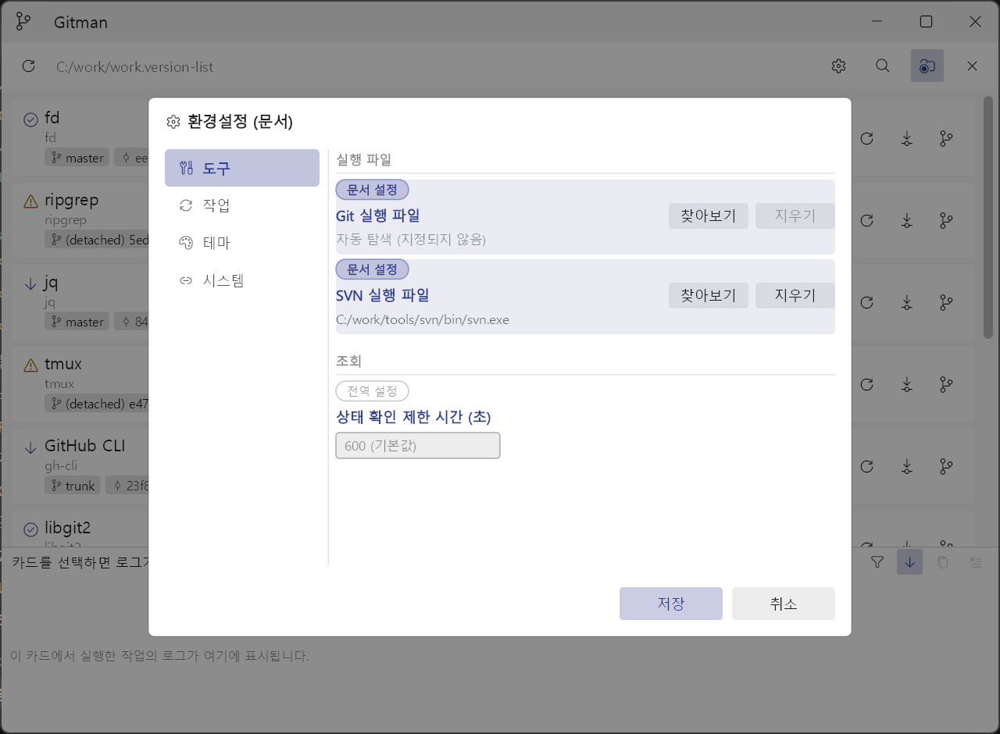

- **실행 파일** — `Git 실행 파일`, `SVN 실행 파일`. 각각 `찾아보기` / `지우기` 버튼이 있고, 값이 비어 있으면 `자동 탐색 (지정되지 않음)`으로 표시되며 `지우기`가 비활성입니다. 지정하려면 **절대 경로**여야 합니다.
- **문서가 적은 실행 파일의 신뢰** — 문서의 `settings.git_executable`·`svn_executable`(빈 값이 아닌 것)은 그 문서의 실행 파일을 신뢰한 뒤에만 씁니다. 남이 준 문서가 저장소 안의 프로그램을 가리켜 문서를 열기만 해도 실행되는 일을 막으려는 것입니다. 신뢰하지 않은 동안은 그 값을 적지 않은 것처럼 **전역 설정의 실행 파일**(비어 있으면 자동 탐색)을 쓰고, 상단 배너에 `문서가 지정한 Git 실행 파일을 쓰지 않았습니다`(둘 다면 `Git·SVN`)를 띄웁니다. 배너 툴팁에 경로와 신뢰하는 길이 나옵니다.
  - 신뢰하는 길은 둘입니다. 도구 막대 우클릭 → `문서 실행 파일 신뢰…`에서 경로를 확인하고 `신뢰`를 누르거나, 이 탭에서 그 실행 파일을 `찾아보기`로 다시 고르고(또는 `지우기`) 저장합니다. 이 창에서 고른 경로는 사용자가 고른 값이라 바로 신뢰합니다. 다만 고르지 않은 다른 실행 파일이 아직 신뢰하지 않은 남의 값이면 둘 다 쓰지 않습니다(신뢰는 두 경로를 함께 봅니다).
  - 신뢰는 `gitman.app-settings.json`의 `trusted_vcs_executables`에 문서 경로와 두 경로의 해시로 기록합니다. 문서의 경로를 손으로 바꾸거나 `git pull`로 바뀌면 다시 신뢰해야 쓰고, 같은 문서를 다른 경로로 열어도 다시 신뢰해야 합니다. 저장소 등록이나 기능 버튼 변경은 이 신뢰를 풀지 않습니다. 신뢰는 실행 파일의 내용을 확인하지 않습니다.
  - 빈 값(`""`, "이 문서는 자동 탐색")과 전역 설정의 경로는 신뢰 없이 씁니다.
  - 신뢰하지 않아 쓰지 않는 문서의 경로도 이 탭의 그 행에는 보입니다. 그때는 값 끝에 `· 신뢰하지 않아 쓰지 않음`이 붙습니다. 여기서 고르거나 지우면 이 표시는 사라집니다.
- **조회** — `상태 확인 제한 시간 (초)`. 숫자만 4자리까지 받으며 비우면 `600 (기본값)`. 범위(10~3600)를 벗어나면 `제한 시간은 10~3600초 사이여야 합니다.`가 뜨고 저장 버튼이 비활성화됩니다. 이 값은 **로컬·원격 조회에 함께** 적용되며 업데이트에는 적용되지 않습니다(업데이트는 무제한).

> **업그레이드 뒤 바뀌는 동작.** 이 버전 전에는 문서에 적은 실행 파일을 확인 없이 썼습니다. 문서에 Git·SVN 실행 파일을 적어 쓰던 문서는 이 버전에서 처음 열 때 신뢰 기록이 없으므로 그 경로를 쓰지 않고 전역 설정의 실행 파일이나 자동 탐색으로 조회합니다. 상단 배너의 알림을 보고 한 번 신뢰하면 전처럼 씁니다. 자동 탐색으로 찾지 못하면 카드가 도구를 찾을 수 없다고 표시할 수 있습니다.

### 13.2 작업 탭

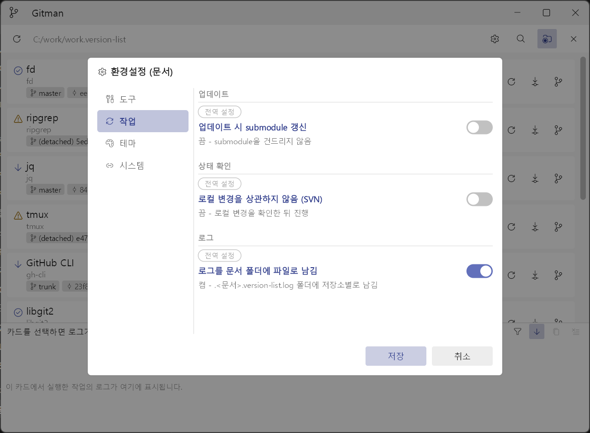

| 항목 | 끔 | 켬 |
| --- | --- | --- |
| `업데이트 시 submodule 갱신` | `끔 - submodule을 건드리지 않음` | `켬 - git pull --recurse-submodules=on-demand` |
| `로컬 변경을 상관하지 않음 (SVN)` | `끔 - 로컬 변경을 확인한 뒤 진행` | `켬 - status 확인 없이 깨끗하다고 믿고 진행` |
| `로그를 문서 폴더에 파일로 남김` | `끔 - 화면 로그만 유지` | `켬 - .<문서>.version-list.log 폴더에 저장소별로 남김` |

`로컬 변경을 상관하지 않음`을 켜면 SVN 저장소에서 로컬 변경 확인(`status`)을 건너뛰고 깨끗하다고 믿은 채 진행합니다. 조회가 매우 느린 대형 SVN 작업 복사본을 위한 옵션이며, 이 설정으로 실행하면 로그에 다음 안내가 남습니다.

> 로컬 변경을 상관하지 않는 설정으로 실행했습니다. 실패나 충돌이 커밋하지 않은 로컬 변경 때문일 수 있으니 작업 복사본을 직접 확인해 주세요.

### 13.3 테마 탭

섹션이 세 개입니다 — `테마`, `키 컬러`, `글꼴`. 자세한 내용은 [14장](#14-테마-키-컬러-글꼴)에 있습니다.

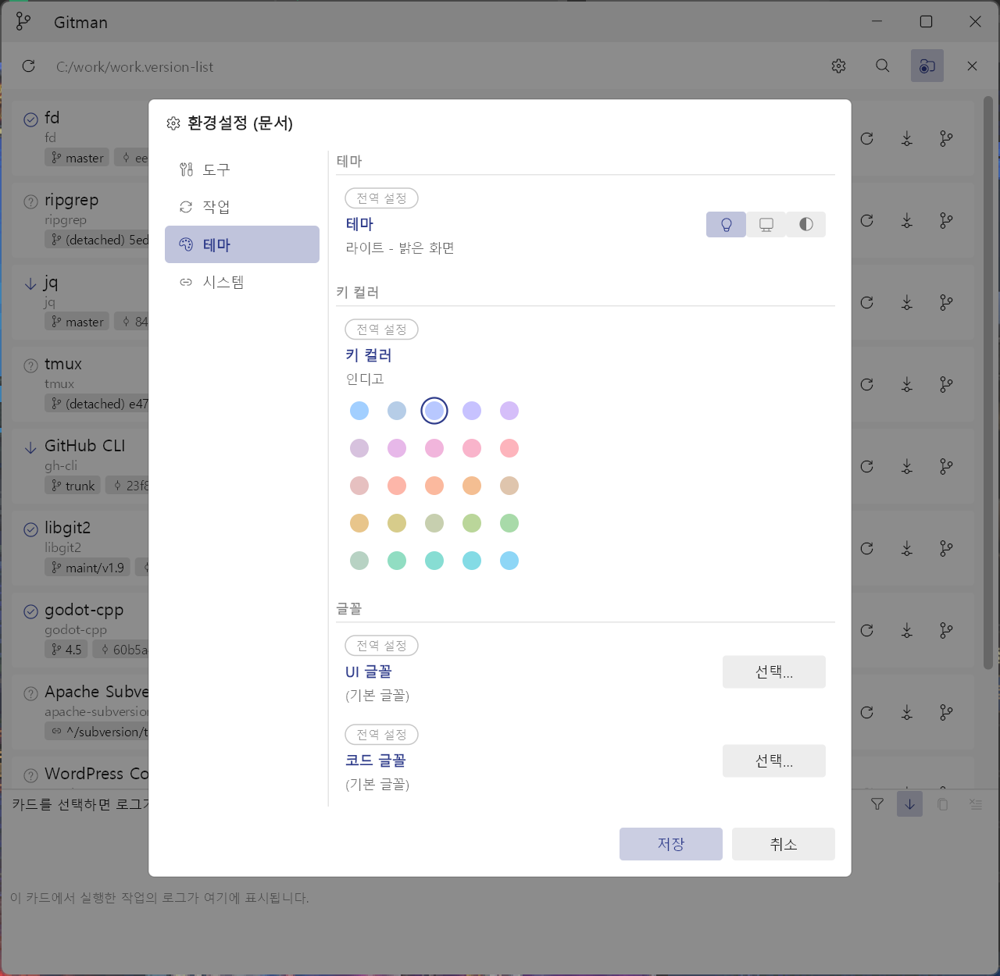

### 13.4 시스템 탭

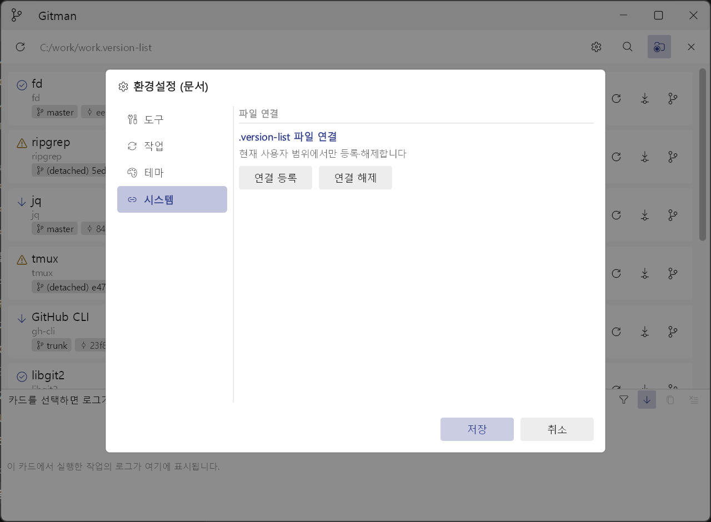

`.version-list 파일 연결` — `현재 사용자 범위에서만 등록·해제합니다` 라는 설명과 함께 `연결 등록` / `연결 해제` 버튼이 있습니다. 앱 수준 동작이라 배지 줄이 없고, 결과는 Windows 기본 MessageBox가 아니라 앱 스타일 알림 창으로 표시됩니다.

### 13.5 범위 배지 — 문서 설정 vs 전역 설정

문서를 연 상태에서는 각 항목 제목 위에 배지가 붙습니다.

| 배지 | 뜻 | 누르면 |
| --- | --- | --- |
| `문서 설정` (강조색 배경) | 이 문서가 전역 설정을 덮어쓰고 있음 | 문서의 정의를 지우고 다시 전역 설정을 따릅니다 |
| `전역 설정` (흐린 테두리) | 전역 값을 그대로 따르는 중 | 아무 일도 하지 않습니다 (툴팁만) |

툴팁은 각각 `이 문서가 전역 설정을 덮어쓰고 있습니다. 클릭하면 삭제하고 전역 설정을 따릅니다.` / `앱 전역 설정을 따릅니다. 값을 바꾸면 이 문서만의 설정이 됩니다.` 입니다.

문서 모드에서 어떤 값을 건드리면 그 항목이 자동으로 "문서에 정의됨"이 됩니다. 덮어쓴 항목에는 옅은 키 컬러 블록이 깔립니다. 전역 모드에는 배지 줄 자체가 없습니다.

### 13.6 창이 낮을 때 — 항목 열 스크롤

창 높이가 모자라면 **오른쪽 항목 열만 스크롤됩니다.**

- 왼쪽 탭 rail, 제목, 메시지 줄, `저장`·`취소` 버튼은 **제자리에 남습니다.** 창이 낮아도 탭을 옮길 수 있고 저장 버튼이 화면 밖으로 밀리지 않습니다.
- 스크롤 막대는 **항목 열 오른쪽**에, 내용이 넘칠 때만 생깁니다. 막대가 보이면 항목 열이 그만큼 좁아집니다.
- 휠로 굴리고 막대를 끌 수 있습니다. 양 끝에서 멈추고, **탭을 옮기면 스크롤 위치가 맨 위로 돌아갑니다.**
- 스크롤 한계는 **지금 보고 있는 탭**의 내용으로 그때그때 다시 계산합니다. 짧은 탭에는 막대가 아예 없고 휠도 아무 일도 하지 않습니다. dialog 크기는 탭이 바뀌어도 그대로입니다.
- 잘려서 보이지 않는 컨트롤은 눌리지도 않습니다.
- 글꼴 선택 창이 위에 떠 있으면 휠은 그쪽이 가져갑니다.
- 환경설정과 전환 창은 창 위아래에 **24 논리 픽셀의 여백**을 남깁니다. 창이 아주 낮으면 창을 없애기보다 여백부터 줄입니다.

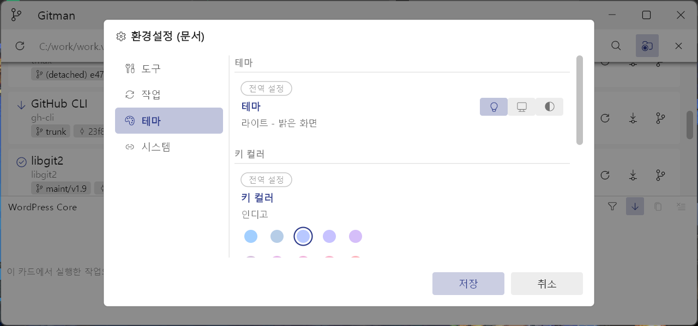

### 13.7 저장과 취소

- 모든 항목이 **초안**입니다. `저장`을 눌러야 파일에 반영되고, `취소`는 초안을 버립니다. 고친 것이 없으면 `저장` 버튼은 비활성입니다.
- 테마·키 컬러·글꼴만 예외적으로 **고르는 즉시 화면에 미리 보입니다.** `취소`로 닫으면 원래대로 돌아갑니다.
- 저장 후 유효 설정이 실제로 바뀐 경우에만 카드를 다시 조회합니다.
- 탭을 옮겨도 다른 탭에서 고친 값은 유지됩니다.

---

## 14. 테마, 키 컬러, 글꼴

세 가지 모두 환경설정의 `테마` 탭에 있고, 셋 다 **문서가 열려 있으면 문서 설정, 없으면 전역 설정**을 편집합니다. 고르면 즉시 미리 보이고 `저장`을 눌러야 남습니다.

### 14.1 테마

아이콘 세 개가 붙은 세그먼트 토글입니다. 왼쪽부터 `라이트 - 밝은 화면`, `시스템 - Windows 앱 모드를 따름`, `다크 - 어두운 화면`이며, 현재 값이 강조되고 아래에 설명 한 줄이 나옵니다.

적용 우선순위는 **고대비 → 라이트/다크 명시값 → 시스템 설정** 입니다. Windows 고대비 모드에서는 키 컬러를 무시하고 흰색을 씁니다.

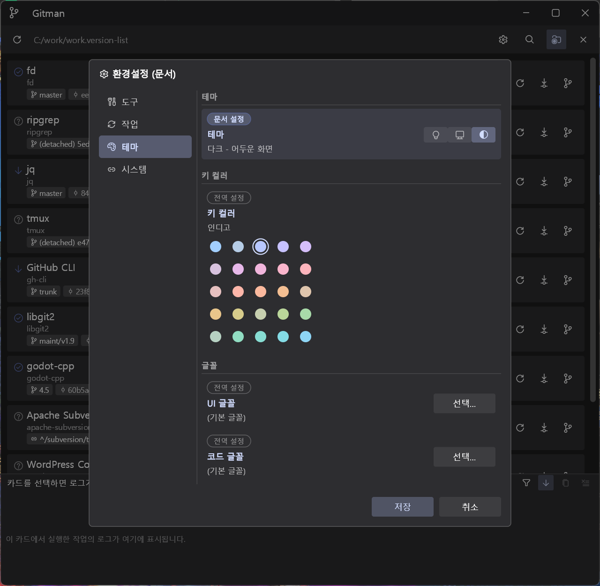

### 14.2 키 컬러 25색

5 × 5 색 동그라미 격자입니다. 현재 색에만 테두리 링이 있고, **격자 바로 위에 현재 색 이름**이 표시됩니다. 기본값은 **민트(`mint`)** 입니다.

| 줄 | 색 |
| --- | --- |
| 1 | 블루(blue) · 슬레이트(slate) · 인디고(indigo) · 바이올렛(violet) · 라벤더(lavender) |
| 2 | 모브(mauve) · 오키드(orchid) · 마젠타(magenta) · 핑크(pink) · 로즈(rose) |
| 3 | 로즈우드(rosewood) · 살몬(salmon) · 코럴(coral) · 피치(peach) · 모카(mocha) |
| 4 | 앰버(amber) · 레몬(lemon) · 올리브(olive) · 라임(lime) · 그린(green) |
| 5 | 세이지(sage) · **민트(mint)** · 티얼(teal) · 아쿠아(aqua) · 스카이블루(skyblue) |

키 컬러는 카드 상태 아이콘, 선택 테두리, 드래그 강조, SVN 현재 위치 표시, 체크박스·입력 칸 초점, 토글, 선택 행·배지·강조 버튼에 쓰입니다. 알 수 없는 값이 저장되어 있으면 `mint`로 물러서고 저장값은 지우지 않습니다.

### 14.3 글꼴

항목이 둘입니다.

| 항목 | 적용 범위 | 툴팁 |
| --- | --- | --- |
| `UI 글꼴` | 창의 모든 글자 — 카드, 대화 상자, 도구 막대 | `창 전체에 쓸 글꼴을 고릅니다` |
| `코드 글꼴` | **로그 창 본문**과 **로컬 변경 창의 diff 본문** | `로그와 diff 본문에 쓸 글꼴을 고릅니다` |

명령 출력과 diff는 열이 맞아야 읽히기 때문에 따로 고를 수 있습니다.

각 항목 오른쪽의 `선택…` 버튼을 누르면 `UI 글꼴 선택` / `코드 글꼴 선택` 창이 열립니다.

- 맨 위에 전환 창과 같은 막대가 있습니다. 갱신 버튼, 필터 칸(placeholder `글꼴 이름으로 거르기`, 툴팁 `이름의 일부를 입력해 글꼴을 거릅니다`), 지우기 `✕`(`필터를 지웁니다`).
- 목록의 첫 항목은 **`(기본 글꼴)`** 이며 고르면 내장 글꼴을 씁니다. 그 아래로 설치된 글꼴이 이름 순으로 서고, **각 행이 그 글꼴 자체로 그려집니다.**
- 아래 미리 보기 상자의 예문은 `다람쥐 헌 쳇바퀴에 타고파 Illegal1O0 {}();` 이며 끝에 이모지 한 자가 붙습니다. 한글·숫자·기호·이모지를 한 번에 확인할 수 있고, 한글 글리프가 없는 글꼴은 여기서 두부(□)로 보입니다.
- 버튼은 `선택` · `취소`. **`선택`을 눌러야** 환경설정 쪽 값이 바뀝니다.
- 이름이 맞는 글꼴이 없으면 `이름이 맞는 글꼴이 없습니다.`, 시스템 글꼴을 읽지 못하면 `시스템 글꼴 목록을 읽지 못했습니다.`

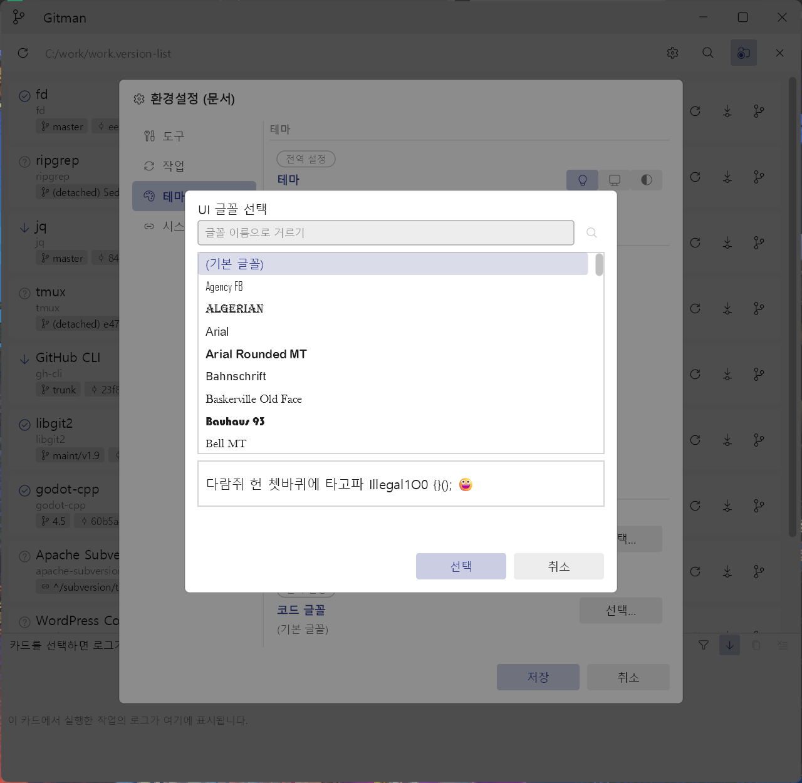


**기본값과 글꼴 대체**

- 기본값은 **빈 이름 = 내장 글꼴**입니다.
- 설정에 저장된 글꼴이 이 PC에 없으면 **조용히 내장 글꼴로 돌아가고 설정 파일은 건드리지 않습니다.** 다른 PC에서 열었다가 돌아올 수 있기 때문입니다.
- **고른 글꼴에 없는 글자는 시스템이 고른 다른 글꼴로 그립니다.** 규칙은 하나 — 고른 글꼴이 그릴 수 있으면 고른 글꼴로 그립니다. 그래서 한글 뒤의 영문이 원래 글꼴로 돌아오고, 공백은 코드 글꼴의 열을 유지합니다.
- 덕분에 한글 글리프가 전혀 없는 `Cascadia Code` 같은 글꼴을 코드 글꼴로 써도 한글이 정상으로 나옵니다. 대체할 글꼴조차 없으면 빈 네모가 보입니다.

**전역과 문서**

- 문서를 연 상태에서 글꼴을 고치면 그 행에 `문서 설정` 배지가 붙고, 배지를 누르면 다시 앱 설정을 따릅니다.
- **빈 이름도 하나의 정의**입니다. `""` 는 "이 문서는 내장 글꼴을 쓴다"는 뜻이고, "앱 설정을 따른다"(키 없음)와 다릅니다.
- 기존 문서에는 `fonts` 키가 없으므로 지금까지와 똑같이 앱 설정을 따릅니다.


코드 글꼴을 바꾸면 로그 창과 diff 본문만 그 글꼴로 바뀝니다. 카드·도구 막대 같은 나머지 화면은 UI 글꼴 그대로입니다.

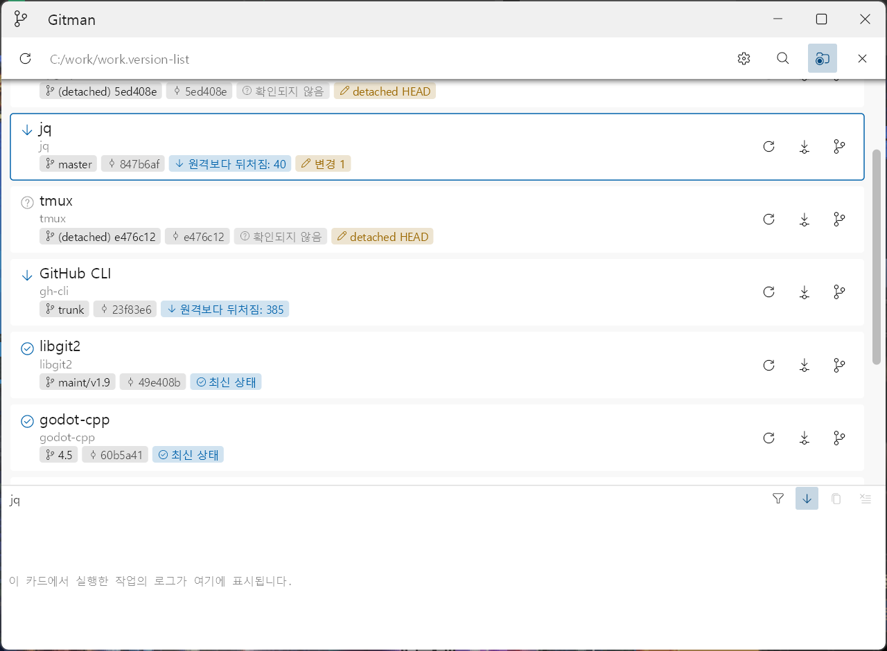

---

## 15. 텍스트 입력과 편집

창 안의 텍스트 칸(환경설정의 제한 시간, 전환 창의 질의 막대, 글꼴 창의 필터, 새 문서 만들기의 이름, 기능 편집 창의 다섯 칸)은 모두 같은 규칙을 씁니다.

### 15.1 마우스

| 조작 | 결과 |
| --- | --- |
| 클릭 | 그 자리에 커서 |
| 끌기 | 범위 선택 |
| Shift+클릭 | 선택 확장 |
| 더블 클릭 | 낱말 선택 |
| 세 번 클릭 | 전체 선택 |

### 15.2 키보드

| 키 | 동작 |
| --- | --- |
| `←` / `→` | 한 글자 이동 |
| `Ctrl+←` / `Ctrl+→` | 낱말 단위 이동 |
| 위 조합 + `Shift` | 선택 확장 |
| `Home` / `End` | 줄 처음 / 끝 (`Shift`로 확장) |
| `Backspace` / `Delete` | 앞 / 뒤 한 글자 지우기 |
| `Ctrl+Backspace` / `Ctrl+Delete` | 앞 / 뒤 낱말 지우기 |
| `Ctrl+A` | 전체 선택 |
| `Ctrl+C` / `Ctrl+Insert` | 복사 |
| `Ctrl+X` / `Shift+Delete` | 잘라내기 |
| `Ctrl+V` / `Shift+Insert` | 붙여넣기 |
| `Ctrl+Z` | 실행 취소 |
| `Ctrl+Y` / `Ctrl+Shift+Z` | 다시 실행 |

- 낱말 경계는 Windows 관례를 따릅니다. 영숫자와 한글 등이 낱말 문자, 나머지가 구분자입니다. `origin/feature-a`에서 `Ctrl+Backspace`는 먼저 `a`, 다음에 `feature-`를 지웁니다.
- **실행 취소는 연속으로 친 글을 한 덩어리로 묶습니다.** 커서를 옮기거나 선택을 하면 덩어리가 끊깁니다.
- 선택한 상태에서 글을 치면 선택이 대체됩니다.
- 글이 칸보다 길면 `…`로 자르지 않고 **가로로 스크롤**해 커서 주변을 보여 줍니다.
- **붙여넣기는 첫 줄만** 씁니다. 여러 줄을 붙여 넣으면 나머지는 버립니다.
- 숫자만 받는 칸은 환경설정의 제한 시간(4자리)과 기능 편집 창의 제한 시간(5자리)입니다.

### 15.3 한글 입력

한글 조합이 **텍스트 칸 안에서** 이루어집니다. 예전처럼 시스템이 별도 창에 그리지 않습니다.

- 조합 중인 구간에 **강조색 밑줄**이 그려지고, 한자 변환 등 후보 창이 조합 글자 바로 밑에 붙습니다.
- IME의 재변환·자동 수정·필기·음성 입력도 그대로 쓸 수 있습니다.
- **필터와 검증은 확정된 글만 봅니다.** `ㅎ` → `하` → `한` 을 칠 때마다 목록이 튀지 않습니다.
- **조합 한 번이 실행 취소 한 덩어리**입니다. 확정한 뒤 `Ctrl+Z` 한 번이면 조합 전체가 되돌아갑니다.
- 조합 중에는 선택 띠를 그리지 않고 포인터로 커서를 옮기지도 않습니다.

### 15.4 이모지

`Win` + `.` 이모지 패널로 넣은 문자가 정상 입력됩니다. `←`/`→`가 이모지를 통째로 넘고 `Backspace`도 통째로 지웁니다. 화면에 나오는 모양은 글꼴 대체가 정합니다. 글꼴 선택 창의 미리 보기에서 확인한 바로는 **컬러 이모지가 그대로 나옵니다.**

---

## 16. 창 배치와 경로 표시

### 16.1 창 크기와 위치

| 상황 | 어디에 저장되나 |
| --- | --- |
| 문서 없이 창을 옮기거나 크기를 바꿈 | 앱 설정(`gitman.app-settings.json`) |
| 문서를 연 상태에서 바꿈 | **그 문서에만** 저장 (앱 설정은 그대로) |
| 문서를 여는 순간 | 직전 배치를 앱 설정에 한 번 기록하고, 문서의 배치를 창에 적용 |
| 문서를 닫음 | 앱 설정의 크기·위치로 돌아감 |

복원 우선순위는 **여는 문서의 배치 > 앱 설정 배치 > 기본값** 입니다. 저장된 위치가 어떤 모니터와도 겹치지 않으면 위치는 버리고 크기만 적용합니다. 최소 창 크기는 480 × 320(논리 픽셀)입니다.

### 16.2 경로 표시

- 화면에 그리는 경로는 구분자를 모두 `/`로 통일합니다. 도구 막대의 문서 경로(`C:/work/work.version-list`), 카드 경로, 시작 페이지의 최근 항목, 환경설정의 실행 파일 경로가 모두 해당합니다. 저장·실행에 쓰는 경로는 Windows 원형 `\` 그대로입니다.
- 도구 막대의 루트 폴더 토글을 켜면 카드 경로가 **문서 폴더 기준 상대 경로**가 됩니다. 문서보다 위 폴더는 `..`, 같은 위치는 `.`이며, 드라이브나 공유가 다르면 전체 경로를 그대로 둡니다.
- 표시만 바뀌고 **문서의 `path` 값은 바뀌지 않습니다.**

---

## 17. 키보드

| 키 | 동작 |
| --- | --- |
| `F5` | 모든 카드를 원격까지 새로 고침 |
| `Enter` | 선택한 카드를 새로 고침. 컨텍스트 메뉴가 열려 있으면 강조 항목 실행. 전환 창의 입력 칸에 초점이 있으면 Git은 첫 후보 선택, SVN은 입력 경로로 이동 |
| `↑` / `↓` | 카드 선택 이동 (메뉴가 열려 있으면 메뉴 항목 이동). 선택이 화면 밖이면 자동 스크롤 |
| `Esc` | 열려 있는 것을 닫음 — 알림 → 컨텍스트 메뉴 → 그 밖의 창 순. 텍스트 칸에 초점이 있어도 글을 지우지 않고 창을 닫습니다. 드래그 중이면 드래그 취소 |
| `Shift+F10` | 선택한 카드의 컨텍스트 메뉴 (로컬 변경 확인·저장소 열기 등). 기능 줄 버튼에 초점이 있으면 그 기능의 배치 메뉴 |
| `Alt+1` / `Alt+2` / `Alt+3` | 초점 카드의 카드 배치 기능을 시작 ([12.10](#1210-키보드)) |
| `Alt+↓` | 초점 카드의 기능 메뉴 |
| `Alt+Space` | Windows 시스템 메뉴 |

기능 확인 창과 편집 창의 키는 [12.10](#1210-키보드)에 있습니다. 텍스트 칸 안에서 쓰는 편집 단축키는 [15.2](#152-키보드)에 있습니다. Page Up / Page Down / Home / End 로 카드 목록을 스크롤하는 기능은 제공하지 않습니다.

---

## 18. 문제 해결

| 증상 | 확인할 것 |
| --- | --- |
| `Git 명령줄 도구를 찾을 수 없습니다. 설치하거나 문서 settings에 경로를 지정하세요.` | Git이 `PATH`에 있는지, 또는 환경설정에서 절대 경로를 지정 |
| `설치된 Git이 지원 최소 버전보다 오래되었습니다.` | Git 2.43.0 이상 / SVN 1.14.5 이상으로 올리기 |
| `문서 settings에 지정한 Git 실행 파일 경로를 사용할 수 없습니다.` | 지정한 경로가 존재하는지. 지우면 자동 탐색으로 돌아갑니다 |
| `문서가 지정한 Git 실행 파일을 쓰지 않았습니다` | 문서에 적힌 실행 파일을 아직 신뢰하지 않았습니다. 그동안은 전역 설정의 실행 파일이나 자동 탐색으로 조회합니다. 믿는 문서면 도구 막대 우클릭 → `문서 실행 파일 신뢰…`로 신뢰하세요([13.1](#131-도구-탭)) |
| `인증이 필요하거나 자격 증명이 거부되었습니다.` | Gitman은 자격 증명을 묻지 않습니다. Git Credential Manager나 SVN 인증 캐시를 먼저 설정하세요 |
| 없는 원격인데 `저장소를 찾을 수 없습니다.` 로 나옴 | 자격 증명이 저장된 호스트에서는 credential helper가 응답해 인증 오류 대신 이 문구가 나옵니다 |
| `문서가 밖에서 바뀌어 저장하지 않았습니다. 문서 다시 읽기로 불러오십시오.` | 다른 프로그램이나 손 편집으로 문서가 바뀌어 방금 변경을 저장하지 않았습니다. 그 변경은 화면에만 있습니다. 도구 막대 우클릭 → `문서 다시 읽기`로 불러오면 그 뒤의 변경은 다시 저장됩니다. 다시 읽으면(닫거나 다른 문서를 열거나 끝내도) 저장하지 못한 변경이 사라지므로 먼저 확인을 받습니다([12.9](#129-문서-다시-읽기와-실행-중-확인)) |
| 닫기 버튼을 눌렀더니 `문서 저장 중` 창이 뜨고 `종료`를 누를 수 없음 | 방금 한 변경(카드 순서, 배치, 기능 편집 등)을 저장하는 중입니다. 끝나면 `종료`를 누를 수 있고, 저장하지 못했으면 `버리고 종료`로 묻습니다. 5초가 지나도 끝나지 않으면 `기다리지 않고 종료`를 누를 수 있습니다 — 문서 폴더(네트워크 드라이브 등)에 쓰기가 늦은지 확인하세요([12.9](#129-문서-다시-읽기와-실행-중-확인)) |
| 문서 닫기·다른 문서 열기가 바로 되지 않음 | 진행 중인 저장의 결과를 기다립니다. 저장에 실패하면 `저장하지 못한 변경` 창이 뜹니다([12.9](#129-문서-다시-읽기와-실행-중-확인)) |
| 확인 창의 `경고 args[N]이 부르는 배치 파일이 …` | 기능이 부르는 배치 파일에 지연 확장을 켜는 글(`EnableDelayedExpansion`, `cmd /v:on`)이나 `call`이 있거나, 파일을 읽지 못하거나 커서 확인하지 못했습니다. 아직 신뢰하지 않은 문서의 네트워크 경로 배치도 확인하지 못했다고 나옵니다. 배치가 넘긴 값을 그대로 쓰는지 확인한 뒤 `실행`을 누르세요([12.6](#126-허용-목록과-cmd-방어)) |
| `[이름] 배치 파일을 확인하지 못해 실행하지 않습니다` | 기능이 부르는 배치 파일을 5초 안에 읽지 못했습니다(닿지 않는 네트워크 경로, 앞선 느린 조회). 경로를 확인하고 다시 누르세요([12.6](#126-허용-목록과-cmd-방어)) |
| `[이름] 배치 파일을 확인하는 동안 실행 값이 바뀌어 실행하지 않습니다` | 배치 파일을 읽는 사이 브랜치나 작업 폴더 같은 값이 바뀌었습니다. 다시 누르세요 |
| 로그 파일 머리글 `# 문서:`에 `.log` 폴더 경로가 있음 | 예전 판이 남긴 파일입니다. 지금 판은 문서 경로를 적습니다([11](#11-로그-파일)) |
| `문서를 다시 읽지 못해 지금 문서를 그대로 둡니다.` | 다시 읽은 파일에 JSON 오류나 오류 진단이 있습니다. 사유는 상단 배너의 툴팁에 있습니다. 고친 뒤 다시 읽습니다 |
| `기능 버튼 경고 N건` | 문서의 `function_buttons`에 잘못된 항목이 있습니다. 상단 배너의 툴팁에 `function_buttons.buttons[2] ("빌드"): …`처럼 위치와 사유가 20건까지 나옵니다. 그 항목만 쓰지 않고 파일의 원문은 지우지 않습니다. 기능 편집 창의 경고 행에서도 볼 수 있습니다 |
| 기능 버튼이 비활성 | 버튼 툴팁이나 기능 메뉴의 이름 뒤에 사유가 있습니다([12.3](#123-실행과-표시)) |
| `[이름] 실행하지 않습니다: …` | 누른 순간의 검사(허용 목록, 작업 폴더, cmd 방어 — cmd 명령줄로 넘길 수 없는 줄바꿈, `${env:}`)에 걸렸습니다. cmd의 `% ! "`·메타 문자와 배치가 읽을 `GITMAN_*`의 메타 문자는 거부하지 않고 실행 전에 확인을 받습니다([12.6](#126-허용-목록과-cmd-방어)) |
| 기능이 `시간 초과(3600초)`로 끝남 | 출력을 로그로 받는 기능의 기본 제한 시간은 3600초입니다. `timeout_seconds`를 늘리거나 `0`(무제한)으로 둡니다 |
| Gitman을 다시 시작할 때마다 신뢰 확인이 뜸 | 앱 설정 파일(`gitman.app-settings.json`)에 쓸 수 없으면 그 실행 동안만 기억합니다. 정의나 저장소 경로를 바꿨거나 손 편집·`git pull`로 기능 이름·아이콘이나 카드에 보이는 기능이 바뀐 경우는 그 뒤 한 번만 다시 묻습니다([12.5](#125-신뢰-확인과-실행-전-확인)) |
| `작업공간 문서가 유효한 JSON이 아닙니다.` | JSON 문법 오류입니다. 원본은 덮어쓰지 않습니다 |
| `fonts는 object여야 합니다. 앱 설정의 글꼴을 사용합니다.` | 문서의 `fonts` 값이 object가 아닙니다. 문서는 정상적으로 열립니다 |
| 고른 글꼴이 적용되지 않음 | 그 글꼴이 이 PC에 없으면 조용히 내장 글꼴로 돌아갑니다. 설정 파일은 그대로이니 다른 PC에서는 다시 적용됩니다 |
| 글자가 `�` 로 보임 | 명령 출력·경로·설정 파일에 깨진 바이트가 있습니다. 앱이 죽지 않고 이 문자로 대신 표시합니다 |
| 문서에 적어 둔 설정이 사라짐 | 환경설정 창에서 건드린 적 없는 항목은 저장 시 제거되고 전역 설정을 따릅니다 |
| 로그 폴더가 안 생김 | 조회가 모두 성공하면 남길 record가 없어 폴더를 만들지 않습니다. 환경설정의 로그 토글과 폴더 쓰기 권한도 확인 |
| 조회가 자주 시간 초과됨 | `상태 확인 제한 시간`을 올리세요(최대 3600초). SVN이라면 `로컬 변경을 상관하지 않음`도 고려 |
| 파일 연결이 동작하지 않음 | 실행 파일을 옮겼다면 `--register-file-association` 재실행. 탐색기의 UserChoice가 우선합니다 |

오류 분류는 로캘에 의존하지 않는 신호(SVN `E<숫자>` 코드, libcurl/OpenSSH 원문, HTTP 상태 번호)로 판단합니다. Git·SVN 자체 메시지는 시스템 언어로 나올 수 있습니다. URL에 포함된 사용자 정보나 토큰은 로그에서 마스킹됩니다.

---

## 19. 데이터 위치 · 업그레이드 · 제거

### 저장 위치

| 데이터 | 위치 |
| --- | --- |
| 프로젝트 목록, 문서 설정, 문서별 테마·키 컬러·글꼴, 창 배치, 기능 버튼과 변수(`function_buttons`) | 사용자가 만든 `<이름>.version-list` |
| 최근 문서 목록, 전역 설정·외양·글꼴, 문서 없을 때의 창 배치, 신뢰한 기능 정의(`trusted_function_definitions`, 문서 경로와 해시), 신뢰한 문서 실행 파일(`trusted_vcs_executables`, 문서 경로와 해시) | `gitman.exe`와 같은 폴더의 `gitman.app-settings.json` |
| 화면 로그 | 메모리 전용 (카드당 1,000 record) |
| 파일 로그 | 문서 폴더의 `.<이름>.version-list.log\<저장소>\<타임스탬프>.log` |
| 파일 연결 | `HKCU\Software\Classes` (등록한 경우만) |

### 업그레이드

새 `gitman.exe`로 기존 파일을 덮어쓰면 끝입니다. 문서 스키마는 버전 1을 유지하며 구버전 문서도 그대로 열립니다. 실행 파일 경로가 바뀌었다면 파일 연결을 다시 등록하세요.

문서의 `settings`에 Git·SVN 실행 파일을 적어 쓰던 문서는 업그레이드 뒤 처음 열 때 그 경로를 쓰지 않고 상단 배너로 알립니다. 한 번 신뢰하면 전처럼 씁니다([13.1](#131-도구-탭)). 카드에 올린 기능이 있는 문서는 처음 누를 때 기능 신뢰를 한 번 다시 묻습니다(카드에 보이는 기능과 순서가 신뢰 해시에 들어갔기 때문입니다).

`function_buttons`를 적은 문서를 기능 버튼이 없던 구버전 Gitman으로 열면 알 수 없는 필드 경고가 한 건 붙지만 문서는 열리고, 그 키는 저장 뒤에도 보존됩니다.

### 제거

1. (등록했다면) `gitman.exe --unregister-file-association`
2. `gitman.exe` 삭제
3. `gitman.app-settings.json` 삭제
4. `.version-list` 문서와 `.<이름>.version-list.log` 폴더는 사용자 데이터이므로 필요할 때 직접 삭제

이외의 잔여물(레지스트리, AppData, 서비스)은 없습니다.

### 문서 저장 방식

임시 파일에 쓰고 flush한 뒤 **원자적으로 교체**합니다. 저장 중 중단되면 원본이 그대로 남습니다. `.bak` 백업 파일은 만들지 않습니다. 다른 프로그램이 동시에 수정하면 revision 비교로 감지해 덮어쓰지 않습니다. **알 수 없는 필드는 그대로 보존합니다.**

---

## 20. 알려진 제한

- 환경설정 창은 **세로만** 대응합니다. 창 **폭**이 600 논리 픽셀보다 좁으면 항목이 가로로 넘칩니다.
- 낮은 창 대응(여백·스크롤)은 환경설정과 전환 창에만 들어갔습니다. 글꼴·탐색·로컬 변경·새 문서·알림 창은 창이 아주 낮으면 여전히 깨집니다.
- 한글 조합 중에는 조합 구간 안을 포인터로 찍어 커서를 옮길 수 없고, 밑줄은 한 종류뿐입니다. 글이 칸을 넘겨 가로 스크롤된 뒤에는 후보 창이 조금 왼쪽에 뜹니다.
- 네트워크 드라이브와 매우 느린 경로에서의 탐색·조회는 검증하지 않았습니다.
- 커밋·푸시·병합·리베이스·충돌 해결·대화형 셸·자격 증명 저장·깊이 2 이상 자동 탐색은 Gitman 자신의 동작으로 지원하지 않습니다. 기능 버튼으로 실행한 사용자 프로그램이 하는 일은 Gitman이 막거나 해석하지 않습니다.
- 로그 파일은 자동으로 정리되지 않습니다.
- 카드 목록을 Page Up/Down, Home/End로 스크롤할 수 없습니다.
- 카드 정렬 기능은 없습니다. 순서는 드래그로만 바꿉니다.
- 기능 버튼:
  - 기능 메뉴에는 스크롤이 없습니다. 그래서 기능 메뉴는 기능을 12개까지, 카드 우클릭 메뉴는 8개까지만 싣고 나머지는 `기능 더 보기…`로 엽니다. 이 수는 1366×768을 125%로 쓰는 화면(작업 표시줄 기본 높이)에 메뉴 전체가 들어가게 정했고, 1920×1080을 200%로 쓰는 화면이나 1366×768을 150%로 쓰는 화면에도 들어갑니다. 그보다 작업 영역이 낮으면(작업 표시줄을 크게 키웠거나 1366×768을 175% 이상으로 쓰는 등) 카드 우클릭 메뉴의 아래쪽(`기능 더 보기…`, `기능 편집…`)이 화면 밖으로 잘릴 수 있습니다. 그때는 `⋯` 기능 메뉴나 도구 막대 우클릭 메뉴를 씁니다.
  - 출력을 로그로 받는 기능이 `start` 같은 방법으로 띄운 손자 프로세스가 중지·종료 때 함께 정리되는지는 확인하지 않았습니다. 출력 파이프를 물려받은 손자가 남으면 기능이 끝난 뒤 잠시 기다렸다가 그 프로세스들을 끝내고 수집을 마감하며, 로그에 그 사유가 한 줄 남습니다.
  - 따로 실행으로 콘솔 프로그램을 띄우면 새 콘솔 창이 뜹니다. 기본 터미널이 Windows 터미널인 PC에서 Windows 터미널 창이 뜨고 프로그램이 끝나면 닫히는 것을 확인했습니다. 기본 터미널이 콘솔 호스트(conhost)인 경우는 확인하지 않았습니다.
  - PowerShell `-File` 스크립트의 한글 출력은 한국어 Windows(코드 페이지 949)에서 깨지지 않는 것을 확인했습니다. 다른 코드 페이지는 확인하지 않았습니다.
  - `Alt+1`~`Alt+3`이나 `Alt+↓`을 누른 뒤 `Alt`를 떼도 창이 메뉴 모드로 들어가지 않는 것을 확인했습니다(바로 이어 누른 `Alt+2`도 실행됨). 그때 경고음이 나는지는 확인하지 않았습니다.
  - 카드의 `⋯`에 초점을 두고 `Enter`를 길게 누르면, 자동 반복된 `Enter`가 열린 기능 메뉴의 첫 활성 기능을 바로 실행할 수 있습니다(코드로 본 것이고 재현하지 않았습니다). 신뢰한 정의이고 `confirm`을 켜지 않은 기능이면 확인 없이 프로그램이 시작됩니다. `⋯`에서는 `Enter`를 한 번만 누릅니다.
  - 기능 실행 중 문서 닫기와 창 닫기의 확인 창, 기능 줄·배치 메뉴·편집 창은 기본 테마와 기본 글자 크기에서 확인했습니다. `Alt+F4`·작업 표시줄 닫기의 확인 창, 글자 크기 150%·어두운 테마·고대비에서의 모양은 아직 눈으로 확인하지 않았습니다.
  - 편집 창에서 사용자 변수는 읽기만 합니다. 문서 JSON에서 고칩니다. 텍스트 칸에 초점이 있을 때 `Alt+↑`/`Alt+↓`로 순서가 바뀌는지는 아직 확인하지 않았습니다.
  - 문서를 다시 읽으면 카드 상태와 로그가 처음부터 시작합니다.

---

## 부록 A. `.version-list` 스키마

### 최상위

| 필드 | 타입 | 설명 |
| --- | --- | --- |
| `schema_version` | 정수 | **필수.** 현재 `1` |
| `projects` | 배열 | **필수.** 카드 표시 순서 = 배열 순서 |
| `settings` | object | 선택. 문서 수준 환경설정 (아래) |
| `appearance` | object | 선택. `{ "theme": "system|light|dark", "accent": "<색 id>" }` |
| `fonts` | object | 선택. `{ "ui": "<글꼴 이름>", "code": "<글꼴 이름>" }` |
| `window` | object | 선택. `x`, `y`, `width`, `height`, `maximized`. 문서를 열고 창을 옮기면 자동으로 추가됩니다 |
| `function_buttons` | object | 선택. 기능 버튼과 변수 ([아래](#function_buttons), [12장](#12-기능-버튼)) |

### `settings`

정의하지 않은 키는 앱 전역 설정을 따릅니다.

| 키 | 타입 | 기본값 | 설명 |
| --- | --- | --- | --- |
| `git_executable` | 문자열 | `""` | 빈 값이면 자동 탐색. 지정 시 **절대 경로**. 지정한 경로는 그 문서의 실행 파일을 신뢰한 뒤에만 씁니다([13.1](#131-도구-탭)) |
| `svn_executable` | 문자열 | `""` | 위와 같음 |
| `query_timeout_seconds` | 정수 | `600` | 상태 확인 제한 시간. 10~3600 |
| `update_submodules` | boolean | `false` | 업데이트 시 submodule 함께 갱신 |
| `ignore_local_changes` | boolean | `false` | SVN에서 로컬 변경 확인을 건너뜀 |
| `write_log_files` | boolean | `true` | 문서 폴더에 로그 파일 남김 |
| `show_relative_paths` | boolean | `false` | 카드 경로를 문서 기준 상대 경로로 표시 |

### `fonts`

| 키 | 타입 | 기본값 | 설명 |
| --- | --- | --- | --- |
| `ui` | 문자열 | 키 없음 | 이 문서의 UI 글꼴 가족 이름 |
| `code` | 문자열 | 키 없음 | 이 문서의 코드 글꼴(로그·diff) 가족 이름 |

- **키가 없으면** 앱 설정을 따릅니다. **`""` 는 정의된 값**이며 "내장 글꼴을 쓴다"는 뜻입니다.
- 값이 문자열이 아니면 경고 하나를 남기고 앱 설정을 따릅니다. 문서 열기는 실패하지 않습니다.
- 앱 설정 파일에도 같은 이름의 `fonts` object가 있으며 기본값은 `{ "ui": "", "code": "" }` 입니다.

값이 범위를 벗어나거나 타입이 다르면 **경고 진단만 남기고 기본값을 씁니다.** 문서 열기는 실패하지 않습니다.

### `projects[]`

| 필드 | 타입 | 설명 |
| --- | --- | --- |
| `id` | 문자열 | **필수.** 문서 안에서 고유. 비어 있을 수 없음 |
| `path` | 문자열 | **필수.** 작업 복사본 경로. 상대 경로는 문서 폴더 기준 |
| `display_name` | 문자열 | 선택. 카드에 표시할 이름 |
| `vcs_hint` | 문자열 | 선택. `auto`(기본) / `git` / `svn` |
| `enabled` | boolean | 선택. `false`면 제외된 카드입니다. 카드는 보이지만 저장소를 조회하지 않고 업데이트·전환도 하지 않습니다. 화면에서 바꾸는 곳은 없고 문서에서 고칩니다 |
| `preferred_remote` | 문자열/null | 선택. remote가 여러 개일 때 비교 기준 |
| `svn_switch_targets` | 배열 | 선택. **보존만 하고 사용하지 않음**(구버전 호환) |

중복된 `id`나 중복된 경로는 **항목별 오류**로 보고되며, 나머지 유효한 항목은 정상 표시됩니다.

### `function_buttons`

| 키 | 타입 | 설명 |
| --- | --- | --- |
| `variables` | object | 선택. 문서 변수 `{ "이름": "값" }` |
| `project_variables` | object | 선택. 저장소별 덮어쓰기 `{ "<저장소 id>": { "이름": "값" } }` |
| `buttons` | 배열 | 선택. 기능 버튼 목록. 배열 순서가 카드 버튼·기능 줄·메뉴의 순서입니다 |

`buttons[]`의 필드:

| 필드 | 타입 | 기본값 | 설명 |
| --- | --- | --- | --- |
| `id` | 문자열 | — | **필수.** 영문 소문자·숫자·`_`·`-`로 64자까지. 문서 안에서 고유하며 같은 id가 또 나오면 뒤의 것을 쓰지 않습니다 |
| `label` | 문자열 | — | **필수.** 비지 않은 이름. 40자를 넘으면 경고만 하고 말줄임합니다 |
| `icon` | 문자열 | `play` | 아이콘 이름([12.8](#128-기능-편집-창)의 표). 표에 없으면 `play`로 그리고 경고하지 않습니다 |
| `program` | 문자열 | — | **필수.** 실행 파일. 변수를 쓸 수 있고, 푼 결과가 허용 목록([12.6](#126-허용-목록과-cmd-방어))을 지켜야 합니다 |
| `args` | 문자열 배열 | `[]` | 원소 하나가 인자 하나 |
| `cwd` | 문자열 | `${projectRoot}` | 작업 폴더. 푼 결과가 절대 경로여야 합니다 |
| `mode` | 문자열 | `capture` | `capture`(출력을 로그로 받기) / `detached`(따로 실행) |
| `vcs` | 문자열 | 없음(모두) | `git` / `svn`. 그 종류의 저장소에만 적용 |
| `project_ids` | 문자열 배열 | 없음(모두) | 적용할 저장소 `id` 목록. 빈 배열이면 어디에도 적용되지 않습니다. 카드 목록에 없는 id는 경고만 합니다 |
| `confirm` | boolean | `false` | 실행 전에 명령줄을 보이고 확인 |
| `timeout_seconds` | 정수 | `3600` | 0~86400. `0`은 무제한. `capture`에서만 쓰고 `detached`에 적으면 경고만 합니다 |
| `placement` | 문자열 | `menu` | `card` / `bar` / `menu`([12.2](#122-배치--카드--기능-줄--메뉴만)). 4번째 `card`와 그 밖의 값은 경고하고 `bar`로 보입니다 |

- 잘못된 항목은 **그 항목만** 경고하고 쓰지 않습니다. 문서, 카드, 나머지 버튼은 그대로이고, 파일의 원문도 저장 뒤에 남습니다. 버튼의 첫 사유 하나만 경고합니다.
- `placement`는 어떤 값이든 버튼을 건너뛰게 하지 않습니다. 그 밖의 필드는 타입이나 값이 틀리면 그 버튼을 건너뜁니다.
- 변수 문법이 틀렸거나(`${`가 닫히지 않음, 빈 이름) 어디에도 정의되지 않은 사용자 변수를 쓰는 버튼, 변수 없는 `program`이 허용 목록에 걸리는 버튼도 읽을 때 건너뜁니다.
- 알 수 없는 키는 경고하고 그대로 보존합니다(버튼 안과 `function_buttons` 바로 아래 모두).
- `function_buttons`가 object가 아니면 경고 하나를 내고 기능 버튼 없이 엽니다. `variables`·`project_variables`가 object가 아니거나 `buttons`가 배열이 아니면 그 부분만 비어 있는 것으로 읽습니다. `null`은 키가 없는 것과 같습니다.
- 기능 버튼의 진단은 모두 경고라 문서 저장을 막지 않습니다. 상단 배너에는 `기능 버튼 경고 N건` 하나로 묶여 나옵니다.

---

## 부록 B. 빠른 참조

| 하고 싶은 것 | 방법 |
| --- | --- |
| 새 작업공간 만들기 | 시작 페이지 → `새 문서 만들기…` |
| 저장소 추가하기 | 도구 막대 돋보기 → 스캔 폴더 선택 → 체크 → 등록 |
| 전체 상태 확인 | `F5` 또는 도구 막대 왼쪽 끝 새로 고침 |
| 한 저장소만 확인 | 카드 선택 후 `Enter`, 또는 카드의 새로 고침 버튼 |
| 최신으로 당겨오기 | 카드의 업데이트 버튼 (Git `pull --ff-only` / SVN `update`) |
| 브랜치·URL 바꾸기 | 카드의 전환 버튼 |
| 브랜치가 많을 때 찾기 | 전환 창의 필터 칸에 이름 일부를 치고 `Enter` |
| SVN에서 특정 경로로 바로 가기 | 전환 창 주소 칸에 `/branches/…` 를 치고 `Enter` |
| 새로 만든 SVN branch 보기 | 전환 창의 갱신 버튼 (창을 닫지 않아도 됨) |
| 무엇이 바뀌었는지 보기 | 카드 우클릭 → `로컬 변경 확인` |
| 저장소 폴더 열기 | 카드 우클릭 → `저장소 열기` / `VSCode로 열기` |
| 카드 순서 바꾸기 | 카드를 끌어다 놓기 (문서에 저장됨) |
| 경로를 짧게 보기 | 도구 막대의 루트 폴더 토글 |
| 색·테마·글꼴 바꾸기 | 환경설정 → `테마` 탭 |
| 로그·diff 글꼴만 바꾸기 | 환경설정 → `테마` 탭 → `코드 글꼴` |
| 이 문서만 다른 설정 쓰기 | 문서를 연 상태에서 환경설정 값을 수정 → `문서 설정` 배지가 붙음 |
| 문서 설정을 되돌리기 | `문서 설정` 배지 클릭 |
| 저장소마다 빌드·스크립트 실행하기 | 카드의 기능 버튼, 기능 줄, `⋯` 기능 메뉴 (`Alt+1`~`Alt+3`, `Alt+↓`) |
| 기능 만들고 고치기 | 도구 막대 우클릭 → `기능 편집…` |
| 기능의 자리 바꾸기 | 카드 기능 버튼이나 기능 줄 버튼 우클릭 → 배치 메뉴 |
| 실행 중인 기능 멈추기 | 그 기능의 버튼(중지 모양)이나 기능 메뉴의 항목 |
| 손으로 고친 문서 불러오기 | 도구 막대 우클릭 → `문서 다시 읽기` |
