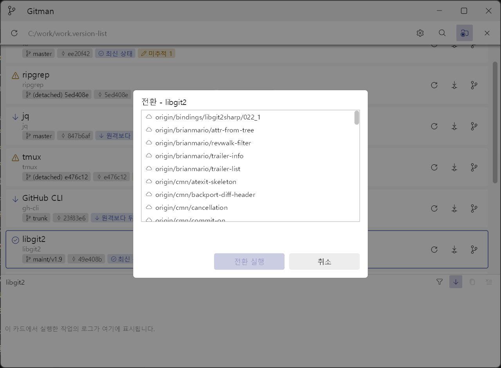
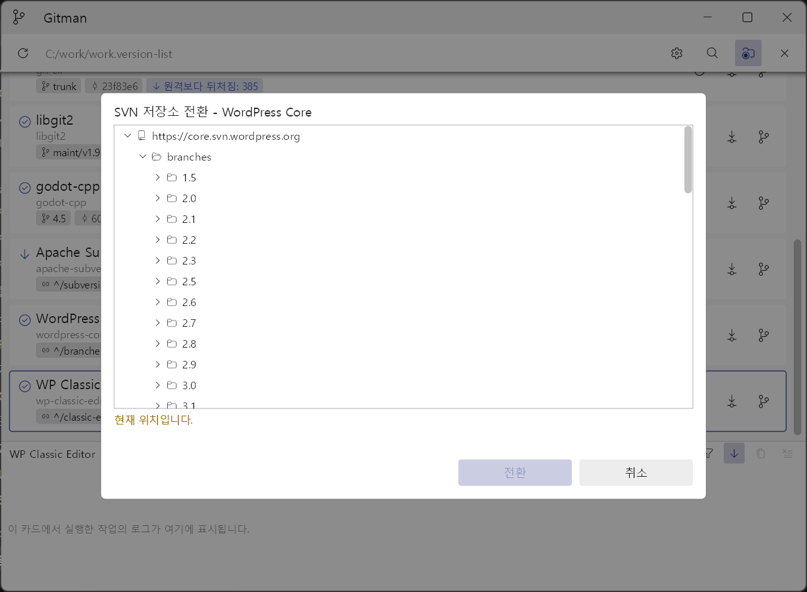
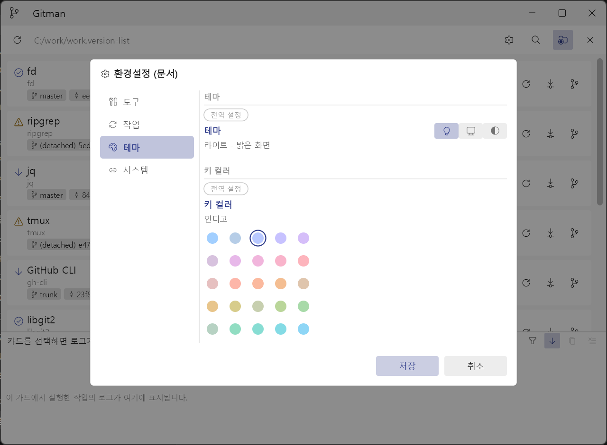
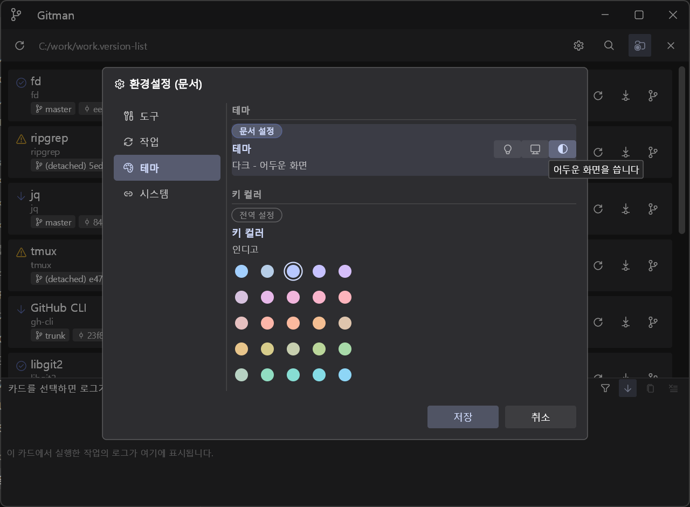
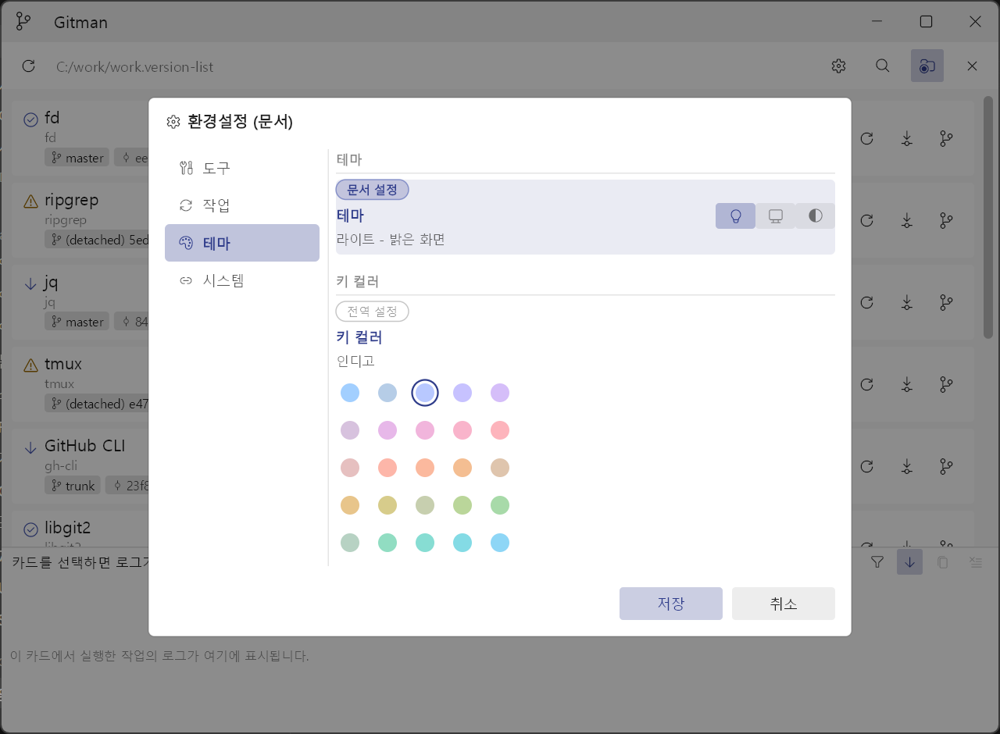

# Gitman 사용 설명서

버전 기준: 2026-08-22 빌드 (`bin/gitman.exe`)
화면은 실제 실행 화면을 캡처한 것입니다.

---

## 1. Gitman은 무엇을 하는 프로그램인가

Gitman은 여러 개의 Git·SVN 작업 복사본을 **한 화면에서 확인하고 갱신**하는 Windows 데스크톱 애플리케이션입니다.


- 저장소 목록은 JSON 형식의 **작업공간 문서(`.version-list`)** 에 저장합니다.
- 저장소마다 카드 한 장이 만들어지고, 카드에는 브랜치 또는 URL, 리비전, 원격과의 동기화 상태, 작업 트리 상태가 표시됩니다.
- 카드에서 **상태 새로 고침**, **업데이트**(`git pull --ff-only` / `svn update`), **전환**(`git switch` / `svn switch`)을 실행할 수 있습니다.
- 실행한 외부 명령의 출력은 카드별 로그에 남고, 원하면 파일로도 남습니다.

### 하지 않는 일

Gitman은 **읽기와 안전한 갱신만** 담당합니다. 다음은 의도적으로 제공하지 않습니다.

- 커밋, 푸시, 병합(merge), 리베이스(rebase), 충돌 해결
- 자동 stash, 강제 전환, 강제 reset, `--discard-changes`, cleanup, revert
- 대화형 터미널, 자격 증명 입력·저장
- 깊이 2 이상 자동 재귀 탐색

fast-forward가 불가능하면 병합하지 않고 오류로 끝냅니다. 안전하지 않은 작업은 우회 옵션 없이 명시적인 오류로 알립니다.

---

## 2. 실행 환경과 설치

### 2.1 필요한 것

| 항목 | 요구 사항 |
| --- | --- |
| 운영체제 | Windows 11 x64 |
| 그래픽 | Direct3D 기본, 실패 시 CPU 렌더링으로 자동 전환 |
| Git CLI | 2.43.0 이상 (Git 저장소를 쓸 때만 필요) |
| SVN CLI | 1.14.5 이상 (SVN 저장소를 쓸 때만 필요) |

Git과 SVN은 **선택 사항**입니다. 한쪽이 없어도 앱은 정상 실행되며, 해당 종류의 카드만 조회·업데이트·전환이 비활성화되고 카드에 이유가 표시됩니다.

### 2.2 설치

배포 산출물은 `gitman.exe` **파일 하나**입니다. Skia와 C/C++ 런타임이 정적으로 연결되어 있고 아이콘·폰트·제3자 라이선스 고지문이 실행 파일 안에 들어 있습니다.

원하는 폴더에 복사하면 설치가 끝납니다. installer, MSIX, 필수 레지스트리 항목이 없습니다.

### 2.3 명령줄 옵션

```powershell
.\gitman.exe                                   # 시작 페이지로 실행
.\gitman.exe "D:\workspaces\team.version-list" # 문서를 열면서 실행
.\gitman.exe --renderer=auto                   # 기본값: D3D 우선, 실패 시 CPU
.\gitman.exe --renderer=direct3d               # Direct3D 고정 (CPU 전환 없음)
.\gitman.exe --renderer=cpu                    # CPU 렌더링 고정
.\gitman.exe --register-file-association       # .version-list 연결 등록
.\gitman.exe --unregister-file-association     # 연결 해제
```

- 문서 경로는 **하나만** 지정할 수 있습니다. 확장자가 `.version-list`가 아니면 사용 예와 함께 오류를 표시합니다.
- 상대 경로와 `/` 혼용은 절대 경로로 정규화한 뒤 처리합니다.
- `--renderer`는 한 번만 지정할 수 있습니다.
- `--smoke-test`, `--simulate-direct3d-failure`는 자동 테스트 전용 진단 옵션입니다.

### 2.4 파일 연결

`--register-file-association`은 **현재 사용자 범위(`HKCU\Software\Classes`)** 에만 등록하므로 관리자 권한이 필요 없습니다. 환경설정 창의 `시스템` 탭에서도 같은 작업을 할 수 있습니다.

- 등록·해제는 여러 번 실행해도 안전합니다(멱등).
- 실행 파일을 다른 폴더로 옮겼다면 **다시 등록**해야 새 경로가 반영됩니다.
- 다른 프로그램이 선택한 사용자 연결(UserChoice)은 건드리지 않습니다.

---

## 3. 첫 화면 — 시작 페이지

문서를 열지 않은 상태에서는 시작 페이지가 표시됩니다.


- 큰 제목 `Gitman`과 부제 `.version-list 작업공간을 열어 여러 저장소의 상태를 한 화면에서 관리합니다.`
- **왼쪽 `시작` 열**
  - `문서 열기…`
  - `새 문서 만들기…` — 새 문서를 만드는 유일한 진입점입니다(도구 막대에는 없습니다).
- **오른쪽 `최근 항목` 열**
  - 이름(굵게) + 폴더 경로(흐림) 형태로, 위 화면처럼 `work  C:/work` 로 표시됩니다. 경로 구분자는 `/`입니다.
  - 최대 **10개**, 최신 순. 누르면 그 문서를 엽니다. 오른쪽 `x`는 목록에서만 지웁니다.
  - 비어 있으면 `최근에 연 문서가 없습니다.`
  - 없어진 문서를 눌러도 **목록에서 자동으로 지우지 않습니다**(네트워크 드라이브가 잠시 끊긴 경우를 위해). 대신 상단 배너로 열기 실패를 알립니다.
- 창이 좁으면(폭 720 논리 픽셀 미만) 두 열이 세로로 쌓이고, 높이가 모자라면 마지막 줄에 `외 N개 더 있습니다`가 표시됩니다.
- 시작 페이지에는 하단 로그 창이 없고, 마우스 클릭만 받습니다.

최근 목록은 `gitman.exe`와 **같은 폴더의 `gitman.app-settings.json`** 에 저장됩니다. 실행 파일 폴더에 쓸 수 없으면(예: Program Files) 목록은 그 실행 동안만 유지되고 안내가 한 번 표시됩니다.

---

## 4. 작업공간 문서 만들기

### 4.1 새 문서 만들기 창

시작 페이지의 `새 문서 만들기…`를 누르면 세 줄짜리 창이 열립니다.

| 행 | 내용 |
| --- | --- |
| `이름` | 문서 이름 (확장자 `.version-list`는 자동으로 붙습니다) |
| `폴더` | **저장소들을 담고 있는 상위 폴더** — 이 폴더의 바로 아래 하위 폴더만 스캔합니다 |
| `위치` | `스캔 폴더에 만들기` 체크 상자(기본 켬). 끄면 아래 입력 칸에서 출력 위치를 따로 고릅니다 |

최종 경로는 `위치 + 이름 + .version-list`입니다.

- 스캔은 **깊이 1**만 봅니다. 폴더 자체가 저장소이면 `지정한 폴더 자체가 저장소입니다. 저장소들을 담은 상위 폴더를 지정하세요.` 라고 알립니다.
- 저장소를 하나도 못 찾으면 문서를 만들지 않습니다.
- 같은 이름의 문서가 이미 있으면 덮어쓰지 않습니다.

### 4.2 열린 문서에 저장소 추가 — 탐색·등록

도구 막대의 돋보기 버튼(`하위 폴더 저장소 탐색·등록`)을 누르고 스캔 폴더를 고르면 깊이 1 후보 목록이 뜹니다.

- 후보마다 저장소 종류와 **제외 사유**가 함께 표시됩니다. 예: `bare 저장소`, `링크라 제외`, `저장소가 아님`, `이미 문서에 등록된 경로입니다.`, `경로를 사용할 수 없음`
- `linked worktree`와 submodule(`.git`이 파일인 경우)은 등록 후보로 허용합니다.
- bare 저장소는 목록에 보이지만 등록할 수 없습니다. reparse point(심볼릭 링크·junction)는 판정하지 않고 제외하되 목록에는 표시합니다.
- 체크한 항목만 문서에 **원자적으로** 추가됩니다.

### 4.3 문서를 직접 작성하기

최소 형식은 다음과 같습니다.

```json
{
    "schema_version": 1,
    "settings": {
        "git_executable": "",
        "svn_executable": "",
        "show_relative_paths": false
    },
    "projects": [
        {
            "id": "frontend",
            "path": "repositories/frontend",
            "display_name": "Frontend",
            "vcs_hint": "git"
        },
        {
            "id": "legacy-server",
            "path": "D:/repositories/legacy-server",
            "display_name": "Legacy Server",
            "vcs_hint": "svn"
        }
    ]
}
```

전체 필드는 [부록 A](#부록-a-version-list-스키마)를 참고하세요.

> **손으로 써 넣은 설정이 사라져 보일 수 있습니다.**
> Gitman은 문서를 저장할 때 **환경설정 창에서 실제로 덮어쓴 항목만** 남깁니다. 문서에 직접 적어 둔 값이라도 환경설정에서 건드린 적이 없으면 다음 저장 때 지워지고 전역 설정을 따르게 됩니다. 또 문서를 열고 창을 옮기기만 해도 `window` 블록이 문서에 추가됩니다.

### 4.4 문서 열기와 닫기

문서를 여는 방법은 네 가지입니다.

1. 도구 막대의 폴더 버튼(`.version-list 문서 열기`)
2. `.version-list` 파일을 Gitman 창으로 **끌어다 놓기**
3. 실행할 때 문서 경로를 인자로 전달
4. 파일 연결을 등록한 뒤 탐색기에서 더블클릭

닫으려면 도구 막대 오른쪽 끝의 `문서 닫기`를 누릅니다. **확인 창은 없습니다** — 문서 변경은 항상 즉시 저장되기 때문입니다. 닫을 때 진행 중인 변경 작업은 취소되고, 창 배치가 한 번 저장된 뒤 시작 페이지로 돌아갑니다.

---

## 5. 화면 구성

### 5.1 도구 막대

창 위쪽 막대입니다. 왼쪽 끝이 새로 고침, 그 오른쪽이 현재 문서 경로, 오른쪽 끝이 문서 닫기입니다.

| 버튼 | 툴팁 | 동작 |
| --- | --- | --- |
| ↻ 새로 고침 | `모든 카드 새로 고침` | 모든 카드를 원격까지 조회합니다 (`F5`와 같음) |
| ⚙ 톱니 | `환경설정 (문서)` / `환경설정 (전역)` | 환경설정 창을 엽니다. 문서가 없어도 열립니다 |
| 🔍 돋보기 | `하위 폴더 저장소 탐색·등록` | 저장소를 찾아 문서에 추가합니다. 문서가 없으면 비활성이며 툴팁에 `(문서를 먼저 여세요)`가 붙습니다 |
| 루트 폴더 | `카드 경로를 문서 기준 상대 경로로 표시` / `카드 경로를 전체 경로로 표시` | 경로 표시 방식을 전환합니다. **켜져 있으면 버튼에 강조 배경**이 생깁니다 |
| 폴더 | `.version-list 문서 열기` | 문서를 고릅니다 (문서가 없을 때만 보임) |
| ✕ | `문서 닫기` | 문서를 닫고 시작 페이지로 돌아갑니다 (문서가 열려 있을 때만 보임) |

문서가 없으면 경로 자리에 `문서 없음`이 표시됩니다. 창이 좁아지면 오른쪽 버튼부터 순서대로 숨고, 경로 글자는 `…`로 잘립니다.

**도구 막대 우클릭 메뉴** — 빈 곳이나 문서 경로 글자를 우클릭하면 두 항목이 나옵니다. (버튼 위에서는 열리지 않고, 문서가 없으면 아무 일도 하지 않습니다.)


- `경로를 탐색기로 열기` — 폴더를 열고 문서 파일을 선택 상태로 둡니다
- `VSCode로 열기` — 문서가 있는 폴더를 VS Code로 엽니다

### 5.2 카드

저장소 하나가 카드 한 장입니다. 구성은 다음과 같습니다.

```text
[상태아이콘]  이름
              경로
              [참조] [리비전] [동기화 상태] [작업 트리]        [↻] [↓] [전환]
```

- **1줄** — 표시 이름(`display_name`, 없으면 `id`)
- **2줄** — 작업 복사본 경로. 경로 표시 토글에 따라 전체 경로 또는 문서 기준 상대 경로
- **3줄** — 칩 4조각

| 칩 | Git 예시 | SVN 예시 |
| --- | --- | --- |
| 참조 | `master`, `trunk`, `maint/v1.9`, `(detached) 5ed408e` | `^/subversion/trunk` (저장소 루트 기준 상대 URL) |
| 리비전 | `ee20f42` | 리비전 번호 |
| 동기화 상태 | `최신 상태`, `원격보다 뒤처짐: 40` | 같음 |
| 작업 트리 | `미추적 1`, `변경 1`, `detached HEAD` | 같음 |

폭이 모자라면 왼쪽부터 채우고, 들어가지 않는 칩은 그리지 않습니다.

카드 버튼 세 개:

| 버튼 | 툴팁 |
| --- | --- |
| ↻ | `이 카드 새로 고침` |
| ↓ | `업데이트 (git pull --ff-only)` / `업데이트 (svn update)`. 실행 중에는 정지 아이콘 + `실행 중인 작업 취소`. 준비 전에는 `카드가 준비된 뒤 업데이트할 수 있습니다` |
| 전환 | `브랜치 전환 (git switch)` / `URL 전환 (svn switch)`. 준비 전에는 `카드가 준비된 뒤 전환할 수 있습니다` |

카드는 **끌어다 놓아 순서를 바꿀 수 있고**, 바뀐 순서는 문서에 저장됩니다(6px 이상 움직여야 드래그로 인식하며 `Esc`로 취소). 별도의 정렬 기능은 없습니다 — 순서는 언제나 문서의 `projects` 배열 순서입니다.

### 5.3 카드 우클릭 메뉴

카드 본문을 우클릭하면 그 카드가 선택되고 메뉴가 열립니다.


| 항목 | 동작 | 활성 조건 |
| --- | --- | --- |
| `저장소 열기` | 작업 복사본 폴더를 탐색기로 엽니다 | 항상 |
| `VSCode로 열기` | 작업 복사본 폴더를 VS Code로 엽니다 (`code.cmd`가 없으면 아무 일도 일어나지 않습니다) | 항상 |
| `로컬 변경 확인` | 로컬 변경 목록과 diff를 봅니다 | 항상 |
| `상태 갱신` | 이 카드만 조회합니다 | 항상 |
| `업데이트` | 업데이트를 실행합니다 | 변경 가능하고 실행 중이 아닐 때 |
| `전환…` | 전환 창을 엽니다 | 변경 가능할 때 |

`↑`/`↓`로 이동(비활성 항목은 건너뜀), `Enter`로 실행, `Esc` 또는 바깥 클릭으로 닫습니다. 메뉴가 떠 있는 동안 휠은 무시됩니다. 실행 중인 카드라도 메뉴에는 취소 항목이 없습니다 — 취소는 카드의 업데이트 버튼으로 합니다.

### 5.4 하단 로그 창

선택한 카드의 로그가 창 아래쪽에 항상 표시됩니다. 선택한 카드가 없으면 제목이 `카드를 선택하면 로그가 표시됩니다`, 카드를 고르면 제목이 그 카드 이름으로 바뀝니다. 로그가 없으면 본문에 `이 카드에서 실행한 작업의 로그가 여기에 표시됩니다.`

헤더 오른쪽 버튼은 **왼쪽부터** 다음 순서입니다.

| 버튼 | 설명 |
| --- | --- |
| 깔때기 | 필터. 누를 때마다 `전체` → `출력만` → `오류만`. 툴팁은 `로그 필터: <현재값> (클릭해 전환)` |
| ↓ | `자동 스크롤 켜기 (맨 아래 따라가기)` / `자동 스크롤 끄기`. 켜져 있으면 강조 표시 |
| 복사 | `표시 중인 로그 복사` |
| 지우기 | `이 카드 로그 지우기` |

업데이트·전환이 실행 중일 때만 버튼 왼쪽에 경과 시간 `MM:SS`가 나타나 1초마다 갱신되고, 끝나면 사라집니다.

- 화면 로그는 **카드당 최대 1,000 record**의 메모리 링 버퍼입니다. 밀려난 줄은 `# 앞선 로그 … 줄이 유실되었습니다 (기록이 밀렸습니다)`로 알립니다.
- 연속된 progress 출력은 화면에서 `(진행 표시 N줄 접힘)`처럼 접혀 보이지만 **파일에는 전부 남습니다**.

---

## 6. 카드 상태 읽는 법

### 6.1 문서를 막 열었을 때

문서를 열면 **로컬 상태만** 조회합니다. 그런데도 일부 카드에는 이미 뒤처짐 수치가 나옵니다.


- `jq`, `GitHub CLI` — upstream이 있는 브랜치는 **로컬에 이미 있는 원격 추적 ref**만으로 앞뒤 차이를 계산할 수 있어, 네트워크를 쓰지 않고도 `원격보다 뒤처짐: 40` 이 바로 나옵니다.
- `ripgrep`, `tmux` — detached HEAD라 비교 대상이 없어 `확인되지 않음`입니다. 이 상태는 키 컬러 대신 **흐린 회색**으로 그려서, 값이 없는 것과 값이 확인된 것을 눈으로 구분할 수 있게 합니다.

`F5`로 원격까지 조회하면 `확인되지 않음`이 실제 판정으로 바뀝니다.


`ripgrep`과 `tmux`가 `비교할 원격 브랜치 없음`으로 확정된 것을 볼 수 있습니다.

### 6.2 동기화 상태 전체

| 표시 | 의미 |
| --- | --- |
| `최신 상태` | 원격과 같습니다 |
| `원격보다 뒤처짐: N` | 원격에 새 커밋/리비전이 있습니다 |
| `로컬이 앞섬: N` | 로컬에만 있는 커밋이 있습니다 (SVN에는 없는 상태) |
| `분기됨: 로컬 N / 원격 M` | 양쪽에 서로 다른 커밋이 있습니다 → 업데이트 차단 |
| `확인되지 않음` | 아직 판정하지 못했습니다. **흐린 회색**으로 표시 |
| `인증 필요` | 자격 증명이 없거나 거부되었습니다 |
| `로컬 저장소 기준` | 원격이 없어 로컬 기준으로만 판단합니다 |
| `비교할 원격 브랜치 없음` | 원격은 있지만 대응하는 브랜치가 없습니다 |
| `오프라인` | 원격에 연결하지 못했습니다 |
| `오류로 판정 불가` | 조회에 실패했습니다 (자세한 내용은 로그) |

이 밖에 `저장소 아님`, `지원하지 않는 저장소 배치`, `VCS 도구를 사용할 수 없음`, `경로를 사용할 수 없음`, `진행 중 작업 있음` 같은 카드 수준 상태가 있습니다.

### 6.3 무엇과 비교하는가 (Git)

Gitman은 **원격 우선**으로 비교 대상을 고릅니다.

1. 현재 브랜치에 upstream이 있으면 그 원격 추적 브랜치
2. 없으면 `preferred_remote` → `origin` → 유일한 remote 순으로 remote를 고르고, **현재 브랜치와 같은 이름의** 원격 브랜치
3. remote는 있는데 비교할 브랜치가 없으면 `비교할 원격 브랜치 없음` (로컬로 물러서지 않습니다)
4. remote가 하나도 없으면 `로컬 저장소 기준`

remote가 여러 개여서 고를 수 없으면 `remote가 여러 개여서 비교 대상을 자동으로 고를 수 없습니다. upstream 또는 preferred_remote를 지정하세요.` 라고 알립니다.

detached HEAD는 비교할 원격 브랜치가 없어 네트워크를 쓰기 전에 판정이 끝나며, fetch하지 않습니다.

### 6.4 SVN의 차이

- 현재 URL을 다시 읽고 **원격 HEAD 리비전과 비교**합니다.
- SVN에는 `로컬이 앞섬`과 `분기됨`이 없어 `최신 상태` 또는 `원격보다 뒤처짐`만 나옵니다.
- 참조 칩에는 전체 URL이 아니라 **저장소 루트 기준 상대 URL**(`^/subversion/trunk`)이 표시됩니다.
- 작업 복사본을 바꾸지 않는 조회만 사용하며, `switched된 하위 경로`와 `리비전 혼합` 여부도 함께 봅니다.

---

## 7. 상태 새로 고침

- 문서를 열면 **로컬 상태만** 조회합니다. 자동 주기 조회는 없습니다.
- 도구 막대의 새로 고침 버튼 또는 **`F5`** 를 누르면 **원격까지** 조회합니다.
- 카드의 새로 고침 버튼, 카드를 선택한 뒤 **`Enter`**, 우클릭 메뉴의 `상태 갱신`은 그 카드만 조회합니다.
- 중복 요청은 병합됩니다. 카드 선택을 바꿔도 진행 중인 작업은 계속됩니다.

Git 조회는 `status --porcelain=v2`, `rev-parse`, `rev-list` 등을, SVN 조회는 `info --show-item`, `status`, `svnversion`을 사용합니다. 셸을 거치지 않고 인자 배열로 직접 실행합니다.

---

## 8. 업데이트

### 8.1 실행 내용

| 종류 | 명령 |
| --- | --- |
| Git | `git pull --ff-only --recurse-submodules=no <remote> <branch>` |
| Git (submodule 켬) | `git pull --recurse-submodules=on-demand …` 성공 후 `git submodule update --init --recursive` |
| SVN | `svn update` (작업 복사본 루트에서) |

- **확인 창은 없습니다.** submodule을 함께 갱신할지는 환경설정의 `업데이트 시 submodule 갱신`(기본 끔)이 정하고, 버튼을 누르면 바로 실행됩니다.
- submodule 갱신은 **부모 pull이 성공한 경우에만** 실행하며, 로그에는 프로젝트 기준 상대 경로와 함께 남습니다.
- 성공이든 실패든 끝나면 로컬 상태를 다시 조회합니다.
- 업데이트에는 **제한 시간이 없습니다.** 중단은 취소 버튼으로만 합니다. 취소는 즉시 동작합니다.

### 8.2 시작하지 않는 경우

아래 조건을 위에서부터 순서대로 검사하며, 걸리면 명령을 만들지 않습니다.

| 조건 | 표시되는 문구(예) |
| --- | --- |
| 도구 없음 | `이 저장소 종류의 명령줄 도구를 사용할 수 없습니다.` |
| 저장소 아님 | `등록한 경로가 Git 저장소가 아닙니다.` / `등록한 경로가 SVN 작업 복사본이 아닙니다.` |
| 충돌 / 진행 중 작업 | `충돌이 남아 있어 갱신하지 않았습니다.` / `진행 중인 merge, rebase 또는 cherry-pick이 있어 갱신하지 않았습니다.` |
| 다른 프로세스 | `다른 Git 프로세스가 저장소를 사용 중입니다.` |
| detached HEAD | `detached HEAD 상태에서는 갱신하지 않습니다.` |
| 커밋하지 않은 수정 | `커밋하지 않은 수정이 있어 갱신하지 않았습니다. 우클릭 메뉴의 "로컬 변경 확인"에서 내용을 볼 수 있습니다.` |
| submodule 변경 | `submodule에 변경이나 충돌이 있어 갱신을 시작하지 않았습니다.` |
| 분기됨 | `로컬과 원격이 분기되어 fast-forward 갱신을 할 수 없습니다.` |
| 대상 없음 | `비교할 원격 branch가 없어 갱신 대상을 정할 수 없습니다.` |
| SVN 전용 | `switched된 하위 경로가 있어 갱신하지 않았습니다.` / `작업 복사본의 리비전이 섞여 있어 갱신하지 않았습니다.` |
| 이미 실행 중 | `이미 작업이 진행 중이라 update를 시작하지 않습니다.` |

> **미추적 파일만 있으면 업데이트를 막지 않습니다.** Git pull은 미추적 파일을 덮어쓰게 되면 스스로 중단하고, SVN update는 tree conflict로 남기기 때문입니다. 차단되는 것은 **추적 파일의 수정**입니다. 위 화면의 `fd` 카드(`미추적 1`)는 업데이트할 수 있고, `jq` 카드(`변경 1`)는 막힙니다.

---

## 9. 전환 (switch)

전환은 **창에서 한 번, 실행 직전에 한 번** 두 번 검증합니다. 검증에 실패하면 창의 오류 문구만 갱신되고 명령은 만들어지지 않습니다.

### 9.1 Git — 브랜치 전환

제목은 `전환 - <카드 이름>` 입니다.



- 창을 열 때 선택한 remote를 fetch한 뒤 후보를 보여 줍니다. **원격 브랜치가 위**(구름 아이콘 + `origin/...`), 로컬 브랜치가 아래입니다.
- 후보가 많으면 목록 오른쪽에 스크롤 막대가 붙고, 목록 둘레에 실선 경계가 그려집니다.
- 아무것도 고르지 않으면 `전환 실행` 버튼이 비활성입니다.
- 원격 후보로 도달할 수 있는 로컬 브랜치는 중복해서 보여 주지 않습니다.
- fetch에 실패해도 목록은 뜹니다. 갱신되지 않은 항목에 `(일부 후보 미갱신)` / `이번 조회에서 갱신되지 않은 후보입니다` 가 붙습니다.
- 대응하는 로컬 브랜치가 없는 원격 브랜치를 고르면 **확인이 필요합니다**: `local tracking branch를 만들고 전환합니다. 확인하려면 한 번 더 누르세요.` 확인하면 버튼이 `브랜치 만들고 전환`으로 바뀝니다.
- 여러 remote에 같은 이름의 브랜치가 있으면 자동으로 고르지 않습니다: `여러 remote에 같은 이름의 branch가 있어 remote를 직접 선택해야 합니다.`
- 실행은 `--no-guess`와 완전한 ref로 하며, **실행 직전에 다시 fetch하지 않습니다**(이미 받아 둔 ref만 사용).
- detached HEAD로 전환, 강제 reset, `--merge`, `--discard-changes`는 지원하지 않습니다.

### 9.2 SVN — URL 전환

제목은 `SVN 저장소 전환 - <카드 이름>` 입니다.



- 작업 복사본에서 저장소 루트 URL을 읽어 **루트부터 디렉터리 트리를 lazy 조회**합니다. 위 화면의 최상단이 저장소 루트(`https://core.svn.wordpress.org`)이고, 그 아래로 실제 디렉터리가 펼쳐집니다.
- `trunk`/`branches`/`tags` 같은 layout 이름을 가정하지 않습니다. 실제로 조회한 디렉터리만 보여 줍니다.
- 노드를 펼칠 때마다 `svn ls`를 실행하고 **디렉터리만** 표시합니다. 결과는 창을 닫으면 버립니다.
- 현재 전환 위치까지 자동으로 펼쳐지며, 그 위치를 고르면 아래에 `현재 위치입니다.` 가 표시되고 `전환` 버튼이 비활성으로 남습니다.
- 조회 중인 노드는 `조회 중`, 실패한 노드는 사유를 표시합니다. 인증이 필요하면 프롬프트 없이 `인증이 필요해 조회하지 못했습니다`.
- 저장소 루트 밖으로는 나가지 않습니다: `저장소 루트 밖의 SVN 디렉터리는 조회하지 않습니다.`
- 실행 직전에 저장소 root와 UUID를 양쪽에서 다시 읽어 **모두 있고 같을 때만** 통과합니다. 다르면 `저장소 root 또는 UUID가 현재 작업 복사본과 다릅니다.`

> 문서에 남아 있는 `svn_switch_targets` 배열은 호환을 위해 보존만 하고 후보나 검증에는 사용하지 않습니다.

### 9.3 전환을 막는 조건

업데이트와 달리 **전환은 미추적 파일도 차단 대상입니다.** 전환은 작업 복사본 내용이 통째로 바뀌기 때문입니다.

- `작업 트리에 변경이나 진행 중인 작업이 있어 전환할 수 없습니다.`
- `이미 현재 참조입니다. 다른 후보를 선택하세요.`
- `이미 작업이 진행 중이라 switch를 시작하지 않습니다.`
- `전환할 수 있는 후보가 없습니다.`

---

## 10. 로컬 변경 확인

카드 우클릭 메뉴의 `로컬 변경 확인`을 누르면 제목이 `로컬 변경 - <카드 이름>` 인 창이 열립니다.


- **위쪽**이 변경 파일 목록입니다. 파일마다 상태 배지(`수정` 등)와 경로, 오른쪽에 파일 열기·폴더 열기 버튼이 있습니다.
- **아래쪽**이 선택한 파일의 **좌우 2단 diff**입니다. 왼쪽이 변경 전, 오른쪽이 변경 후이며 바뀐 줄이 강조됩니다.
- 목록과 diff 각각에 스크롤 막대가 붙습니다.
- 변경이 없으면 `표시할 로컬 변경이 없습니다.`, 차이가 없으면 `표시할 차이가 없습니다.`
- 이진 파일은 `이진 파일 - 내용을 표시하지 않습니다.`
- 미추적 디렉터리는 `미추적 디렉터리 - 내부 파일은 표시하지 않습니다.`
- 표시 상한은 **256 KiB**이며 넘으면 `표시 상한(256 KiB)을 넘어 이후 내용을 생략했습니다.`
- 닫기는 `닫기` 버튼 또는 `Esc`입니다.

---

## 11. 로그 파일

화면 로그와 같은 내용을 문서 폴더에 파일로도 남깁니다(환경설정에서 끌 수 있습니다).

문서가 `D:\workspaces\team.version-list`이면:

```text
D:\workspaces\.team.version-list.log\
    frontend\20260821-184012.log
    legacy-server\20260821-184015.log
```

- 폴더 이름 앞의 `.`은 탐색기에서 저장소 폴더들 사이에 섞이지 않고 맨 앞에 모이게 합니다.
- 저장소 폴더 이름은 작업 복사본의 **마지막 폴더 이름**입니다. 문서 안에서 겹치면 상위 폴더를 붙이고(`a-b-c`), 그래도 겹치면 드라이브까지 붙입니다(`c-drive_a-b-c`). 저장소가 추가·삭제되면 이름이 다시 계산되므로 **같은 저장소의 폴더 이름이 달라질 수 있습니다.**
- 파일은 문서를 연 뒤 그 저장소에 **첫 로그 record가 생길 때** 하나 만들어 문서를 닫거나 앱이 끝날 때까지 이어 씁니다. 조회가 전부 성공하면 남길 것이 없어 **로그 폴더가 아예 만들어지지 않을 수 있습니다** — 성공은 카드 표시로 충분하다고 보고 기록하지 않기 때문입니다.
- 형식은 UTF-8(BOM 없음), CRLF입니다. 첫 두 줄이 머리글입니다.

```text
# 문서: D:\workspaces\.team.version-list.log
# 저장소: Frontend (D:\repositories\frontend)
2026-08-21 18:40:12.128 [lifecycle/information] update 시작 (git pull --ff-only)
```

- **자동 정리(회전)는 없습니다.** 오래된 파일은 직접 지웁니다.
- 폴더를 만들지 못하거나 쓰기에 실패하면 경고 한 건을 남기고 그 세션 동안 파일 로그를 끕니다.

---

## 12. 환경설정

톱니 버튼으로 엽니다. 제목이 **`환경설정 (문서)`** 이면 지금 열려 있는 문서의 설정을, **`환경설정 (전역)`** 이면 앱 전역 설정을 편집합니다. 왼쪽에 탭 4개가 세로로 놓입니다.

### 12.1 도구 탭


- **실행 파일** — `Git 실행 파일`, `SVN 실행 파일`. 각각 `찾아보기` / `지우기` 버튼이 있고, 값이 비어 있으면 `자동 탐색 (지정되지 않음)`으로 표시되며 `지우기`가 비활성입니다. 지정하려면 **절대 경로**여야 합니다.
- **조회** — `상태 확인 제한 시간 (초)`. 숫자만 입력하며 비우면 `600 (기본값)`. 범위(10~3600)를 벗어나면 `제한 시간은 10~3600초 사이여야 합니다.`가 뜨고 저장 버튼이 비활성화됩니다. 이 값은 **로컬·원격 조회에 함께** 적용되며 업데이트에는 적용되지 않습니다(업데이트는 무제한).

### 12.2 작업 탭


| 항목 | 끔 | 켬 |
| --- | --- | --- |
| `업데이트 시 submodule 갱신` | `끔 - submodule을 건드리지 않음` | `켬 - git pull --recurse-submodules=on-demand` |
| `로컬 변경을 상관하지 않음 (SVN)` | `끔 - 로컬 변경을 확인한 뒤 진행` | `켬 - status 확인 없이 깨끗하다고 믿고 진행` |
| `로그를 문서 폴더에 파일로 남김` | `끔 - 화면 로그만 유지` | `켬 - .<문서>.version-list.log 폴더에 저장소별로 남김` |

`로컬 변경을 상관하지 않음`을 켜면 SVN 저장소에서 로컬 변경 확인(`status`)을 건너뛰고 깨끗하다고 믿은 채 진행합니다. 조회가 매우 느린 대형 SVN 작업 복사본을 위한 옵션이며, 이 설정으로 실행하면 로그에 다음 안내가 남습니다.

> 로컬 변경을 상관하지 않는 설정으로 실행했습니다. 실패나 충돌이 커밋하지 않은 로컬 변경 때문일 수 있으니 작업 복사본을 직접 확인해 주세요.

### 12.3 테마 탭



- **테마** — 아이콘 세 개가 붙은 세그먼트 토글입니다. 왼쪽부터 `라이트 - 밝은 화면`, `시스템 - Windows 앱 모드를 따름`, `다크 - 어두운 화면`이며, 현재 값이 강조되고 아래에 설명 한 줄이 나옵니다.
- **키 컬러** — 5 × 5 색 동그라미 격자입니다. 현재 색에만 테두리 링이 있고, **격자 바로 위에 현재 색 이름**(위 화면에서는 `인디고`)이 표시됩니다.

### 12.4 시스템 탭


`.version-list 파일 연결` — `현재 사용자 범위에서만 등록·해제합니다` 라는 설명과 함께 `연결 등록` / `연결 해제` 버튼이 있습니다. 앱 수준 동작이라 배지 줄이 없고, 결과는 Windows 기본 MessageBox가 아니라 앱 스타일 알림 창으로 표시됩니다.

### 12.5 범위 배지 — 문서 설정 vs 전역 설정

문서를 연 상태에서는 각 항목 제목 위에 배지가 붙습니다.

| 배지 | 뜻 | 누르면 |
| --- | --- | --- |
| `문서 설정` (강조색 배경) | 이 문서가 전역 설정을 덮어쓰고 있음 | 문서의 정의를 지우고 다시 전역 설정을 따릅니다 |
| `전역 설정` (흐린 테두리) | 전역 값을 그대로 따르는 중 | 아무 일도 하지 않습니다 (툴팁만) |

툴팁은 각각 `이 문서가 전역 설정을 덮어쓰고 있습니다. 클릭하면 삭제하고 전역 설정을 따릅니다.` / `앱 전역 설정을 따릅니다. 값을 바꾸면 이 문서만의 설정이 됩니다.` 입니다.

문서 모드에서 어떤 값을 건드리면 그 항목이 자동으로 "문서에 정의됨"이 됩니다. 위 도구 탭 화면에서 두 실행 파일 항목이 `문서 설정`, 제한 시간이 `전역 설정`인 것이 그 예입니다. 전역 모드에는 배지 줄 자체가 없습니다.

### 12.6 저장과 취소

- 모든 항목이 **초안**입니다. `저장`을 눌러야 파일에 반영되고, `취소`는 초안을 버립니다. 고친 것이 없으면 `저장` 버튼은 비활성입니다.
- 테마와 키 컬러만 예외적으로 **고르는 즉시 화면에 미리 보입니다.** `취소`로 닫으면 원래 색으로 돌아갑니다.
- 저장 후 유효 설정이 실제로 바뀐 경우에만 카드를 다시 조회합니다.
- 탭을 옮겨도 다른 탭에서 고친 값은 유지됩니다.

---

## 13. 테마와 키 컬러

테마를 다크로 고르면 창 전체가 즉시 바뀝니다. 아래는 같은 화면의 다크·라이트 비교입니다. 테마 항목의 배지가 `전역 설정`에서 `문서 설정`으로 바뀌고 `저장` 버튼이 활성화된 것도 함께 보입니다.





적용 우선순위는 **고대비 → 라이트/다크 명시값 → 시스템 설정** 입니다. Windows 고대비 모드에서는 키 컬러를 무시하고 흰색을 씁니다.

### 키 컬러 25색

기본값은 **민트(`mint`)** 입니다. 격자는 줄마다 한 계열입니다.

| 줄 | 색 |
| --- | --- |
| 1 | 블루(blue) · 슬레이트(slate) · 인디고(indigo) · 바이올렛(violet) · 라벤더(lavender) |
| 2 | 모브(mauve) · 오키드(orchid) · 마젠타(magenta) · 핑크(pink) · 로즈(rose) |
| 3 | 로즈우드(rosewood) · 살몬(salmon) · 코럴(coral) · 피치(peach) · 모카(mocha) |
| 4 | 앰버(amber) · 레몬(lemon) · 올리브(olive) · 라임(lime) · 그린(green) |
| 5 | 세이지(sage) · **민트(mint)** · 티얼(teal) · 아쿠아(aqua) · 스카이블루(skyblue) |

키 컬러는 카드 상태 아이콘, 선택 테두리, 드래그 강조, SVN 현재 위치 표시, 체크박스·입력 칸 초점, 토글, 선택 행·배지·강조 버튼에 쓰입니다. 알 수 없는 값이 저장되어 있으면 `mint`로 물러서고 저장값은 지우지 않습니다.

테마와 키 컬러도 다른 설정과 같이 **문서가 열려 있으면 문서 설정, 없으면 전역 설정**을 편집합니다.

---

## 14. 창 배치와 경로 표시

### 14.1 창 크기와 위치

| 상황 | 어디에 저장되나 |
| --- | --- |
| 문서 없이 창을 옮기거나 크기를 바꿈 | 앱 설정(`gitman.app-settings.json`) |
| 문서를 연 상태에서 바꿈 | **그 문서에만** 저장 (앱 설정은 그대로) |
| 문서를 여는 순간 | 직전 배치를 앱 설정에 한 번 기록하고, 문서의 배치를 창에 적용 |
| 문서를 닫음 | 앱 설정의 크기·위치로 돌아감 |

복원 우선순위는 **여는 문서의 배치 > 앱 설정 배치 > 기본값** 입니다. 저장된 위치가 어떤 모니터와도 겹치지 않으면 위치는 버리고 크기만 적용합니다. 최소 창 크기는 480 × 320(논리 픽셀)입니다.

### 14.2 경로 표시

- 화면에 그리는 경로는 구분자를 모두 `/`로 통일합니다. 도구 막대의 문서 경로(`C:/work/work.version-list`), 카드 경로, 시작 페이지의 최근 항목, 환경설정의 실행 파일 경로가 모두 해당합니다. 저장·실행에 쓰는 경로는 Windows 원형 `\` 그대로입니다.
- 도구 막대의 루트 폴더 토글을 켜면 카드 경로가 **문서 폴더 기준 상대 경로**가 됩니다. 문서보다 위 폴더는 `..`, 같은 위치는 `.`이며, 드라이브나 공유가 다르면 전체 경로를 그대로 둡니다.
- 표시만 바뀌고 **문서의 `path` 값은 바뀌지 않습니다.**

---

## 15. 키보드

| 키 | 동작 |
| --- | --- |
| `F5` | 모든 카드를 원격까지 새로 고침 |
| `Enter` | 선택한 카드를 새로 고침 (컨텍스트 메뉴가 열려 있으면 강조 항목 실행) |
| `↑` / `↓` | 카드 선택 이동 (메뉴가 열려 있으면 메뉴 항목 이동). 선택이 화면 밖이면 자동 스크롤 |
| `Esc` | 열려 있는 것을 닫음 — 알림 → 컨텍스트 메뉴 → 그 밖의 창 순. 드래그 중이면 드래그 취소 |
| `Alt+Space` | Windows 시스템 메뉴 |

Page Up / Page Down / Home / End 스크롤은 제공하지 않습니다.

---

## 16. 문제 해결

| 증상 | 확인할 것 |
| --- | --- |
| `Git 명령줄 도구를 찾을 수 없습니다. 설치하거나 문서 settings에 경로를 지정하세요.` | Git이 `PATH`에 있는지, 또는 환경설정에서 절대 경로를 지정 |
| `설치된 Git이 지원 최소 버전보다 오래되었습니다.` | Git 2.43.0 이상 / SVN 1.14.5 이상으로 올리기 |
| `문서 settings에 지정한 Git 실행 파일 경로를 사용할 수 없습니다.` | 지정한 경로가 존재하는지. 지우면 자동 탐색으로 돌아갑니다 |
| `인증이 필요하거나 자격 증명이 거부되었습니다.` | Gitman은 자격 증명을 묻지 않습니다. Git Credential Manager나 SVN 인증 캐시를 먼저 설정하세요 |
| 없는 원격인데 `저장소를 찾을 수 없습니다.` 로 나옴 | 자격 증명이 저장된 호스트에서는 credential helper가 응답해 인증 오류 대신 이 문구가 나옵니다 |
| `이 작업공간 문서에 대응하는 revision token이 없어 저장하지 않았습니다.` / `load 이후 작업공간 문서가 변경되어 저장하지 않았습니다.` | 다른 프로그램이 문서를 동시에 수정했습니다. 문서를 다시 열고 작업하세요 |
| `작업공간 문서가 유효한 JSON이 아닙니다.` | JSON 문법 오류입니다. 원본은 덮어쓰지 않습니다 |
| `현재 Gitman보다 새로운 schema version입니다.` | 더 새 버전의 Gitman으로 만든 문서입니다 |
| 문서에 적어 둔 설정이 사라짐 | 환경설정 창에서 건드린 적 없는 항목은 저장 시 제거되고 전역 설정을 따릅니다 |
| 로그 폴더가 안 생김 | 조회가 모두 성공하면 남길 record가 없어 폴더를 만들지 않습니다. 환경설정의 로그 토글과 폴더 쓰기 권한도 확인 |
| 조회가 자주 시간 초과됨 | `상태 확인 제한 시간`을 올리세요(최대 3600초). SVN이라면 `로컬 변경을 상관하지 않음`도 고려 |
| 파일 연결이 동작하지 않음 | 실행 파일을 옮겼다면 `--register-file-association` 재실행. 탐색기의 UserChoice가 우선합니다 |

오류 분류는 로캘에 의존하지 않는 신호(SVN `E<숫자>` 코드, libcurl/OpenSSH 원문, HTTP 상태 번호)로 판단합니다. Git·SVN 자체 메시지는 시스템 언어로 나올 수 있습니다. URL에 포함된 사용자 정보나 토큰은 로그에서 마스킹됩니다.

---

## 17. 데이터 위치 · 업그레이드 · 제거

### 저장 위치

| 데이터 | 위치 |
| --- | --- |
| 프로젝트 목록, 문서 설정, 문서별 테마·키 컬러, 창 배치 | 사용자가 만든 `<이름>.version-list` |
| 최근 문서 목록, 전역 설정·외양, 문서 없을 때의 창 배치 | `gitman.exe`와 같은 폴더의 `gitman.app-settings.json` |
| 화면 로그 | 메모리 전용 (카드당 1,000 record) |
| 파일 로그 | 문서 폴더의 `.<이름>.version-list.log\<저장소>\<타임스탬프>.log` |
| 파일 연결 | `HKCU\Software\Classes` (등록한 경우만) |

### 업그레이드

새 `gitman.exe`로 기존 파일을 덮어쓰면 끝입니다. 문서 스키마는 버전 1을 유지하며 구버전 문서도 그대로 열립니다. 실행 파일 경로가 바뀌었다면 파일 연결을 다시 등록하세요.

### 제거

1. (등록했다면) `gitman.exe --unregister-file-association`
2. `gitman.exe` 삭제
3. `gitman.app-settings.json` 삭제
4. `.version-list` 문서와 `.<이름>.version-list.log` 폴더는 사용자 데이터이므로 필요할 때 직접 삭제

이외의 잔여물(레지스트리, AppData, 서비스)은 없습니다.

### 문서 저장 방식

임시 파일에 쓰고 flush한 뒤 **원자적으로 교체**합니다. 저장 중 중단되면 원본이 그대로 남습니다. `.bak` 백업 파일은 만들지 않습니다. 다른 프로그램이 동시에 수정하면 revision 비교로 감지해 덮어쓰지 않습니다. **알 수 없는 필드는 그대로 보존합니다.**

---

## 18. 알려진 제한

- 네트워크 드라이브와 매우 느린 경로에서의 탐색·조회는 검증하지 않았습니다.
- 커밋·푸시·병합·리베이스·충돌 해결·대화형 셸·자격 증명 저장·깊이 2 이상 자동 탐색은 지원하지 않습니다.
- 로그 파일은 자동으로 정리되지 않습니다.
- Page Up/Down, Home/End 키보드 스크롤이 없습니다.
- 카드 정렬 기능은 없습니다. 순서는 드래그로만 바꿉니다.

---

## 부록 A. `.version-list` 스키마

### 최상위

| 필드 | 타입 | 설명 |
| --- | --- | --- |
| `schema_version` | 정수 | **필수.** 현재 `1` |
| `projects` | 배열 | **필수.** 카드 표시 순서 = 배열 순서 |
| `settings` | object | 선택. 문서 수준 환경설정 (아래) |
| `appearance` | object | 선택. `{ "theme": "system|light|dark", "accent": "<색 id>" }` |
| `window` | object | 선택. `x`, `y`, `width`, `height`, `maximized`. 문서를 열고 창을 옮기면 자동으로 추가됩니다 |

### `settings`

정의하지 않은 키는 앱 전역 설정을 따릅니다.

| 키 | 타입 | 기본값 | 설명 |
| --- | --- | --- | --- |
| `git_executable` | 문자열 | `""` | 빈 값이면 자동 탐색. 지정 시 **절대 경로** |
| `svn_executable` | 문자열 | `""` | 위와 같음 |
| `query_timeout_seconds` | 정수 | `600` | 상태 확인 제한 시간. 10~3600 |
| `update_submodules` | boolean | `false` | 업데이트 시 submodule 함께 갱신 |
| `ignore_local_changes` | boolean | `false` | SVN에서 로컬 변경 확인을 건너뜀 |
| `write_log_files` | boolean | `true` | 문서 폴더에 로그 파일 남김 |
| `show_relative_paths` | boolean | `false` | 카드 경로를 문서 기준 상대 경로로 표시 |

값이 범위를 벗어나거나 타입이 다르면 **경고 진단만 남기고 기본값을 씁니다.** 문서 열기는 실패하지 않습니다.

### `projects[]`

| 필드 | 타입 | 설명 |
| --- | --- | --- |
| `id` | 문자열 | **필수.** 문서 안에서 고유. 비어 있을 수 없음 |
| `path` | 문자열 | **필수.** 작업 복사본 경로. 상대 경로는 문서 폴더 기준 |
| `display_name` | 문자열 | 선택. 카드에 표시할 이름 |
| `vcs_hint` | 문자열 | 선택. `auto`(기본) / `git` / `svn` |
| `enabled` | boolean | 선택 |
| `preferred_remote` | 문자열/null | 선택. remote가 여러 개일 때 비교 기준 |
| `svn_switch_targets` | 배열 | 선택. **보존만 하고 사용하지 않음**(구버전 호환) |

중복된 `id`나 중복된 경로는 **항목별 오류**로 보고되며, 나머지 유효한 항목은 정상 표시됩니다.

---

## 부록 B. 빠른 참조

| 하고 싶은 것 | 방법 |
| --- | --- |
| 새 작업공간 만들기 | 시작 페이지 → `새 문서 만들기…` |
| 저장소 추가하기 | 도구 막대 돋보기 → 스캔 폴더 선택 → 체크 → 등록 |
| 전체 상태 확인 | `F5` 또는 도구 막대 왼쪽 끝 새로 고침 |
| 한 저장소만 확인 | 카드 선택 후 `Enter`, 또는 카드의 새로 고침 버튼 |
| 최신으로 당겨오기 | 카드의 업데이트 버튼 (Git `pull --ff-only` / SVN `update`) |
| 브랜치·URL 바꾸기 | 카드의 전환 버튼 |
| 무엇이 바뀌었는지 보기 | 카드 우클릭 → `로컬 변경 확인` |
| 저장소 폴더 열기 | 카드 우클릭 → `저장소 열기` / `VSCode로 열기` |
| 카드 순서 바꾸기 | 카드를 끌어다 놓기 (문서에 저장됨) |
| 경로를 짧게 보기 | 도구 막대의 루트 폴더 토글 |
| 색·테마 바꾸기 | 환경설정 → `테마` 탭 |
| 이 문서만 다른 설정 쓰기 | 문서를 연 상태에서 환경설정 값을 수정 → `문서 설정` 배지가 붙음 |
| 문서 설정을 되돌리기 | `문서 설정` 배지 클릭 |
