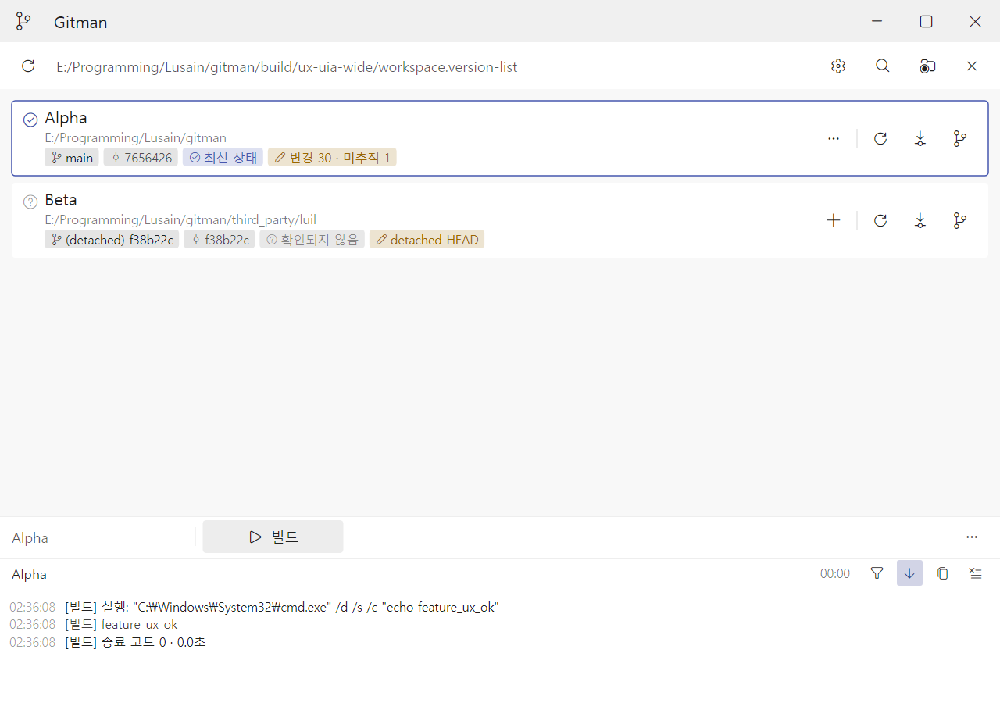
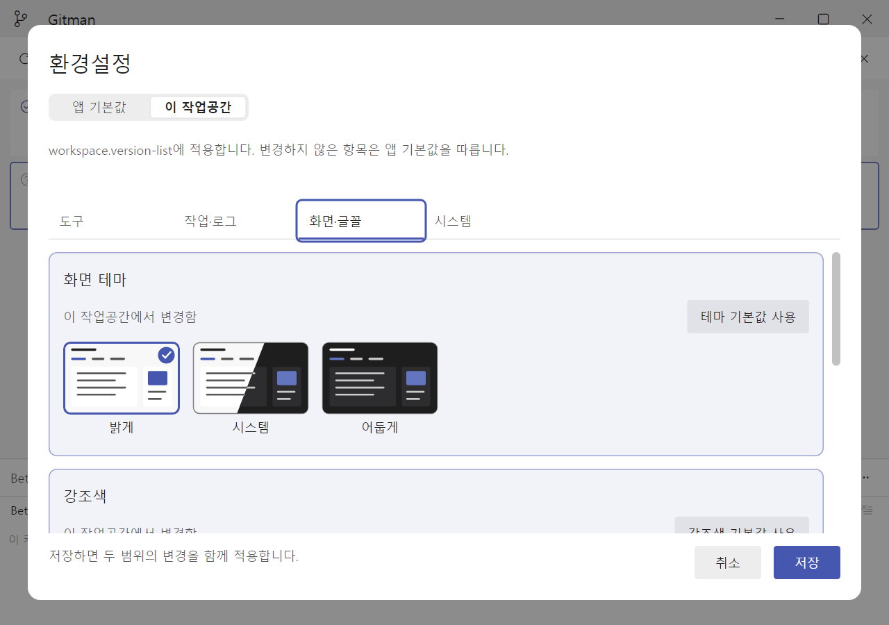
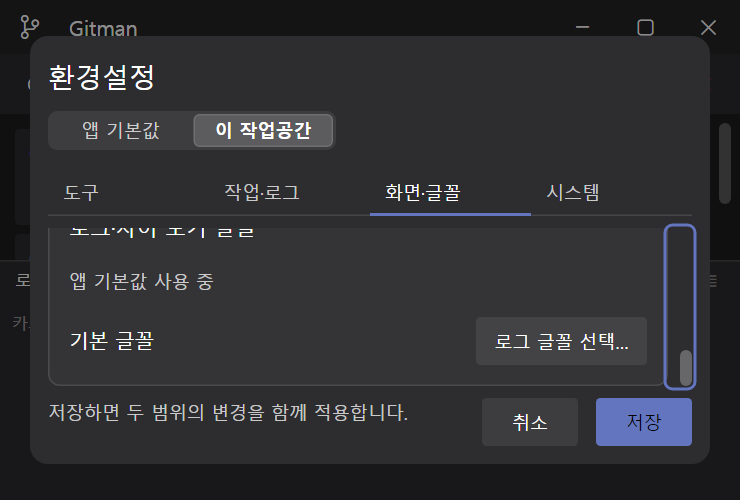

# 저장소 중심 기능 등록과 환경설정 재설계 검증

2026-11-06. 검토 기준과 변경 이유는 [UI/UX 재검토](../ui-ux-review.md)에 있다. luil은 원격 main을 확인한 `f38b22c65d2e8038ffd1f929454e2604434b5161`로 갱신했다.

## 자동 검증

| 구성 | 등록 | 통과 | 건너뜀 | 실패 |
| --- | ---: | ---: | ---: | ---: |
| VS2026 Debug | 1232 | 1229 | 3 | 0 |
| VS2026 Release | 1232 | 1229 | 3 | 0 |

두 구성 모두 renderer smoke와 소스 스타일 검사를 포함한다. 건너뛴 것은 공개 GitHub clone, 인증이 필요한 원격, 실제 SVN 실행 파일을 사용하는 세 검사다.

```powershell
cmake --build --preset vs2026-tests-debug
cmake --build --preset vs2026-tests-release
ctest --preset vs2026-tests-debug --output-on-failure -j 4
ctest --preset vs2026-tests-release --output-on-failure -j 4
```

기본 시스템 임시 폴더에서 실행했다. 처음에 임시 폴더를 작업 트리 안에 두자 Git이 상위 저장소를 발견해 일반 폴더를 검사하는 두 검사가 실패했다. 시스템 임시 폴더에서 두 검사와 전체 모음을 다시 실행해 통과했다. 이 문제로 제품 코드를 변경하지 않았다.

추가·수정한 회귀 검증은 다음을 확인한다.

- 기능이 없는 저장소의 추가 진입점과 저장소 기본 적용 범위, 선택 저장소 기능 줄 표시.
- 다른 저장소 기능과 해석하지 못한 원문 보존, 기존 항목의 ID를 피하는 생성.
- 저장소마다 카드 슬롯 3개와 `Alt+1`부터의 번호, 메뉴 페이지를 이동해도 추가·관리 접근 유지.
- 앱·작업공간 초안 유지, 상속 값 갱신, 두 저장 대상에 적용, 전체 취소, 다른 범위의 오류 검사.
- 좁은 창의 마지막 글꼴 버튼 전체 노출. 740×500, 배율 100%·150%·200%에서 실제 영역의 최대 스크롤과 snapshot 한계를 비교한다. 고정 폭을 쓰던 snapshot의 두 번째 clamp를 실제 창 폭으로 수정했고 상단 치수도 본문 계산과 공유한다.

## 실제 앱 검증

`luil-uia`의 격리 데스크톱에서 시험용 문서·앱 설정과 최종 Release exe를 사용했다. 모니터 배율은 150%다. 실제 창을 1280×900 또는 740×500으로 크기 변경하고 UI Automation Invoke·SelectionItem·Value·RangeValue로 조작했다.

| 동작 | 결과 |
| --- | --- |
| Alpha 카드 `+` → 이름·프로그램·인자 입력 → 적용 | 저장 파일의 기능이 `project_ids: ["alpha"]`, 배치 `bar`로 저장됐다. Alpha가 선택되고 실행 버튼이 보였다. |
| 추가한 기능 실행 | 신뢰 확인 뒤 `cmd.exe /d /c echo feature_ux_ok`를 실행해 출력과 종료 코드 0을 확인했다. |
| Beta 카드 `+` | Alpha 기능이 목록에 나오지 않았고 Beta를 대상으로 새 초안이 생겼다. 취소했다. |
| 환경설정 | 도구·화면·글꼴 탭, 앱 기본값·이 작업공간 범위 선택과 취소를 확인했다. |
| 740×500, 어두운 테마 | 상단·본문·하단의 분리와 스크롤을 확인했다. RangeValue를 끝으로 옮긴 뒤 마지막 `로그 글꼴 선택…` 버튼의 노출 상태와 전체 높이를 되읽어 확인했다. |







고대비와 Windows 텍스트 크기 변경은 이번 실제 앱 검증에 포함하지 않았다. 배율별 geometry와 기존 글자 크기 검증은 자동 검사에 포함된다.

`bin/gitman.exe`를 검증한 Release exe로 갱신하고 SHA-256 일치를 확인했다. 사용자 앱 설정은 바꾸지 않았다. 사용 설명서 Markdown과 단일 파일 HTML도 갱신했다.
